# 🛡️ Introduction to Pentesting: Detailed Study Notes

> Expanded notes for people just starting out with penetration testing.
> Written while working through the TryHackMe **"Dive Into Pentesting"** room.


---

## 📑 Table of Contents

1. [Introduction: What is a pentest?](#-introduction-what-is-a-pentest)
2. [Why does coverage matter?](#-why-does-coverage-matter)
3. [Web application pentesting](#-web-application-pentesting)
4. [Network pentesting: external vs internal](#-network-pentesting-external-vs-internal)
5. [Vulnerability, Threat, Risk: the trio](#-vulnerability-threat-risk-the-trio)
   - [Vulnerability](#-vulnerability)
   - [Threat](#-threat)
   - [Risk](#-risk)
   - [The risk management cycle](#-the-risk-management-cycle)
   - [Practice questions](#-practice-questions)
6. [Why do vulnerabilities exist?](#-why-do-vulnerabilities-exist)
   - [Human assumptions](#-human-assumptions)
   - [Programming errors](#-programming-errors)
7. [The room's final assessment](#-the-rooms-final-assessment)
8. [Glossary](#-glossary)
9. [Test yourself](#-test-yourself)
10. [Sources](#-sources)

> ℹ️ **Note:** These notes are based on the visible pages of the source PDF. Some sections (for example the body of *Threat* and the full risk management cycle) weren't visible there, so those parts are written from general security knowledge and marked with **📎 Additional info**.

---

## 🎯 Introduction: What is a pentest?

**Penetration testing (pentest)** is a *proactive* security practice. The goal is to **uncover weaknesses in an organization's systems, applications and networks before attackers can exploit them**.

### Why is it increasingly valuable?

Modern environments keep getting more complex: cloud services, dozens of APIs, remote work, many third-party integrations. As the attack surface grows, the need for someone who searches for weaknesses systematically grows too.

### What should a good pentester be able to do?

| Skill | Explanation |
|-------|-------------|
| 🧪 Know the fundamentals | Deeply understand the core concepts |
| 📊 Produce meaningful results | Say "this creates this risk for the business", not just "I found a bug" |
| 🗣️ Communicate | Explain risk to **stakeholders** (management, developers, risk teams) in terms they understand |

### 🗺️ What does the room cover?

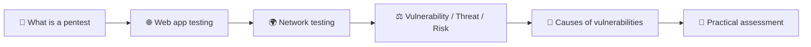

> 💡 **Golden rule:** A pentest is always performed with **written permission** and an agreed **scope**. Testing without authorization is illegal.

---

## 🧭 Why does coverage matter?

In a pentest, **coverage** is critical. The goal isn't to find one or two bugs, it's to assess the organization's **overall security posture** fully.

To achieve meaningful coverage, a pentester must understand **which areas they look at**. This room shows two main areas:

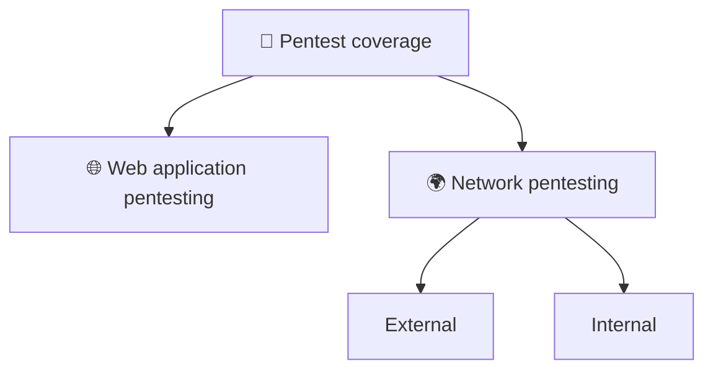

> 🏠 **Analogy:** When checking a house's security, looking only at the front door isn't enough. Windows, the basement, the back door and the shared wall with the neighbor must be checked too. That's coverage.

---

## 🌐 Web application pentesting

**Web application pentesting** focuses on finding gaps and weaknesses in a web application.

- Testing is usually performed **from a user's perspective**.
- The pentester interacts with the application's **user interface (UI)** and its **APIs**.
- Because web apps are typically **exposed to the internet**, a weakness can reach many users.

### 🖼️ Diagram: the pentester and the web app's components

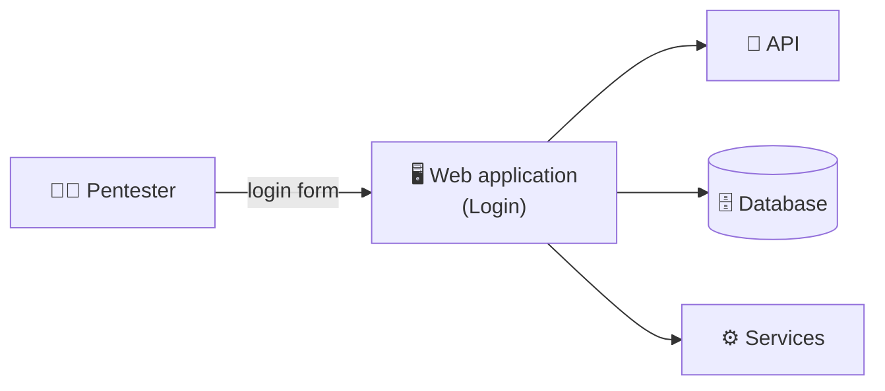

The diagram shows a simple interaction: the pentester works with the application, while behind the scenes the application talks to an API, a database and other services. During a pentest, **all of these components are potential targets**.

### 🔍 What gets assessed?

| Area | Core question | Example problem |
|------|---------------|-----------------|
| ⌨️ **User input** | How is submitted data processed? | Unfiltered input fields |
| 🔑 **Authentication** | How is a user's identity verified? | Weak password policy |
| 🚪 **Authorization** | Does everyone act only within their permissions? | A regular user reaching an admin page |
| 🍪 **Sessions** | How is a session handled after login? | A session that stays valid after logout |
| 💾 **Data processing** | How is data stored, transmitted and displayed? | Sensitive data sent unencrypted |

### 🧠 Why does web testing matter so much?

- Exposed to the internet → the number of potential attackers is **practically unlimited**.
- Stores user data → a breach affects **users directly**.
- Changes often (new features, updates) → new vulnerabilities can appear.

---

## 🌍 Network pentesting: external vs internal

Network pentesting is performed from two different perspectives. We look at the same network through **two different attacker's eyes**.

### 1️⃣ External network pentesting

**Perspective:** an outside user with **little to no information** about the externally exposed systems.

**Targets (external-facing infrastructure):**

| Target | Role |
|--------|------|
| 🖧 Internet-facing servers | Provide services to the outside |
| 🧱 Firewall | Filters incoming/outgoing traffic |
| 🔒 VPN gateway | Secure remote entry point |
| 🖥️ Remote access services | Connecting to systems from outside |
| 📧 Mail server | Email exchange |

**Goal:** evaluate **how these systems are exposed** and assess the **security controls** that protect them against unauthorized users.

### 2️⃣ Internal network pentesting

**Perspective:** an **"assumed breach"** scenario. A threat actor **already has access** to a system in the network.

**Key question:** *What could the attacker do next?*

- 🔀 move between systems (**lateral movement**),
- ⬆️ escalate privileges (**privilege escalation**),
- 🗃️ reach sensitive data.

**Goal:**
- assess **trust relationships**,
- assess **access controls**,
- assess **network segmentation**,
- identify weak configurations,
- determine whether security controls can **limit the impact of a compromise**.

### 🖼️ Diagram: external and internal perspective

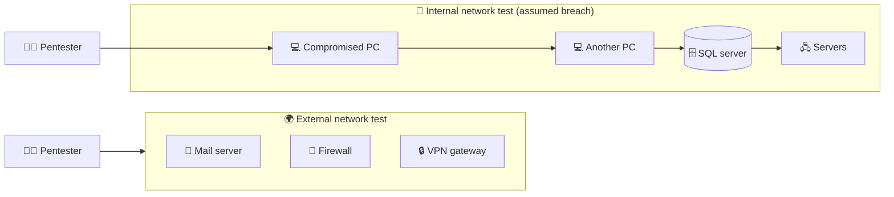

The diagram shows a simple interaction: on the left, the pentester approaches the mail server, firewall and VPN gateway from outside. On the right, starting from one computer inside the network, they move on to other systems, the SQL server and the servers.

### ⚖️ Comparison

| | 🌍 External | 🏢 Internal |
|---|---|---|
| Starting point | The internet | Inside the network |
| Initial information | Little / none | Often some access already |
| Core question | "Can we get in?" | "How far can we go once inside?" |
| What's tested | The outer defensive layer | Internal controls, segmentation |
| Scenario | An outside attacker | An attacker who got in via phishing or malware |

> 🏰 **Analogy:** The external test checks the castle walls. The internal test checks whether **the inner doors are locked**, in case the enemy is already inside.

---

## ⚖️ Vulnerability, Threat, Risk: the trio

These three are **core concepts of cyber security** and are commonly used together. They let organizations assess and manage security concerns in a **structured way**.

For a pentester, understanding this trio is the key to **communicating findings and their significance** clearly to stakeholders.

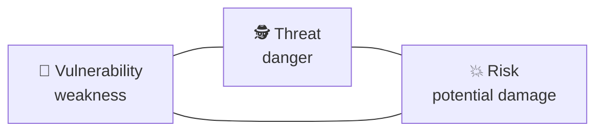

---

### 🐞 Vulnerability

**Definition:** A weakness or gap in an organization's environment that **could be exploited** to compromise the security of systems, data or operations.

> ⚠️ **Key idea:** A vulnerability **does no harm on its own**. It only presents **an opportunity for exploitation**.

#### Technical vulnerabilities

Vulnerabilities come in many types. Here we focus on **technical vulnerabilities**: weaknesses in software, systems or configurations that can be exploited due to:

| Source | Explanation |
|--------|-------------|
| 🐛 **Coding errors** | A flaw in the code a developer wrote |
| ⚙️ **Insecure settings** | Default passwords, unnecessarily open ports |
| 🏗️ **Flawed system design** | Architecture built without security in mind |

#### 📌 Example

A **web server running outdated software with known flaws** is a vulnerability. The weakness exists, but **nothing happens unless it is taken advantage of**.

#### 🖼️ Diagram: how a weakness becomes an "opportunity"

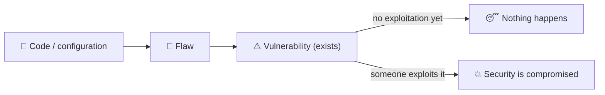

---

### 🕵️ Threat

> 📎 **Additional info:** Only this section's heading is visible in the PDF. The explanation below is based on general security knowledge.

**Definition:** Any **actor, event or circumstance** that can exploit a vulnerability or otherwise cause harm to a system.

#### Sources of threats

| Type | Example |
|------|---------|
| 🧑‍💻 External attacker | Organized groups, lone hackers |
| 🏢 Insider threat | A disgruntled or careless employee |
| 🦠 Malware | Ransomware, trojans |
| 🌪️ Non-human events | Fire, flood, power outage |

#### Difference from a vulnerability

| | Vulnerability | Threat |
|---|---|---|
| What is it? | A **weakness** in the system | An **actor/event** that can exploit a weakness |
| Where is it? | In our system (internal) | Often outside |
| Example | An unpatched server | An attacker scanning that server |

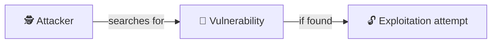

---

### 💥 Risk

**Definition:** The **potential damage** that could occur if a threat **successfully exploits** a vulnerability.

We determine a vulnerability's overall risk by combining two factors:

- 💢 **Impact:** how big is the damage if exploitation succeeds?
- 🎲 **Likelihood:** how probable is exploitation?

#### 🧮 The formula

To simplify the calculation of overall risk, this formula is commonly used:

```
Vulnerability × Threat = Risk
```

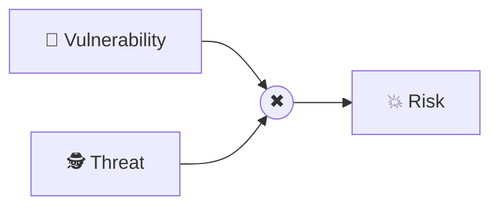

#### 🔥 Risk matrix (Impact × Likelihood)

| Likelihood \ Impact | 🟢 Low | 🟡 Medium | 🔴 High |
|---|---|---|---|
| **High likelihood** | 🟡 Medium | 🟠 High | 🔴 Critical |
| **Medium likelihood** | 🟢 Low | 🟡 Medium | 🟠 High |
| **Low likelihood** | 🟢 Low | 🟢 Low | 🟡 Medium |

#### 🧠 Important nuances

- 🔎 A vulnerability that **looks harmless** can create **significant risk** if it affects critical systems.
- 🧱 A vulnerability that **looks harmful** can create **minimal risk** if it exists in an isolated environment.
- 🌐 The same flaw (for example **SQL injection**) carries **higher risk** on an internet-facing application than on an internal one, because the attack surface is larger.

---

### 🔄 The risk management cycle

> 📎 **Additional info:** This part of the PDF is only partly visible (the mitigation and transfer examples). The full structure of the cycle comes from general knowledge.

Risk management isn't a one-time fix, it's a **repeating process**.

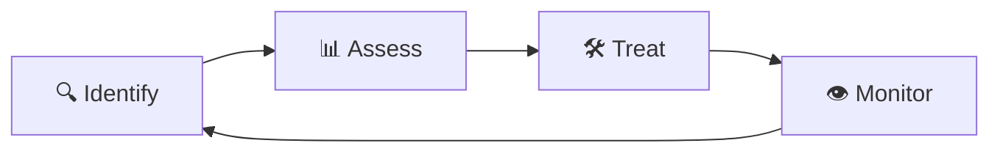

#### Ways to treat risk

| Approach | Meaning | Example |
|----------|---------|---------|
| 🛠️ **Mitigation** | Apply controls that reduce the risk | **Patching** a reported high-severity vulnerability |
| 🔁 **Transfer** | Shift the financial burden to someone else | Buying **cyber insurance** |
| ✅ **Acceptance** | Knowingly accept the risk | Low risk that is costly to fix |
| 🚫 **Avoidance** | Stop the risky activity | Shutting down a legacy service |

#### 📖 Example scenario: transferring risk

A company holds customer data. Security controls are in place and effective, but **the risk cannot be fully removed**. To cover the financial cost if a data breach occurs, the company **buys a cyber insurance policy**. This is **risk transfer**.

> 📌 Even when controls are effective, **residual risk** remains. That's why tools like insurance are also used.

---

### 📋 Practice questions

The room asks practice questions after this topic. Below are **my own questions**, open them to check the answers.

<details>
<summary><b>❓ An organization patched a high-severity issue that you reported. Which stage of the risk management cycle does this fall under?</b></summary>

**Mitigation.** Removing the vulnerability directly reduces the risk.
</details>

<details>
<summary><b>❓ Does SQL injection pose a higher risk on an external-facing or an internal-facing application?</b></summary>

**External-facing.** The attack surface is larger and there are more potential attackers, so likelihood increases.
</details>

---

## 🧩 Why do vulnerabilities exist?

Vulnerabilities can occur through **flaws, features or human error**. These lead to compromise of data and resources, and an attacker can exploit **one or more** of them to achieve their goal.

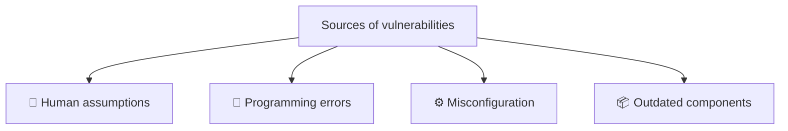

> 📎 The last two (misconfiguration, outdated components) come from parts not visible in the PDF and were added from general knowledge.

### 🧍 Human assumptions

Developers who aren't security-aware often assume **"users will use the system as intended."** Attackers **deliberately break that assumption**: they use the system in unintended ways to expose weaknesses.

#### 📌 Example: profile picture upload

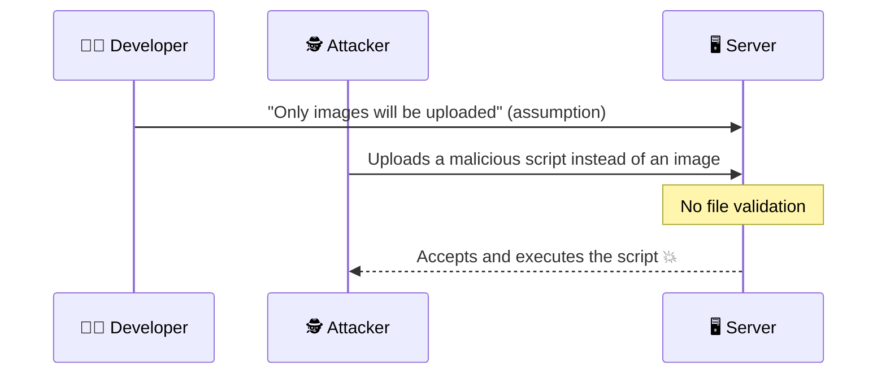

- **Assumption:** users will upload only image files as their profile picture.
- **Problem:** there are no file validation controls.
- **Result:** the attacker uploads a malicious script and **the server executes it**.

> ✅ **Lesson:** Think about what a user **can** do, not what they will do. Never trust incoming data.

### 🐛 Programming errors

**Programming errors** can introduce unintended behavior that poses a security risk. Main sources:

| Source | Explanation | Example |
|--------|-------------|---------|
| 🧠 **Logic mistakes** | A flaw in the program's decision rules | A "cancel order" button that refunds even after payment was already settled |
| 🔍 **Incomplete validation** | Part of the input isn't checked | A field is validated but a URL parameter isn't |

---

## 🏁 The room's final assessment

The room ends with an **interactive practical assessment**: *"Dive into Pentesting: Penetration Testing Scenarios"*. You apply the concepts you learned in scenarios. When you finish successfully, an "Assessment Complete" screen appears and the room's flag is unlocked.

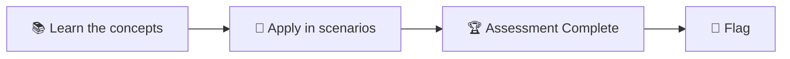

> 🚫 **No spoilers:** I'm not putting the flag or task answers in this repo. Do the room **yourself** so you really learn.

---

## 📖 Glossary

| Term | Short explanation |
|------|-------------------|
| **Penetration test** | An authorized security assessment that looks for weaknesses |
| **Coverage** | How broad the assessed areas are |
| **Security posture** | The organization's overall security state |
| **Scope** | The boundary of systems and actions authorized for testing |
| **Stakeholders** | People affected by or deciding on the results |
| **UI / API** | How a web app is interacted with: user interface and programmatic interface |
| **Authentication** | Verifying "who are you?" |
| **Authorization** | Verifying "what are you allowed to do?" |
| **Session** | The ongoing connection between a user and the server after login |
| **Input validation** | Checking submitted data |
| **External-facing** | A system reachable from the internet |
| **Attack surface** | Every point where an attacker can target the system |
| **Threat actor** | The party carrying out an attack |
| **Exploit** | To take advantage of a vulnerability |
| **Assumed breach** | A scenario that assumes the attacker is already inside |
| **Lateral movement** | Moving sideways between systems |
| **Privilege escalation** | Gaining higher permissions |
| **Trust relationship** | Trust links between systems |
| **Network segmentation** | Splitting a network into parts to limit spread of damage |
| **Security controls** | Technical and procedural measures that reduce risk |
| **Vulnerability** | A weakness that can be exploited |
| **Threat** | An actor or event that can exploit a weakness |
| **Risk** | Potential damage when a threat exploits a vulnerability |
| **Impact / Likelihood** | How bad it would be / how probable it is |
| **Mitigation / Transfer** | Reducing the risk / shifting its cost to someone else |
| **Residual risk** | Risk remaining after controls |
| **Technical vulnerability** | A weakness in software, systems or configuration |
| **File validation** | Checking the type and content of uploaded files |
| **SQL injection** | A vulnerability type where input interferes with a database query |

---

## 📝 Test yourself

<details>
<summary><b>1. What is the main goal of a pentest?</b></summary>

To find weaknesses **before** attackers do and to communicate the risk clearly to stakeholders.
</details>

<details>
<summary><b>2. Why does coverage matter?</b></summary>

To fully assess the organization's **overall security posture**, different areas (web, network) must be covered.
</details>

<details>
<summary><b>3. Which five areas are assessed in web pentesting?</b></summary>

User input, authentication, authorization, sessions and data processing.
</details>

<details>
<summary><b>4. What is the main difference between external and internal network pentesting?</b></summary>

External testing starts from the outside and checks exposure. Internal testing starts from an "assumed breach" and checks how far an attacker can get from inside.
</details>

<details>
<summary><b>5. Does a vulnerability cause harm by itself?</b></summary>

No. It only creates an **opportunity** for exploitation. Harm occurs when a threat uses it.
</details>

<details>
<summary><b>6. Which two factors does risk depend on?</b></summary>

**Impact** and **likelihood of exploitation**.
</details>

<details>
<summary><b>7. What is the simplified formula for risk?</b></summary>

`Vulnerability × Threat = Risk`
</details>

<details>
<summary><b>8. Which type of risk treatment is cyber insurance?</b></summary>

**Transfer.**
</details>

<details>
<summary><b>9. Give an example of a "human assumption" vulnerability.</b></summary>

A developer assumes only images will be uploaded, writes no file validation, and an attacker uploads a malicious script.
</details>

---

## 📚 Sources

- TryHackMe: the **Dive Into Pentesting** room (do the hands-on part there yourself)
- Room write-up overview: [Sharon Jebitok, "Dive Into Pentesting (TryHackMe)"](https://www.sharonjebitok.com/dive-into-pentesting-tryhackme)

> ℹ️ These notes were written in my own words for personal learning. The diagrams are not the originals, they were redrawn with Mermaid.
