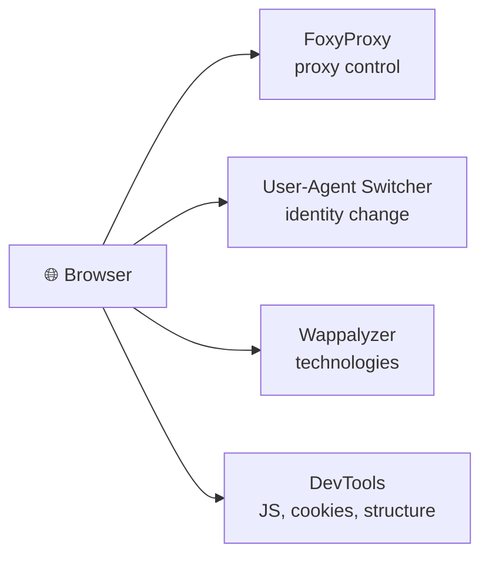
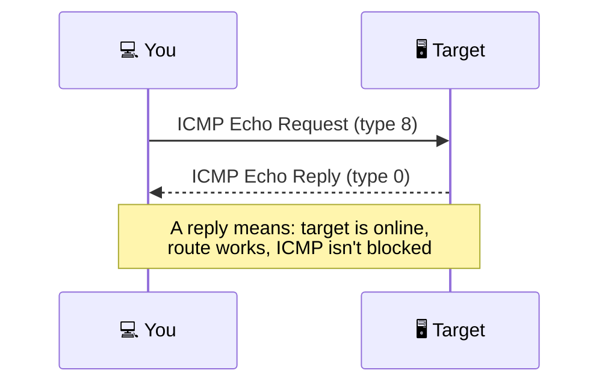
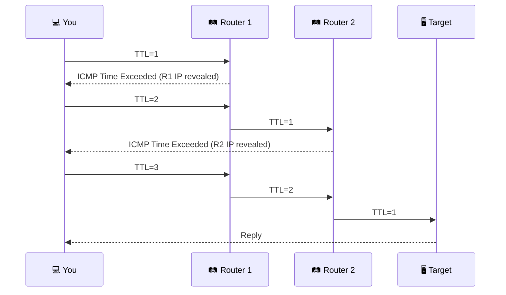
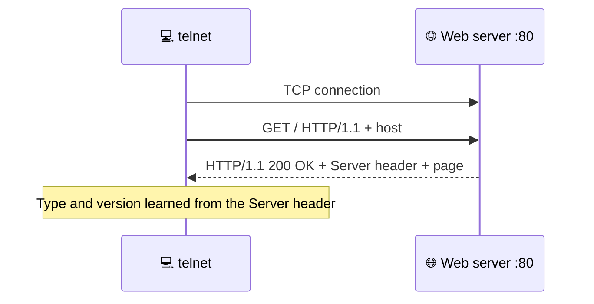
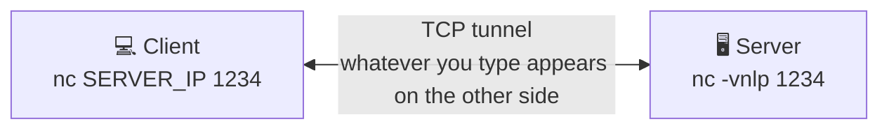
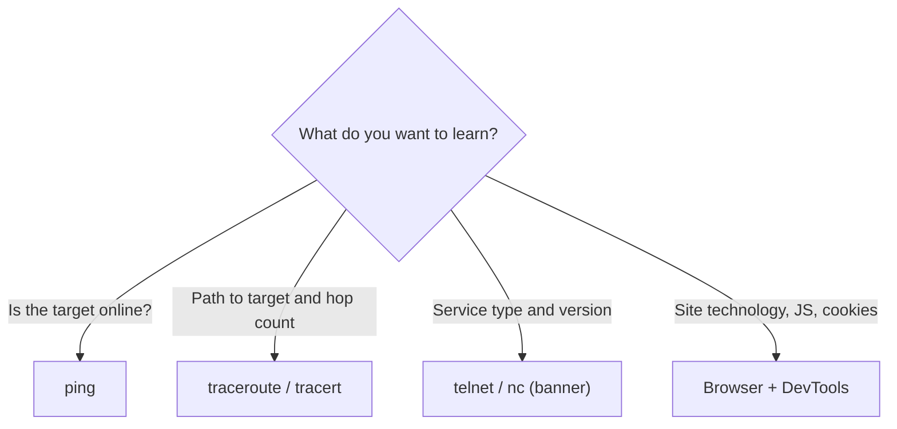

# 📡 Active Reconnaissance: Detailed Study Notes

> Gathering information by directly engaging the target, and the essential tools for it.
> Written while working through the TryHackMe **"Active Reconnaissance"** room.


---

## 📋 About the room

| | |
|---|---|
| 🧭 Type | Walkthrough |
| 🟢 Difficulty | Easy |
| 🏷️ Tags | Web, Linux |
| 💳 Subscription | Free |
| 🔗 Room | [tryhackme.com/room/activerecon](https://tryhackme.com/room/activerecon) |
| 🎯 Goal | Gather information with a browser, `ping`, `traceroute`, `telnet`, `nc` |

---

## 📑 Table of Contents

1. [Introduction: what is active recon?](#-introduction-what-is-active-recon)
2. [Web browser](#-web-browser)
3. [Ping](#-ping)
4. [Traceroute](#-traceroute)
5. [Telnet](#-telnet)
6. [Netcat](#-netcat)
7. [Putting it all together](#-putting-it-all-together)
8. [The defender's view](#-the-defenders-view)
9. [Glossary](#-glossary)
10. [Test yourself](#-test-yourself)
11. [Sources](#-sources)

> ⚖️ **Legal notice:** Active recon is direct contact with a target. It must **never be done without signed legal authorization from the client**. These notes are for **authorized testing, education and defense** only. In the examples, replace `TARGET_IP` only with a lab target that **you own or are authorized to test**.

---

## 🎯 Introduction: what is active recon?

In the previous room we covered **passive recon**: gathering information without any direct engagement with the target. This room focuses on **active recon**.

### 🆚 Passive vs active

| | 🤫 Passive | 📡 Active |
|---|---|---|
| Contact | None, watching from afar | **Some contact with the target** |
| Analogy | Looking from a distance | Closely inspecting door and window locks |
| Legal condition | Low risk | **Written permission is essential** |

Active contact can take different forms:

- 📞 A call or **visiting the company under a pretense** (social engineering)
- 🌐 Visiting their website
- 🔌 Checking whether the firewall has an SSH port open

### 📝 It leaves traces in logs

Any direct connection may leave traces in the target's **logs**:

| Trace | What it shows |
|-------|---------------|
| 🔢 Client IP | Who connected |
| 🕐 Time | When |
| ⏱️ Duration | How long |

But **not every connection is suspicious**. Active recon can **look like regular client activity**. For example, one browser among hundreds of legitimate users doesn't raise suspicion. This helps the **red team** (attackers) avoid needlessly alarming the **blue team** (defenders).

### 🗺️ Room map


### ⚠️ Practical note

Without a subscription the AttackBox may not have internet access. Use a **VPN** for questions that need the internet.

---

## 🌐 Web browser

A browser is a convenient tool because it's **available on every system**.

### 🔌 Default ports

| Protocol | Default TCP port |
|----------|------------------|
| HTTP | **80** |
| HTTPS | **443** |

The browser **doesn't show** these in the address bar. You can still use a custom port, for example `https://127.0.0.1:8834/` connects to the local machine's port 8834 over HTTPS.

### 🛠️ Developer Tools (DevTools)

| Operating system | Shortcut |
|------------------|----------|
| Linux / Windows | `Ctrl + Shift + I` (or `F12`) |
| macOS | `Option + Command + I` |

DevTools lets you inspect **many things the browser exchanged with the server**:

| Capability | Explanation |
|------------|-------------|
| 📜 JavaScript files | View and even modify them |
| 🍪 Cookies | Inspect the cookies set on your system |
| 📁 Site structure | Discover the content's folder structure |
| 🌐 Network requests | See which requests went out and the responses |

> 🖼️ Firefox DevTools and Chrome DevTools are very similar. In the Debugger/Sources panel you can open a page's script files.

### 🧩 Handy browser add-ons

| Add-on | Purpose |
|--------|---------|
| **FoxyProxy** | Quickly switch proxy servers (handy with tools like Burp Suite or when switching proxies often) |
| **User-Agent Switcher and Manager** | Appear to access a site from a different OS or browser |
| **Wappalyzer** | Show the **technologies** a visited website uses |

> 💡 Add-ons like Wappalyzer are useful mainly because they collect this information **while you browse like any other user**.



### 🧪 Hint for the hands-on task

On the room's test page, open DevTools, go to the **Debugger/Sources** panel, find `script.js` and look in the code for the value related to the number of questions.

---

## 🏓 Ping

**Ping** is named after *ping-pong*: you throw the ball and expect to get it back.

**Main purpose:** check whether you can reach a remote system and it can reach you back. Originally it verified network connectivity, but we're more interested in checking **whether a remote system is online**.

### 🔬 Technical explanation

Ping uses **ICMP** (Internet Control Message Protocol):

| Message | ICMP type |
|---------|-----------|
| Ping request (**Echo Request**) | Type **8** |
| Ping reply (**Echo Reply**) | Type **0** |



**Goal:** make sure the target is online **before spending time on more detailed scans**.

### 💻 Usage

```bash
ping TARGET_IP
ping HOSTNAME          # hostname is resolved to an IP first
ping -c 10 TARGET_IP   # Linux/macOS: 10 packets
ping -n 10 TARGET_IP   # Windows: 10 packets
```

> ⏹️ On Linux, if you don't set a count, ping doesn't stop. Press `Ctrl + C`.

### 📊 Reading the output

| Indicator | Meaning |
|-----------|---------|
| `64 bytes from ...` | A reply arrived |
| `icmp_seq` | Packet sequence number |
| `ttl` | The packet's Time To Live value |
| `time` | Round-trip time (ms) |
| **packet loss** | Percentage of lost packets |
| `rtt min/avg/max/mdev` | Round-trip time statistics |

Example: 5 packets sent, 5 replies received, **0% loss** → the target is online, ICMP Echo isn't blocked, and the firewalls and routers on the path don't block it.

### ❌ What if there's no reply?

`Destination Host Unreachable` and **100% packet loss** can have these causes:

| Cause | Explanation |
|-------|-------------|
| 💤 Target isn't responsive | Still booting, turned off, or the OS crashed |
| 🔌 Network issue | Unplugged, or a faulty device on the path |
| 🧱 Firewall | Software or a separate appliance blocks the packets |
| 🪟 **Windows Firewall** | Blocks ping by default |
| 📴 On your side | Your own system is disconnected |

> 🧠 **Key takeaway:** No reply doesn't **necessarily** mean the target is down. A firewall can be the reason.

### 🧪 Hints for the hands-on tasks

- To find the option that sets packet size, search `ping -h` output for the word **size**.
- Find the ICMP header size in the ICMP message format diagram.

---

## 🛤️ Traceroute

**traceroute** follows the **route** packets take from your system to another host.

**Goals:**
- Find the **IP addresses of the routers (hops)** a packet traverses
- Learn **how many routers** lie between two systems

> ⚠️ The route can change because many routers use **dynamic routing** protocols that adapt to network changes.

| Operating system | Command |
|------------------|---------|
| Linux / macOS | `traceroute TARGET` |
| Windows | `tracert TARGET` |

### 🧠 How does it work? The TTL trick

There's no direct way to see the path. We **"trick" routers via ICMP** into revealing their IPs, using a small **TTL** (Time To Live).

> 🔑 Although the *T* in TTL stands for time, it indicates the **maximum number of routers a packet can pass through before it's dropped**. Each router **decrements TTL by 1** before forwarding.

Example: a packet leaves with TTL=64 and reaches the target with TTL=60 after passing 4 routers.

**When TTL reaches 0**, the packet is dropped and an **ICMP Time-to-Live exceeded** message is sent back to the sender. That message reveals the router's IP.



**`traceroute` on Linux:**
1. Sends a packet with TTL=1 → the 1st router sends back ICMP → its IP is revealed.
2. Sends with TTL=2 → dropped at the 2nd router.
3. And so on.

> ℹ️ Some routers are configured not to send an ICMP message even when they drop a packet.

### 📊 Reading the output

| Element | Meaning |
|---------|---------|
| A numbered line | One router / hop |
| Three values per line | Three packets are sent per hop |
| IP + ms | The router's IP and reply time |
| `*` | An expected ICMP reply never arrived |
| Several IPs on one line | Packets took different routes |

### 🔄 Same command, different route

Running traceroute to the same target twice can show **a different number of hops** and **different IPs**. Inside your own network the route rarely changes, but outside networks give no guarantee it stays fixed.

### 📌 Key takeaways

| Observation | Meaning |
|-------------|---------|
| Hop count can vary | No guarantee of the same route each time |
| Some routers return a public IP | Some may be examined if the **scope** allows |
| Some routers don't reply | Shown as `*` |

### 🧪 Hint for the hands-on task

In the room's two traceroute outputs, pay attention to the **last line** (the hop reaching the target) and the **line numbers**.

---

## 📞 Telnet

The **TELNET** (*Teletype Network*) protocol was developed in **1969** to communicate with a remote system through a command-line interface.

| Property | Value |
|----------|-------|
| Default port | **23** |
| Protocol | TCP |
| Security | ❌ All data, **including usernames and passwords, is sent in cleartext** |
| Secure alternative | ✅ **SSH** (Secure Shell) |

> 🚫 Cleartext means anyone with access to the communication channel can steal login credentials. That's why telnet **shouldn't be used anymore** for remote administration.

### 🎯 But useful for another purpose: banner grabbing

Because the telnet client works over TCP, you can **connect to any TCP service** and grab its "banner".

```bash
telnet TARGET_IP PORT
```

A **banner** is text a service presents, often carrying its **type and version**.

### 🌐 Web server connection example

We talk HTTP to a web server listening on port 80:

```text
GET / HTTP/1.1
host: example
(press Enter twice)
```

| Part | Explanation |
|------|-------------|
| `GET / HTTP/1.1` | Request the main (index) page using HTTP 1.1 |
| `GET /page.html HTTP/1.1` | Request a specific page |
| `host: ...` | A host value, to get a valid response instead of an error |
| Enter twice | Signals the end of the request |



> 🔍 What interests us most is the **`Server:`** line in the response: the **type and version of the installed web server**.

If you connect to a mail server, you must use **commands matching the protocol** (SMTP, POP3, etc.).

### 🧪 Hint for the hands-on task

Connect to the target's port 80 with telnet and look at the `Server:` line in the response: it shows both the server name and version.

---

## 🔌 Netcat

**Netcat (`nc`)** is a very valuable tool for a pentester. It supports **TCP and UDP** and can act in two roles:

| Role | Explanation |
|------|-------------|
| 👤 **Client** | Connects to a listening port |
| 🖥️ **Server** | **Listens** on a port of your choice |

### 🏷️ Grabbing a banner

```bash
nc TARGET_IP PORT
```

Very similar to telnet. For a web server you can send the same HTTP request. The `Server:` header shows the server's type and version.

> ⌨️ Sometimes you may need `SHIFT + ENTER` after the `GET` line.

### 👂 Listening mode (server side)

```bash
nc -lp 1234
nc -vnlp 1234     # same as: nc -v -l -n -p 1234
```

| Option | Meaning |
|--------|---------|
| `-l` | Listen mode |
| `-p` | Specify the port number |
| `-n` | Numeric only, no hostname resolution via DNS |
| `-v` | Verbose output, useful to discover issues |
| `-vv` | Very verbose |
| `-k` | Keep listening after the client disconnects |

**Notes:**
- `-p` must appear **right before the port number** you want to listen on.
- `-n` avoids DNS lookups and warnings.
- Ports **below 1024** require **root privileges** to listen on.

### 🗣️ Client side and echo

```bash
nc SERVER_IP 1234
```

Once connected, **whatever you type on one side is echoed on the other**, like a two-way "chat tunnel".



### 🧪 Hint for the hands-on task

Connect to the target's **port 21** (FTP) with `nc`. The service sends a banner itself and the version is written there. Close the connection with `quit`.

---

## 🧩 Putting it all together

You can combine these tools in a **shell script** to build a primitive network and system scanner:

| Tool | Role in the scanner |
|------|---------------------|
| `traceroute` | Map the path to the target |
| `ping` | Check whether the target responds to ICMP Echo |
| `telnet` | Check which ports are open and reachable |

Existing scanners do this at a **much more advanced** level. We'll see that with **nmap** in the next four rooms.

### 📊 Command table

| Tool | Example |
|------|---------|
| ping (Linux/macOS) | `ping -c 10 TARGET_IP` |
| ping (Windows) | `ping -n 10 TARGET_IP` |
| traceroute (Linux/macOS) | `traceroute TARGET_IP` |
| tracert (Windows) | `tracert TARGET_IP` |
| telnet | `telnet TARGET_IP PORT_NUMBER` |
| netcat client | `nc TARGET_IP PORT_NUMBER` |
| netcat server | `nc -lvnp PORT_NUMBER` |

### 🧰 Which tool when?



> 🌐 A web browser is installed on practically every computer and phone, which makes it an essential tool for **reconnaissance without raising alarms**. To learn DevTools in depth, TryHackMe's *Walking An Application* room is recommended.

---

## 🛡️ The defender's view

> 📎 This section is based on general knowledge.

| Active recon trace | Defensive measure |
|--------------------|-------------------|
| Many ICMP requests | Restrict ICMP where it's not needed, monitor unusual volume |
| Connection attempts to many ports | Log analysis, IDS/IPS rules |
| Version leakage in banners | Hide unnecessary version info in server headers |
| Legacy services like Telnet | Disable and replace with **SSH** |
| Quiet browser-based recon | Web log analysis, anomaly detection |

---

## 📖 Glossary

| Term | Short explanation |
|------|-------------------|
| **Active recon** | Recon requiring direct contact with the target |
| **Red team / Blue team** | Attacking side / defending side |
| **DevTools** | A browser's built-in developer tools |
| **FoxyProxy** | A browser add-on that manages proxies |
| **User-Agent** | The header a browser uses to identify itself |
| **Wappalyzer** | An add-on that shows a site's technologies |
| **ICMP** | A messaging protocol for network diagnostics |
| **Echo Request / Reply** | Ping request / reply (type 8 / type 0) |
| **Packet loss** | Percentage of lost packets |
| **Hop** | One router a packet passes through |
| **TTL** | Maximum number of hops a packet may pass |
| **Time Exceeded** | The ICMP message sent when TTL runs out |
| **Telnet** | A legacy cleartext remote administration protocol (port 23) |
| **SSH** | The secure alternative to Telnet |
| **Banner grabbing** | Obtaining the type/version text a service presents |
| **Netcat (nc)** | A tool acting as a TCP/UDP client or server |
| **Cleartext** | Unencrypted text |
| **Scope** | The boundary of targets authorized for testing |
| **AttackBox** | TryHackMe's browser-based attack machine |

---

## 📝 Test yourself

<details>
<summary><b>1. What is the main difference between passive and active recon?</b></summary>

Passive recon has no direct contact with the target. Active recon needs direct contact, can leave traces in logs, and requires written permission.
</details>

<details>
<summary><b>2. Which default ports does a browser use for HTTP and HTTPS?</b></summary>

TCP 80 for HTTP and TCP 443 for HTTPS.
</details>

<details>
<summary><b>3. What can you see with DevTools?</b></summary>

JavaScript files, cookies, network requests and the site's folder structure.
</details>

<details>
<summary><b>4. Which protocol and message types does ping use?</b></summary>

ICMP: Echo Request (type 8) and Echo Reply (type 0).
</details>

<details>
<summary><b>5. If ping gets no reply, what could be the reasons?</b></summary>

The target is off or crashed, there's a network problem, a firewall (for example Windows Firewall) blocks ICMP, or your own system is disconnected.
</details>

<details>
<summary><b>6. How does traceroute reveal router IPs?</b></summary>

It sends packets with a small TTL. When TTL hits 0 the router drops the packet and sends ICMP Time Exceeded, revealing its IP. TTL is increased by 1 each time.
</details>

<details>
<summary><b>7. The "T" in TTL doesn't mean time. What does TTL indicate?</b></summary>

The maximum number of routers (hops) a packet can pass through before being dropped.
</details>

<details>
<summary><b>8. Why is Telnet considered insecure?</b></summary>

It sends all data, including usernames and passwords, in cleartext. The secure alternative is SSH.
</details>

<details>
<summary><b>9. What is banner grabbing and why is it useful?</b></summary>

Obtaining the type/version info a service sends. It helps learn what software runs on the target.
</details>

<details>
<summary><b>10. What does each option in nc -vnlp 1234 do?</b></summary>

`-v` verbose output, `-n` disables DNS resolution, `-l` listen mode, `-p 1234` the port number.
</details>

---

## 📚 Sources

- TryHackMe: [Active Reconnaissance room](https://tryhackme.com/room/activerecon) (do the hands-on part there yourself)
- [DevTools - Chrome Docs](https://developer.chrome.com/docs/devtools/)
- [DevTools - Firefox User Docs](https://firefox-source-docs.mozilla.org/devtools-user/)
- [Browser developer tools - MDN](https://developer.mozilla.org/en-US/docs/Learn_web_development/Howto/Tools_and_setup/What_are_browser_developer_tools)
- [ICMP - Wikipedia](https://en.wikipedia.org/wiki/Internet_Control_Message_Protocol)
- [ping - manual](https://man7.org/linux/man-pages/man8/ping.8.html)
- [traceroute - manual](https://man7.org/linux/man-pages/man8/traceroute.8.html)
- [telnet - manual](https://linux.die.net/man/1/telnet) | [Telnet - Wikipedia](https://en.wikipedia.org/wiki/Telnet)
- [nc - manual](https://linux.die.net/man/1/nc) | [Netcat - Wikipedia](https://en.wikipedia.org/wiki/Netcat)

> ℹ️ These notes were written in my own words for personal learning. The diagrams were drawn with Mermaid. The room's task answers are not included.
