# 🗂️ Content Discovery: Detailed Study Notes

> Finding hidden web content manually, through OSINT, and with Gobuster.
> Written while working through the TryHackMe **"Content Discovery"** room.

🌐 Languages: [Azərbaycanca](content-discovery.md) | **English**

---

## 📋 About the room

| | |
|---|---|
| 🧭 Type | Walkthrough |
| 🟢 Difficulty | Easy |
| 🏷️ Tags | Linux |
| 💳 Subscription | Free |
| 🔗 Room | [tryhackme.com/room/contentdiscoveryx](https://tryhackme.com/room/contentdiscoveryx) |
| 🎯 Goal | Find hidden web content manually, via OSINT, and with Gobuster |

---

## 📑 Table of Contents

1. [Introduction: what is Content Discovery?](#-introduction-what-is-content-discovery)
2. [Manual discovery: common files](#-manual-discovery-common-files)
3. [Manual discovery: headers and framework stack](#-manual-discovery-headers-and-framework-stack)
4. [OSINT: search engines and web tools](#-osint-search-engines-and-web-tools)
5. [OSINT: repositories and archives](#-osint-repositories-and-archives)
6. [Automated discovery: Gobuster fundamentals](#-automated-discovery-gobuster-fundamentals)
7. [Subdomains and virtual hosts](#-subdomains-and-virtual-hosts)
8. [Summary: combining the three approaches](#-summary-combining-the-three-approaches)
9. [The defender's view](#-the-defenders-view)
10. [Glossary](#-glossary)
11. [Test yourself](#-test-yourself)
12. [Sources](#-sources)

> ⚖️ **Legal notice:** The techniques here (especially brute-forcing with Gobuster) should only be used on web applications **you own or are explicitly authorized to test**. Aggressive brute-force scanning can cause **performance issues** on small servers. The examples use the placeholder `TARGET_IP`.

---

## 🎯 Introduction: what is Content Discovery?

In web application security, **"content"** means anything hosted on a server: pages, files, directories, admin portals, configuration files, backup archives.

> 🔍 **Content Discovery** is the process of finding content that wasn't meant to be publicly accessible, or isn't linked anywhere obvious.

This content could be:
- 👤 Staff portals
- 🕰️ Older versions of the site
- 💾 Exposed backup files
- 🔐 Administration panels

### 🧭 Three main approaches

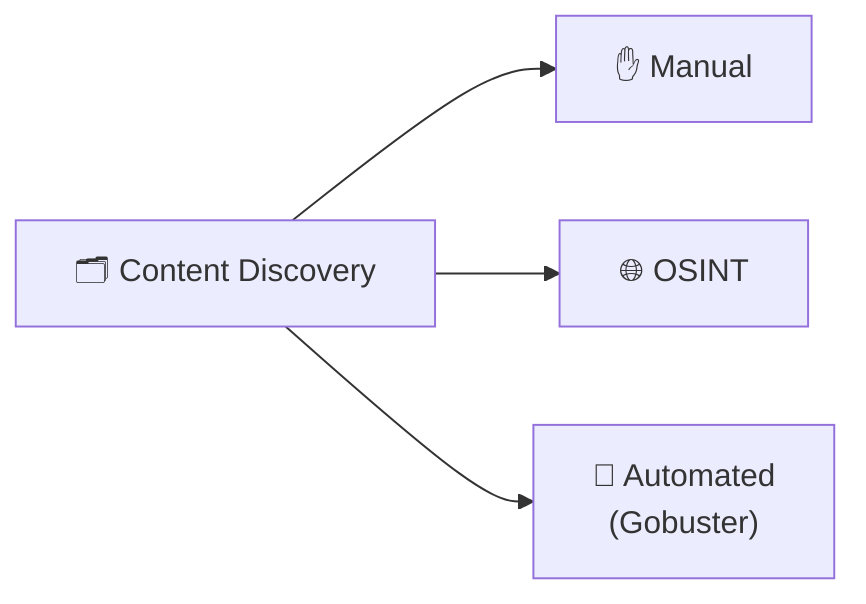

| Approach | When it helps |
|----------|----------------|
| ✋ **Manual** | Fast, obvious clues (robots.txt, headers) |
| 🌐 **OSINT** | Finding what the target has **already made public** |
| 🤖 **Automated** | **Breadth** neither of the other two can cover alone |

### 🎓 Learning objectives

| # | Skill |
|---|-------|
| 1️⃣ | **Manually** discover hidden content via `robots.txt`, `sitemap.xml`, favicons, HTTP headers, and framework analysis |
| 2️⃣ | Use **OSINT** tools: Google dorking, Wappalyzer, Wayback Machine, GitHub, and S3 bucket enumeration |
| 3️⃣ | Use **Gobuster** to brute-force directories, subdomains, and virtual hosts |
| 4️⃣ | Apply a **structured methodology** during a pentest |

> 💡 **Core philosophy:** these three methods **complement each other**. Manual checks give quick wins, OSINT finds what the target has already leaked, and automation gives the breadth neither alone can achieve.

---

## 📄 Manual discovery: common files

Several files web servers expose **by convention** can reveal more than intended. Checking these should be the **first step**.

### 🤖 robots.txt

**robots.txt** tells search engine crawlers which pages they may **index**.

```bash
curl http://TARGET_IP/robots.txt
```

```text
User-agent: *
Allow: /
Disallow: /staff-portal
```

> 🔑 **Value for a pentester:** site owners list sensitive directories here so they **don't appear in search results**. This becomes a **ready-made list of interesting locations** for a pentester.

> ⚠️ **Important nuance:** `robots.txt` is only a **guideline** for bots, **not** a security control. A disallowed path can still be **accessible** if visited directly.

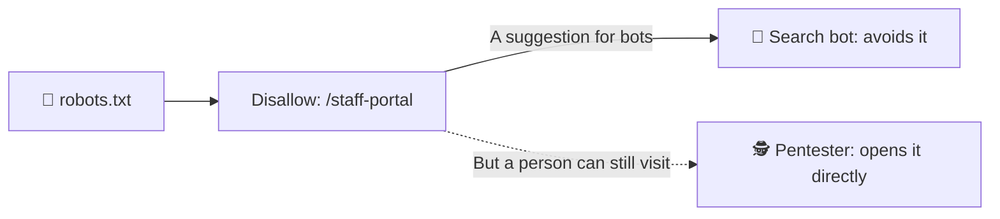

### 🗺️ sitemap.xml

**sitemap.xml** is the opposite of `robots.txt` — it lists pages the owner **wants indexed**.

```bash
curl http://TARGET_IP/sitemap.xml
```

> 🔎 **Why is it valuable?** It sometimes includes **staging pages, old content**, or URLs hard to find via normal browsing. Parameters (like `?id=1`) also hint at **input points worth testing**.

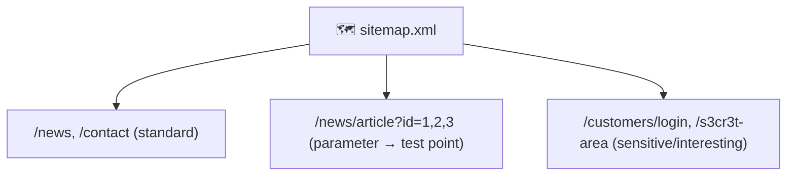

### ⚖️ robots.txt vs sitemap.xml

| | robots.txt | sitemap.xml |
|---|---|---|
| Purpose | Tells bots **what not to see** | Tells bots **what to see** |
| A security measure? | ❌ No, just a suggestion | ❌ No |
| Value to a pentester | Shows places that are being hidden | Shows every indexed page (and parameters) |

### 🧪 Hint for the hands-on task

Read both files with `curl` and pay attention to **unusual-looking paths** (ones that differ from the standard `/news`, `/contact`).

---

## 🧬 Manual discovery: headers and framework stack

### 📬 HTTP headers

When a server responds, **HTTP headers** often reveal useful technical details.

```bash
curl http://TARGET_IP -v
# or just the headers:
curl -I http://TARGET_IP
```

| Header | Reveals |
|--------|---------|
| `Server` | The web server software and version (e.g. `nginx/1.18.0`) |
| `X-Powered-By` | The language/framework the app runs on |

> 🔑 **Why does it matter?** A specific version number lets you look for **publicly known vulnerabilities** affecting that version.

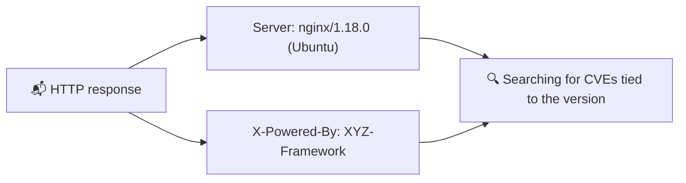

### 🏗️ Investigating the framework stack

Once you identify the framework (via favicon, headers, or comments/copyright notices in the source), visit the **framework's own website**.

> 📚 **Why is it useful?** Documentation pages often describe the **default directory structure, admin panel path, and default credentials**.

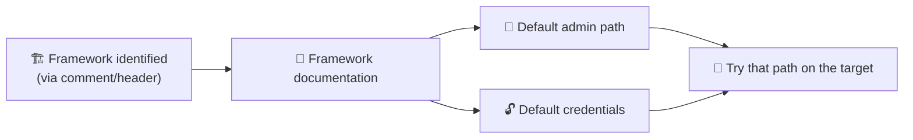

> ⚠️ **A very common issue:** many organizations never **change the default admin/admin credentials** after installing a framework. A simple, but very effective, entry point.

### 🧪 Hint for the hands-on task

- Check the headers with `curl -I` and look for a non-standard, custom header.
- Find the framework link in a comment near the bottom of the source, visit its **documentation** page, and read the **default credentials and admin path**.

---

## 🔎 OSINT: search engines and web tools

### 🕵️ Google Hacking / Dorking

Google's **advanced search operators** let you filter results to surface **sensitive indexed content** from the target.

| Operator | Example | Description |
|----------|---------|--------------|
| `site` | `site:tryhackme.com` | Results only from the given domain |
| `inurl` | `inurl:admin` | Results with a word in the URL |
| `filetype` | `filetype:pdf` | A specific file type |
| `intitle` | `intitle:admin` | A word in the page title |
| `intext` | `intext:password` | A word in the page body |
| `cache` | `cache:tryhackme.com` | Google's cached version |

> 🧩 **Operators can be combined:** `site:tryhackme.com filetype:pdf` returns **every PDF** indexed from `tryhackme.com`.

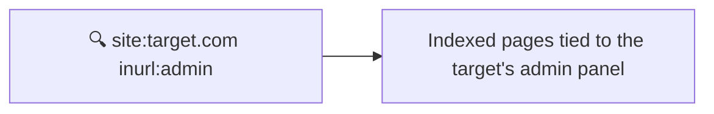

### 🔬 Wappalyzer

**Wappalyzer** is a browser extension and online tool that identifies a site's **technologies** (framework, CMS, CDN, analytics, payment processors), often including **version numbers**.

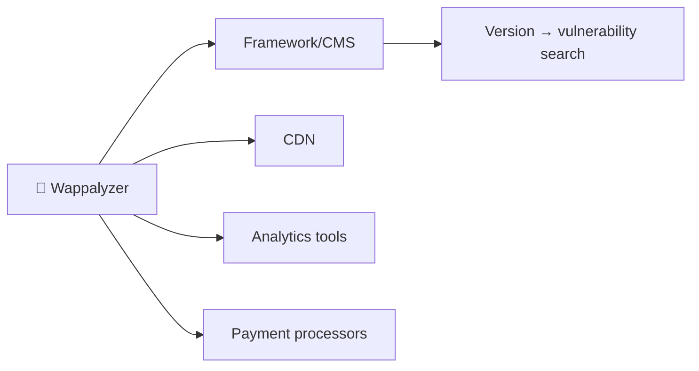

### 🧪 Hint for the hands-on task

Remember the name of the Google dork operator that limits results to a specific domain (`site:`).

---

## 📚 OSINT: repositories and archives

### 🕰️ Wayback Machine

**[Wayback Machine](https://web.archive.org/)** is an archive of the internet dating back to the late 1990s. Searching for a domain shows **every snapshot** captured over time.

> 🔑 **Why is it useful?** For finding pages **removed from the live site** but still visible in the archive: old login forms, forgotten API endpoints, content briefly published then taken down.

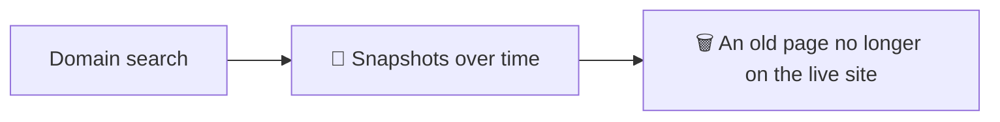

### 🐙 GitHub

**Git** is a **version control system** tracking file changes over time. GitHub is the most widely used cloud platform for Git repositories.

> ⚠️ **A frequent mistake:** developers sometimes **accidentally commit** sensitive data — API keys, credentials, config files, `.env` files — before realizing the repository is public.

**Search strategy:**
1. Search GitHub for the company name or domain.
2. Once you find a relevant repo, review **the commit history, not just the current files**.

> 🔑 **Why does commit history matter?** Sensitive data is often **removed in a later commit**, but **remains in the history**.

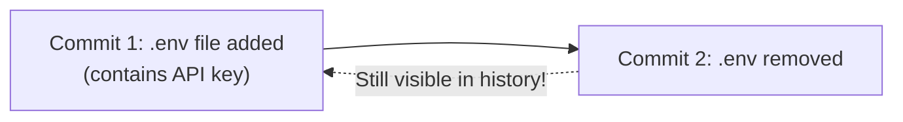

### ☁️ S3 Buckets

**Amazon S3** is a cloud storage platform many organizations use to host files and static web content.

```
https://{name}.s3.amazonaws.com
```

> ⚠️ **A common misconfiguration:** owners set permissions, but mistakes are common — a publicly accessible bucket can expose files that were **never meant to be seen**.

**Common naming patterns:**

| Pattern | Explanation |
|---------|-------------|
| `{company}-assets` | General assets |
| `{company}-backup` | Backups |
| `{company}-www` | Web content |
| `{company}-dev` | Development environment |

> 🔎 Bucket URLs can often be found in the website's **source code** or in **GitHub repositories**.

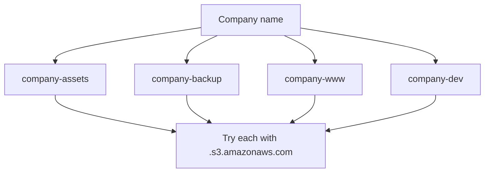

### 🧪 Hint for the hands-on task

Remember the Wayback Machine's address (`https://web.archive.org/`) and the **ending** of an S3 bucket URL (`.s3.amazonaws.com`).

---

## 🤖 Automated discovery: Gobuster fundamentals

Manual and OSINT techniques only go so far. **Automated discovery** uses tools that send **hundreds or thousands of requests** to check whether directories, files, or other resources exist.

> 📖 This relies on **wordlists** — text files of commonly used directory/file names.

### 🛠️ What is Gobuster?

| | |
|---|---|
| Language | Go |
| License | Open source |
| Modes | `dir` (directory/file), `dns` (subdomain), `vhost` (virtual host) |
| Pre-installed on | AttackBox and Kali Linux |

```bash
gobuster --help
```

### ⚙️ Global flags

| Flag | Explanation |
|------|-------------|
| `-t` / `--threads` | Number of parallel threads (default: 10) |
| `-w` / `--wordlist` | Path to the wordlist file (**required for every mode**) |
| `-o` / `--output` | Write results to a file |
| `--delay` | Wait time between requests (useful against rate-limited servers) |

### 📖 Wordlists

> 🏆 **[SecLists](https://github.com/danielmiessler/SecLists)** is the most widely used collection, pre-installed on the AttackBox at `/usr/share/wordlists/SecLists/`.

| File | Use case |
|------|----------|
| `Discovery/Web-Content/common.txt` | Covers most scenarios |
| `Discovery/Web-Content/directory-list-2.3-medium.txt` | A broader list |

### 📁 `dir` mode

```bash
gobuster dir -u "http://TARGET_IP" -w /path/to/wordlist
```

| Flag | Required? |
|------|-----------|
| `-u` | ✅ Yes — target URL |
| `-w` | ✅ Yes — wordlist file |

> ⚠️ **Omitting either results in an error.**

### ⚙️ Extra flags for `dir` mode

| Flag | Explanation |
|------|-------------|
| `-x` / `--extensions` | File extensions to search for (`-x .php,.txt,.js`) |
| `-r` / `--followredirect` | Follow HTTP redirects |
| `-k` / `--no-tls-validation` | Skip TLS certificate verification (useful in labs) |
| `-s` / `--status-codes` | Only show specific status codes (`-s 200,301`) |

### 💻 Example output

```bash
gobuster dir -u http://TARGET_IP -w /usr/share/wordlists/SecLists/Discovery/Web-Content/common.txt
```

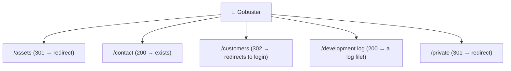

> 🔑 **Results worth paying attention to:** log files like `/development.log` can carry **sensitive info** (error traces, paths, sometimes credentials). Paths redirecting with `301`/`302` are **interesting targets** too.

### 🧪 Hint for the hands-on task

Run a `dir` scan with `common.txt` and look for an **unexpectedly named** directory/file and a **log file** in the results.

---

## 🌐 Subdomains and virtual hosts

### ⚖️ Subdomain vs Virtual Host: understanding the difference

Important not to confuse these two:

| | Subdomain | Virtual Host (vhost) |
|---|---|---|
| **How is it resolved?** | Through **DNS** | By the **web server** |
| **Mechanism** | A DNS record points to an IP | The server decides which site to serve based on the `Host:` header |
| **Example** | `blog.example.thm` → DNS → IP | Multiple sites on the same IP, separated by `Host:` |

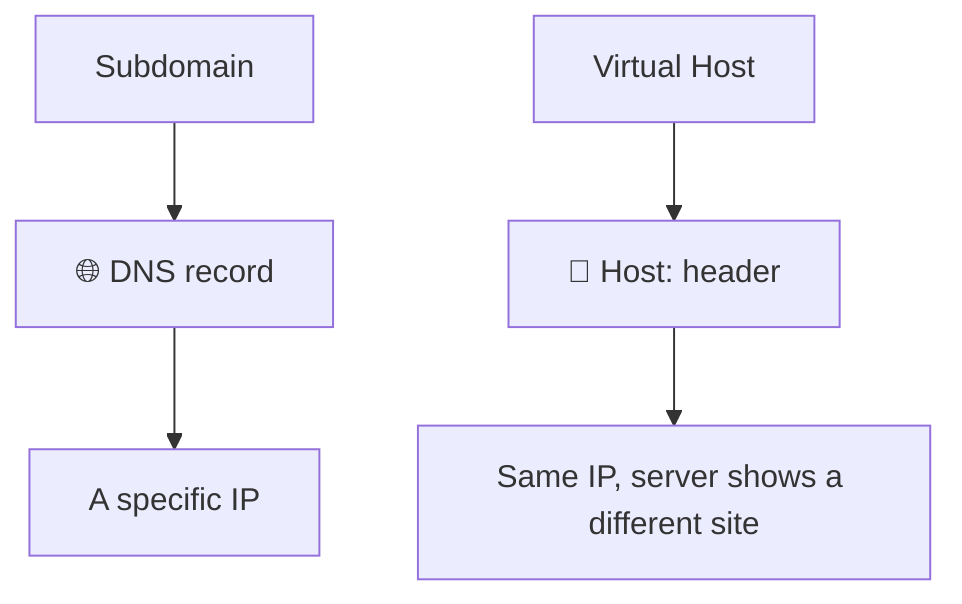

> 🎯 **Why check both?** A vulnerability patched on the main domain **may still be active on a subdomain**. For example, even if `tryhackme.thm` is patched, the same issue could remain on `mobile.tryhackme.thm`.

Gobuster offers a **separate mode** for each: `dns` (subdomains) and `vhost` (virtual hosts).

### 🔧 Preparing the environment (lab context)

> 📎 These steps apply to TryHackMe's **local lab network** — a real engagement may differ.

| Step | Command |
|------|---------|
| Update the DNS resolver | `sudo nano /etc/resolv-dnsmasq` → add `nameserver TARGET_IP` |
| Restart Dnsmasq | `/etc/init.d/dnsmasq restart` |
| Update the hosts file | `sudo nano /etc/hosts` → add `TARGET_IP domain.thm` |
| Verify | `ping domain.thm` |

### 🌐 `dns` mode

Queries DNS for each wordlist entry as a **subdomain candidate**.

```bash
gobuster dns -d DOMAIN -w /path/to/wordlist --wildcard
```

| Flag | Required? |
|------|-----------|
| `-d` / `--domain` | ✅ Yes — the target domain |
| `-w` | ✅ Yes — wordlist |
| `--wildcard` | **Force** enumeration even when wildcard DNS is detected (with false-positive risk) |

| Extra flag | Explanation |
|------------|-------------|
| `-i` / `--show-ips` | Show the IPs subdomains resolve to |
| `-r` / `--resolver` | Use a custom DNS server |

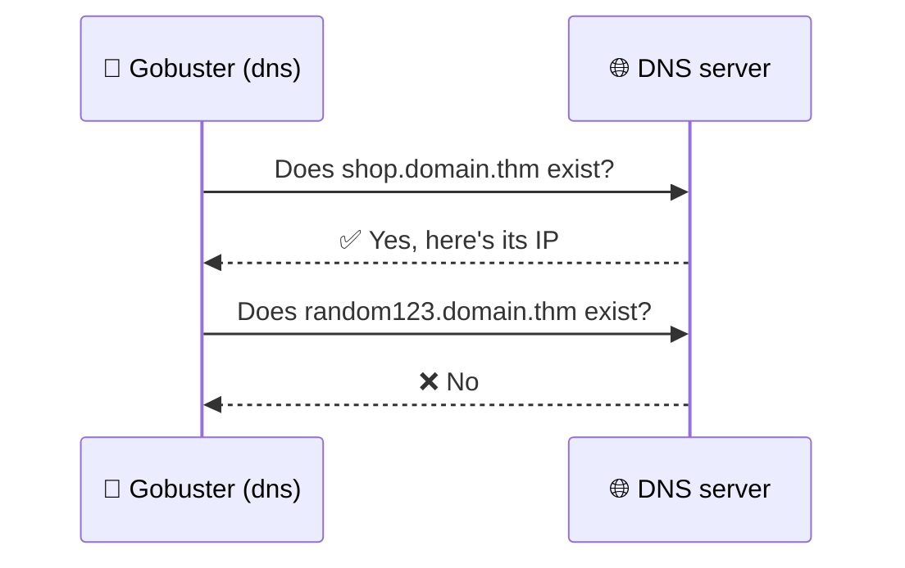

### 🏠 `vhost` mode

**Doesn't use DNS.** Instead, it sends HTTP requests to the target IP, cycling through wordlist entries as the **`Host:` header** value.

```bash
gobuster vhost -u "http://TARGET_IP" --domain DOMAIN -w /path/to/wordlist --append-domain --exclude-length 250-320
```

| Flag | Explanation |
|------|-------------|
| `--append-domain` | Appends each wordlist word to the domain (`admin` → `admin.domain.thm`) |
| `--exclude-length` | Filters out results sharing a common response size (**false positives**) |

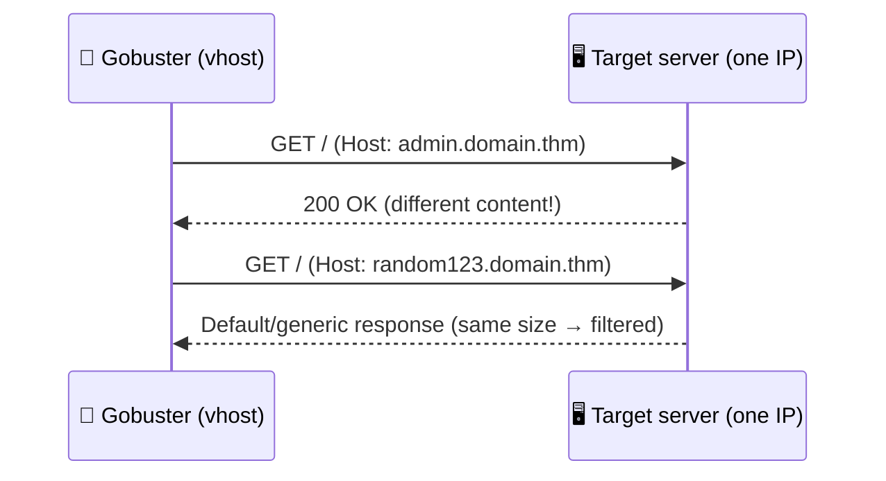

> 🔑 **Why is `vhost` useful?** It finds virtual hosts **not registered in public DNS**, but still configured on the server — these could be admin panels or test environments.

### ⚖️ Comparing `dns` and `vhost`

| | `dns` mode | `vhost` mode |
|---|---|---|
| Queries | The DNS server | The target web server |
| Finds | Officially registered subdomains | Host-recognized hosts that may not be in DNS |
| Key header | — | The `Host:` HTTP header |

### 🧪 Hint for the hands-on task

Remember the shorthand flag required alongside `-w` for `dns` mode (`-d`). Count how many hosts respond with a **status 200** in a `vhost` scan's results.

---

## 📊 Summary: combining the three approaches

| Method | Techniques |
|--------|-----------|
| ✋ **Manual** | `robots.txt`, `sitemap.xml`, favicon fingerprinting, HTTP headers, framework stack |
| 🌐 **OSINT** | Google dorking, Wappalyzer, Wayback Machine, GitHub, S3 buckets |
| 🤖 **Automated** | Gobuster's `dir`, `dns`, and `vhost` modes |

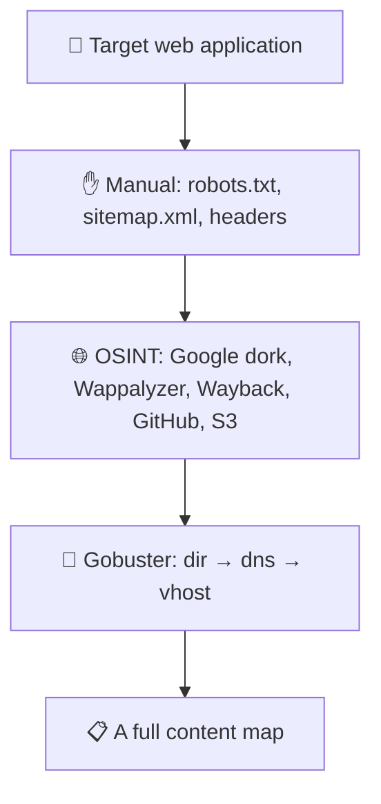

> 🧠 **Core philosophy:** these three approaches are **sequential and complementary**. Manual checks give **quick wins**, OSINT surfaces what the target has **already made public**, and automation provides the **breadth** neither of the others can cover.

---

## 🛡️ The defender's view

> 📎 This section is based on general knowledge.

| Risk | Defensive measure |
|------|---------------------|
| Sensitive paths exposed via `robots.txt` | Apply **real authorization checks** instead of just listing sensitive paths there |
| Test/staging URLs in `sitemap.xml` | Only include genuinely public pages in the sitemap |
| Version leakage through headers | Hide or minimize `Server`/`X-Powered-By` headers |
| Default admin credentials | **Change default passwords** right after installation |
| Log files left in a web folder | Store logs outside web-accessible paths |
| Leaked secrets on GitHub (in commit history) | Keep secrets in `.env`/a vault solution, and don't just clean the current files — purge or rotate the history too |
| Open S3 buckets | Regularly audit bucket permissions, default to **private** |
| Brute-force scans like Gobuster | Rate-limiting/WAF rules that detect unusual volumes of 404s and rapid sequential requests |
| Unprotected virtual hosts | Apply the same authentication standard across all vhosts, including test environments |

---

## 📖 Glossary

| Term | Short explanation |
|------|-------------------|
| **Content Discovery** | The process of finding non-public or hidden web content |
| **robots.txt** | A file telling search bots which paths not to index |
| **sitemap.xml** | A list of pages the owner wants indexed |
| **HTTP header** | Extra technical metadata sent with a request/response |
| **Framework** | Pre-made code that speeds up development |
| **OSINT** | Open-Source Intelligence — gathering info from public sources |
| **Google dorking** | Using Google's advanced operators to find sensitive content |
| **Wappalyzer** | A tool that identifies a site's technology stack |
| **Wayback Machine** | A historical archive of the internet |
| **Git** | A version control system that tracks file changes |
| **GitHub** | A cloud platform for Git repositories |
| **Commit history** | The full record of changes in a repository |
| **Amazon S3** | A cloud storage service built around "buckets" |
| **Wordlist** | A text file of common file/directory names |
| **Gobuster** | A directory, subdomain, and vhost brute-force tool |
| **dir mode** | Gobuster's directory/file discovery mode |
| **dns mode** | Gobuster's subdomain discovery mode |
| **vhost mode** | Gobuster's virtual host discovery mode |
| **Subdomain** | A domain part resolved via DNS |
| **Virtual host (vhost)** | A site distinguished on the same IP via the `Host:` header |
| **Wildcard DNS** | A DNS config that answers for any possible subdomain (can cause false positives) |
| **False positive** | An incorrect "match" result |

---

## 📝 Test yourself

<details>
<summary><b>1. What are the three main approaches to Content Discovery?</b></summary>

Manual, OSINT, and automated (e.g. Gobuster).
</details>

<details>
<summary><b>2. Why isn't robots.txt considered a security measure?</b></summary>

It's only a suggestion for bots. A disallowed path can still be accessed if visited directly.
</details>

<details>
<summary><b>3. What's the difference between sitemap.xml and robots.txt?</b></summary>

robots.txt shows what shouldn't be indexed, sitemap.xml shows what the owner wants indexed.
</details>

<details>
<summary><b>4. Which two HTTP headers hint at the technology stack?</b></summary>

Server and X-Powered-By.
</details>

<details>
<summary><b>5. Why is reading a framework's documentation useful?</b></summary>

It may describe the default directory structure, admin panel path, and default credentials.
</details>

<details>
<summary><b>6. Why check a GitHub repo's commit history, not just current files?</b></summary>

Sensitive data removed in a later commit can still remain visible in the history.
</details>

<details>
<summary><b>7. Which two flags are required for Gobuster's dir mode?</b></summary>

-u (target URL) and -w (wordlist file).
</details>

<details>
<summary><b>8. What's the key difference between a subdomain and a virtual host?</b></summary>

A subdomain is resolved via DNS. A virtual host is determined by the web server via the Host: header, with no DNS needed.
</details>

<details>
<summary><b>9. What problem do Gobuster's dns and vhost modes each solve?</b></summary>

dns mode finds officially registered subdomains. vhost mode finds hosts configured on the server, via the Host: header, that may not be registered in DNS.
</details>

<details>
<summary><b>10. Why does the --exclude-length flag matter?</b></summary>

It filters out responses sharing a common/default size (false positives), helping focus on genuine findings.
</details>

---

## 📚 Sources

- TryHackMe: [Content Discovery room](https://tryhackme.com/room/contentdiscoveryx) (do the hands-on part there yourself)
- [robots.txt - Wikipedia](https://en.wikipedia.org/wiki/Robots.txt)
- [Sitemaps - Wikipedia](https://en.wikipedia.org/wiki/Sitemaps)
- [Google hacking - Wikipedia](https://en.wikipedia.org/wiki/Google_hacking)
- [Wappalyzer](https://www.wappalyzer.com/)
- [Wayback Machine](https://web.archive.org/)
- [Git - Wikipedia](https://en.wikipedia.org/wiki/Git)
- [Amazon S3 - Wikipedia](https://en.wikipedia.org/wiki/Amazon_S3)
- [Gobuster - GitHub](https://github.com/OJ/gobuster/)
- [Virtual hosting - Wikipedia](https://en.wikipedia.org/wiki/Virtual_hosting)
- [Domain Name System - Wikipedia](https://en.wikipedia.org/wiki/Domain_Name_System)

> ℹ️ These notes were written in my own words for personal learning. The diagrams were drawn with Mermaid. The room's flags, specific IP address, default credentials, and exact task answers are not included; methodology and hints are given instead.
