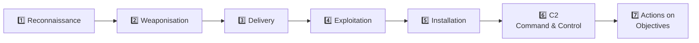
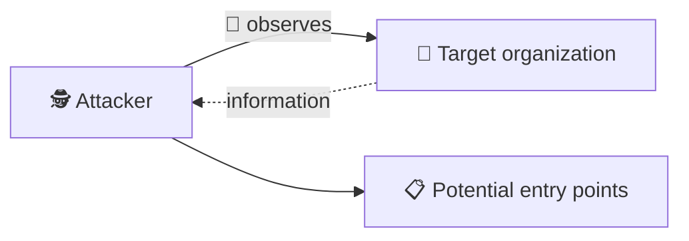
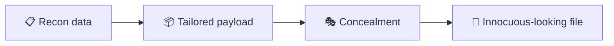
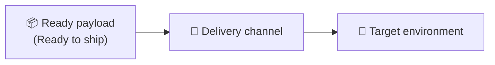
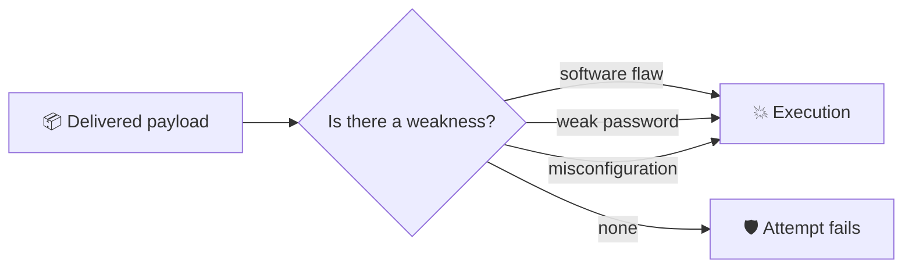
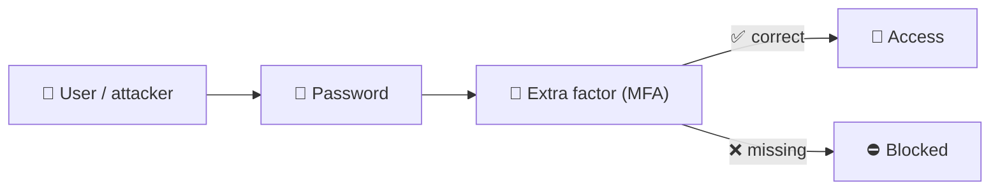
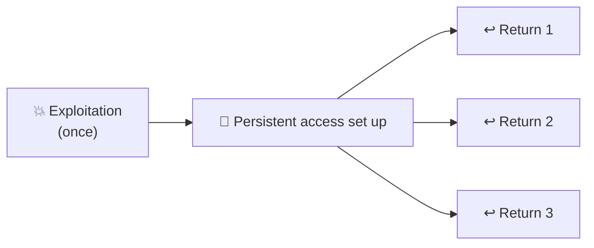
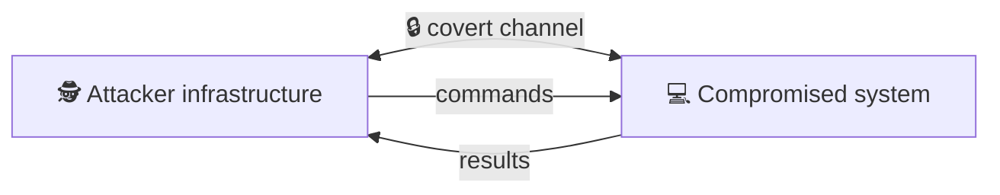
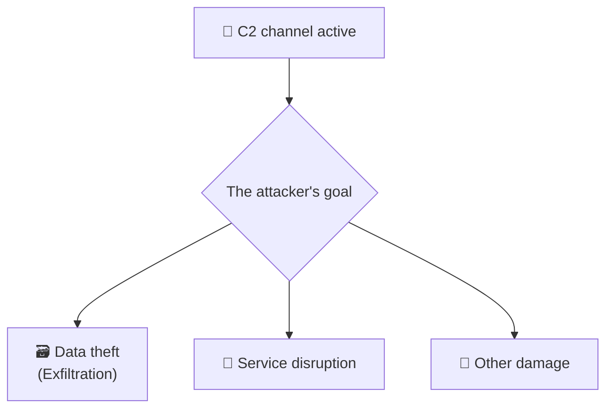
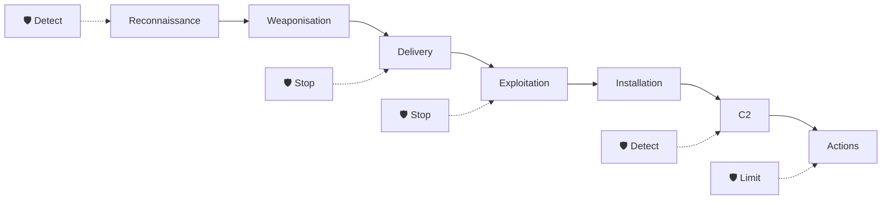

# ⛓️ Cyber Kill Chain: Detailed Study Notes

> Notes for strengthening defense by understanding how attacks unfold.
> Written while working through the TryHackMe **"Cyber Kill Chain"** room.

---

## 📑 Table of Contents

1. [Introduction: What is the Cyber Kill Chain?](#-introduction-what-is-the-cyber-kill-chain)
2. [1️⃣ Reconnaissance](#1️⃣-reconnaissance)
3. [2️⃣ Weaponisation](#2️⃣-weaponisation)
4. [3️⃣ Delivery](#3️⃣-delivery)
5. [4️⃣ Exploitation](#4️⃣-exploitation)
6. [5️⃣ Installation](#5️⃣-installation)
7. [6️⃣ Command and Control (C2)](#6️⃣-command-and-control-c2)
8. [7️⃣ Actions on Objectives](#7️⃣-actions-on-objectives)
9. [Breaking the chain: the defender's view](#-breaking-the-chain-the-defenders-view)
10. [Glossary](#-glossary)
11. [Test yourself](#-test-yourself)
12. [Sources](#-sources)

> ℹ️ **Note:** These notes are based on the visible pages of the source PDF (10 of 26 pages). Parts that weren't visible are written from general security knowledge and marked **📎 Additional info**. The notes are for **defense and understanding**, not hands-on attack instructions.

---

## 🎯 Introduction: What is the Cyber Kill Chain?

The **Cyber Kill Chain** is a cybersecurity framework introduced by **Lockheed Martin in 2011**. The idea is inspired by the **military "kill chain"** concept.

**Goal:** help organizations defend against cyber attacks by **understanding how they are conducted**.

The Kill Chain divides an attack into **seven stages**:

| # | Stage | In short |
|---|-------|----------|
| 1 | **Reconnaissance** | The attacker gathers information about the target |
| 2 | **Weaponisation** | A deliverable payload is created based on what was learned |
| 3 | **Delivery** | The prepared payload is transmitted to the target environment |
| 4 | **Exploitation** | A weakness is taken advantage of |
| 5 | **Installation** | Persistent access is established |
| 6 | **Command & Control** | A covert communication channel to the compromised system is set up |
| 7 | **Actions on Objectives** | The attacker achieves their real goal |

### 💡 Why does this model matter?

- It shows an attack **not as a single event but as a sequence**.
- For a defender, **every stage is a separate opportunity**: breaking any link of the chain stops the attack.
- The attacker must succeed at **every stage**, the defender only needs to stop them at **one**.

> ⚔️ **Analogy:** A burglary is staged too: watch the building → prepare tools → approach → open the door → stay inside → keep contact → steal. You can be caught at any step.

---

## 1️⃣ Reconnaissance

**Definition:** The act of **gathering information** about a target. In the first stage, the attacker learns about the target.

**Origins:** The concept comes from **the military**. In cyber security, this stage collects information about the target's **vulnerabilities and weaknesses** to discover **potential entry points**.

### 🖼️ Diagram: Reconnaissance

### Two types of reconnaissance

| | 🤫 **Passive** | 📡 **Active** |
|---|---|---|
| Noise | **None**, no direct contact with the target | **Some**, requires a form of interaction with the target |
| Chance of detection | Very low | Higher |
| Example | **OSINT** (open-source intelligence) | Directly interacting with target systems |

> 🔎 **OSINT** (Open-Source Intelligence): information gathered from publicly available sources (social media, job postings, company websites, public records).

### 📎 Additional info: defender's view

| Step | Defensive measure |
|------|-------------------|
| Reduce public exposure | Be careful what employee and technology details get shared |
| Notice active recon | Detect unusual scanning activity with logging and monitoring |
| Shrink the attack surface | Don't leave unnecessary services exposed to the internet |

---

## 2️⃣ Weaponisation

After reconnaissance is complete, the attacker **proceeds to the next stage, weaponisation**.

**The essence:** Based on the information gathered about the target systems, the attacker creates a **payload tailored** to exploit the discovered weaknesses.

### 🖼️ Diagram: Weaponisation

### The attacker's options

| Path | Explanation |
|------|-------------|
| 🧰 Ready-made exploit | Use one that already exists |
| ✏️ Edit | Modify an existing one |
| 🛠️ Create from scratch | Build their own |

> 🧱 **Frameworks and toolkits** can help the attacker in this stage.

### 🎭 Attempts to evade detection

- Many attackers resort to **obfuscation** or **encryption** to evade detection.
- They might **hide the payload in an innocuous-looking file**, such as an **MS Word** or **PDF** file.

### 🔑 Key point

Weaponisation happens **in the attacker's own environment**. It isn't visible on the target's network, so it is hard to observe directly. That's what makes this stage **invisible to the eye**.

### 📎 Additional info: defender's view

| Measure | Purpose |
|---------|---------|
| Threat intelligence | Recognize known payloads and tools and prepare in advance |
| File analysis / sandboxing | Check suspicious documents in a safe environment |
| Macro and execution policies | Restrict code execution from documents |

---

## 3️⃣ Delivery

In the previous stage, the attacker prepared a tailored payload. Now they need to **find a suitable way to transmit it to the target environment**. They pick a delivery method using **the information gathered from reconnaissance**.

### 🖼️ Diagram: Delivery

### 📦 Delivery examples

Attackers keep **getting creative** to deliver their payload successfully.

> 📎 The examples for this section aren't visible in the PDF. The categories below are **general, high-level** information.

| Category | Explanation |
|----------|-------------|
| 📧 **Email** | Phishing messages with malicious attachments or links |
| 🌐 **Web** | A malicious or compromised website |
| 💾 **Physical media** | Media such as a found USB drive |
| 🧑‍🤝‍🧑 **Social engineering** | Tricking a person into opening the file themselves |

### 📎 Additional info: defender's view

| Measure | Purpose |
|---------|---------|
| Email filtering and attachment analysis | Stop malicious messages before they arrive |
| User training | Recognize suspicious emails and links |
| Web filtering | Block access to malicious sites |
| USB policies | Limit connection of unknown media |

---

## 4️⃣ Exploitation

After **successful delivery** of the malicious payload comes the exploitation stage.

**Exploitation can take various forms:**

| Form | Explanation |
|------|-------------|
| 🐞 **Software vulnerability** | Taking advantage of a flaw in software |
| 🔑 **Weak password** | A default or easily guessed password |
| ⚙️ **System misconfiguration** | Incorrectly set up parameters |

### 🖼️ Diagram: Exploitation

### 📌 Examples

The attacker might use various ways to exploit a system. **The most straightforward approach is targeting a password-based authentication system.** If the password is **a default or weak password**, it is easy for the attacker.

### 🛡️ MFA: a protective layer even after credentials are valid

**MFA (Multi-Factor Authentication)** is the technology that makes it harder for an attacker to gain access **even with valid login credentials**. Besides the password, a **second factor** is required (phone code, app approval, physical key).

### 📎 Additional info: defender's view

| Measure | Purpose |
|---------|---------|
| Patch management | Close known software vulnerabilities |
| Strong password policy + MFA | Make password-based attacks harder |
| Secure configuration | Remove defaults and unnecessary settings |
| Vulnerability scanning | Find weaknesses before the attacker does |

---

## 5️⃣ Installation

After **successful exploitation** of a target system, the installation phase **ensures persistent access to the exploited system**.

> 🔑 **The keyword here is persistence.**

**Result:** the attacker can **return to the exploited system later without going through the exploitation phase again**.

### 🖼️ Diagram: Persistent access

### 🏠 Analogy

A burglar breaks a window to get in and **makes a duplicate key to the door**. Next time there's no need to break the window.

> 📎 Details for this section aren't visible in the PDF. The information below is based on general knowledge.

### 📎 Additional info: purpose of persistence and defense

| Defensive measure | Purpose |
|-------------------|---------|
| Endpoint monitoring (EDR) | Catch new and unusual changes on a system |
| Auditing startup locations | Detect unexpected programs and services |
| Account auditing | Find new or suspicious accounts |
| Least privilege | Limit installation capabilities |

---

## 6️⃣ Command and Control (C2)

After successful installation of persistent access within the target environment, the attacker needs to **maintain reliable and discreet access** to the compromised systems so they can later act on their objectives.

**The aim of the C2 phase** is to establish this **covert communication channel** for use in the next phase. In this phase, the attacker sets up the C2 communication channel **between the compromised systems and their own infrastructure**.

### 🖼️ Diagram: C2 channel

### 🏗️ Infrastructure

Attackers can use various techniques to create such infrastructure:

| Component | Example |
|-----------|---------|
| 🌐 **Domain names** | Domains owned or hijacked by the attacker |
| 🔢 **IP addresses** | Servers controlled by the attacker |
| ☁️ **Cloud services** | Abuse of legitimate services |

To evade detection, the attacker tries to make this communication **look like ordinary traffic**.

### 🧠 Key idea

A C2 channel is like **a remote control**: the attacker gives commands to the system without being there.

### 📎 Additional info: defender's view

| Measure | Purpose |
|---------|---------|
| DNS and network traffic monitoring | Spot unusual outbound connections |
| Egress filtering | Block access to unknown destinations |
| Threat intelligence | Block known malicious domains and IPs |
| Looking for periodic "beacon" behavior | Detect regular, automated connections |

---

## 7️⃣ Actions on Objectives

After establishing a covert C2 channel, the attacker can **carry out their original goals**. The goals range from **data exfiltration (information theft)** to **service disruption**.

### 🖼️ Diagram: Final stage

### 🎯 Examples: goals vary

Attackers might target an organization **for a variety of reasons**. Some attacks are **blaring**, for example if the attacker is only interested in **attention or impact**.

> 📎 The examples for this section aren't fully visible in the PDF. The information below is based on general knowledge.

| Goal | Outcome |
|------|---------|
| 💰 Financial | Selling data, ransom demands |
| 🕵️ Espionage | Leaking confidential information |
| 🔌 Disruption | Halting a service |
| 📣 Impact / attention | Loud, visible attacks |

### 📎 Additional info: defender's view

| Measure | Purpose |
|---------|---------|
| DLP (Data Loss Prevention) | Catch sensitive data leaving |
| Network segmentation | Limit the spread of damage |
| Backups | Recovery after disruption |
| Incident response plan | Fast, coordinated response |

---

## 🛡️ Breaking the chain: the defender's view

> 📎 This section is based on general knowledge and ties the stages above together from the defender's side.

| Stage | 🔍 Detect | ⛔ Stop |
|-------|-----------|---------|
| Reconnaissance | Notice unusual scan traffic | Reduce public information |
| Weaponisation | Threat intelligence | (On the attacker's side, hard to stop directly) |
| Delivery | Email/web analysis | Filtering, training |
| Exploitation | Vulnerability and anomaly monitoring | Patching, MFA, strong configuration |
| Installation | EDR, auditing | Least privilege, application control |
| C2 | Network/DNS monitoring | Egress filtering |
| Actions on Objectives | DLP, log analysis | Segmentation, backup, incident response |

> 💡 **Golden rule:** The **earlier** you break the chain, the less damage is done.

---

## 📖 Glossary

| Term | Short explanation |
|------|-------------------|
| **Cyber Kill Chain** | A framework splitting an attack into seven stages (Lockheed Martin, 2011) |
| **Framework** | A conceptual structure for approaching a problem systematically |
| **Reconnaissance** | Gathering information about a target |
| **Passive reconnaissance** | "Quiet" recon without direct contact with the target |
| **Active reconnaissance** | Recon that requires interacting with the target |
| **OSINT** | Open-source intelligence |
| **Weaponisation** | Preparing a tailored attack payload |
| **Payload** | The malicious content intended to run on the target |
| **Exploit** | Code or a technique that takes advantage of a weakness |
| **Obfuscation** | Concealing code/payload, making it hard to read |
| **Delivery** | Transmitting the payload to the target |
| **Exploitation** | Successfully using a weakness |
| **Misconfiguration** | Incorrect setup |
| **MFA** | Multi-factor authentication |
| **Installation** | Setting up persistent access |
| **Persistence** | Keeping the ability to return to a system |
| **C2 (Command & Control)** | The channel through which an attacker controls a compromised system |
| **Data exfiltration** | Stealing data out of the target |
| **Service disruption** | Disrupting how a service works |
| **EDR** | Endpoint Detection and Response |
| **DLP** | Data Loss Prevention |
| **Egress filtering** | Filtering traffic leaving the network |

---

## 📝 Test yourself

<b>1. Who introduced the Cyber Kill Chain and when?</b>

**Lockheed Martin**, in **2011**.

<b>2. How many stages does the Kill Chain have? List them in order.</b>

Seven: Reconnaissance, Weaponisation, Delivery, Exploitation, Installation, Command and Control, Actions on Objectives.

<b>3. What is the difference between passive and active reconnaissance?</b>

Passive recon is "noiseless", with no direct contact with the target (for example OSINT). Active recon requires some interaction with the target.

<b>4. How might an attacker try to hide a payload to evade detection?</b>

Obfuscation, encryption, or hiding it inside innocuous-looking file types (Word, PDF).

<b>5. In what forms can exploitation appear?</b>

A software vulnerability, a weak password, or a system misconfiguration.

<b>6. Which technology makes access harder even when the attacker has valid login credentials?</b>

**MFA** (multi-factor authentication).

<b>7. What is the keyword of the Installation stage, and why is it needed?</b>

**Persistence.** So the attacker can return to the system later without exploiting it again.

<b>8. What is the purpose of the C2 stage?</b>

To set up a **covert communication channel** between the compromised systems and the attacker's infrastructure.

<b>9. What can an attacker do in Actions on Objectives?</b>

Carry out original goals, from data exfiltration to service disruption.

<b>10. What is the main benefit of the Kill Chain for a defender?</b>

It offers a chance to detect or stop the attack at every stage. The earlier you break the chain, the less damage is done.

---

## 📚 Sources

- TryHackMe: the **Cyber Kill Chain** room (do the hands-on part there yourself)
- Room write-up overview: [Sharon Jebitok, "Cyber Kill Chain (TryHackMe)"](https://www.sharonjebitok.com/cyber-kill-chain-tryhackme)
- Framework originator: Lockheed Martin (2011)

> ℹ️ These notes were written in my own words for personal learning. The diagrams are not the originals, they were redrawn with Mermaid.
