# 🧪 Nmap Advanced Port Scans: Detailed Study Notes

> Null, FIN, Xmas, Maimon, ACK, Window scans, spoofing, decoys, fragmentation, and the idle/zombie scan.
> Written while working through the TryHackMe **"Nmap Advanced Port Scans"** room.

🌐 Languages: [Azərbaycanca](nmap-advanced-port-scans.md) | **English**

---

## 📋 About the room

| | |
|---|---|
| 🧭 Type | Walkthrough |
| 🟡 Difficulty | Medium |
| 🏷️ Tags | Linux |
| 💳 Subscription | Premium |
| 🔗 Room | [tryhackme.com/room/nmap03](https://tryhackme.com/room/nmap03) |
| 🎯 Goal | Non-standard TCP flag combinations, spoofing, and firewall/IDS evasion techniques |
| 📍 Place | Room 3 of the Network Security module's Nmap series |

---

## 📑 Table of Contents

1. [Introduction: why do unusual flag combinations work?](#-introduction-why-do-unusual-flag-combinations-work)
2. [Null, FIN, and Xmas scans](#-null-fin-and-xmas-scans)
3. [TCP Maimon scan](#-tcp-maimon-scan)
4. [TCP ACK, Window, and custom scans](#-tcp-ack-window-and-custom-scans)
5. [Spoofing and decoys](#-spoofing-and-decoys)
6. [Fragmented packets](#-fragmented-packets)
7. [Idle/Zombie scan](#-idlezombie-scan)
8. [Getting more details](#-getting-more-details)
9. [Summary: scan types and options](#-summary-scan-types-and-options)
10. [The defender's view](#-the-defenders-view)
11. [Glossary](#-glossary)
12. [Test yourself](#-test-yourself)
13. [Sources](#-sources)

> ⚖️ **Legal notice:** Many techniques in this room (spoofing, decoys, idle scan, fragmentation) are designed to **evade firewalls and IDS systems**. These should only be tried in a **lab environment you own or are explicitly authorized to test**. IP/MAC spoofing is **illegal or strictly prohibited** on many real networks. The examples use placeholders like `TARGET_IP`, `SPOOFED_IP`, `ZOMBIE_IP`.

---

## 🎯 Introduction: why do unusual flag combinations work?

This room is the **third** in the Nmap series:

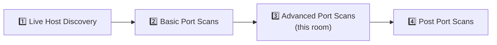

In the previous room we learned the TCP **3-way handshake** and the **six flags** (URG, ACK, PSH, RST, SYN, FIN). Security researchers started **experimenting** with them: *"What happens if we send a packet, not part of any ongoing connection, with one or more flags set?"*

> 🤔 **Analogy:** a packet with the ACK flag set is like saying **"Yes, I hear you, please continue"** to someone who hasn't said anything — nonsensical, but it reveals how the system reacts to this unusual situation.

### 🗺️ Scans covered in this room

| Category | Scans |
|----------|-------|
| 🚩 Non-standard flag scans | Null, FIN, Xmas, Maimon, ACK, Window, Custom |
| 🎭 Evasion techniques | IP spoofing, MAC spoofing, Decoy scan, Idle/Zombie scan |
| 🧩 Packet manipulation | Fragmented packets |
| 🔍 Verbose output | `--reason`, `-v`/`-vv`, `-d`/`-dd` |

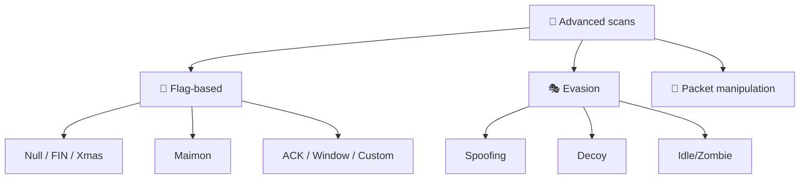

---

## 🎄 Null, FIN, and Xmas scans

These three scans rely on the same logic: **open ports don't respond**, **closed ports send RST**.

### 0️⃣ Null scan

| | |
|---|---|
| Option | `-sN` |
| Flags set | **None** (all zero) |

```bash
sudo nmap -sN TARGET_IP
```

### 1️⃣ FIN scan

| | |
|---|---|
| Option | `-sF` |
| Flags set | Only **FIN** |

```bash
sudo nmap -sF TARGET_IP
```

### 🎄 Xmas scan

Named after Christmas tree lights — because in Wireshark the packet appears **"lit up"** with several flags at once.

| | |
|---|---|
| Option | `-sX` |
| Flags set | **FIN + PSH + URG** (simultaneously) |

```bash
sudo nmap -sX TARGET_IP
```

### 🧠 The shared logic across all three

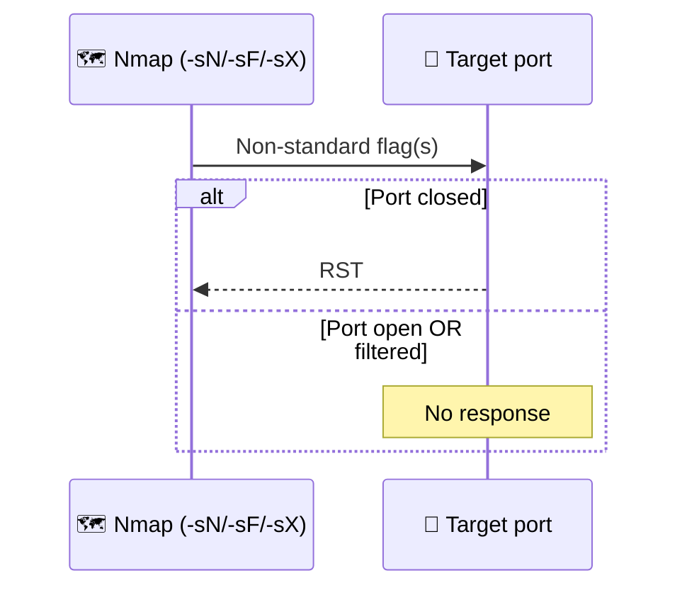

| Observed result | Nmap's interpretation |
|-------------------|--------------------------|
| **RST arrives** | Port is **closed** |
| **No response** | Port is **open\|filtered** (open, or blocked by a firewall — Nmap can't tell the difference) |

> ⚠️ **The core limitation:** these three scans **can't confirm "open"** with certainty, only "not closed". Some firewalls also silently drop packets without sending RST at all.

### 📊 Comparing the number of flags

| Scan | Flags set |
|------|-----------|
| Null (`-sN`) | **0** |
| FIN (`-sF`) | **1** |
| Xmas (`-sX`) | **3** |

### 🛡️ When are these scans useful?

> 🧱 **Stateless firewall:** checks only whether an incoming packet has the **SYN flag** to detect a connection attempt. Sending a different flag combination can **deceive** this kind of firewall.
>
> 🏰 **Stateful firewall:** practically blocks all these "odd" packets, making these techniques **useless**.

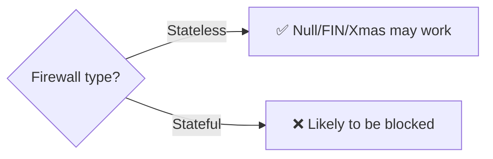

### 🧪 Hint for the hands-on task

Run FIN and Null scans against the same target and compare the results — both should show the **same number** of ports as `open|filtered`.

---

## 👻 TCP Maimon scan

| | |
|---|---|
| Described by | Uriel Maimon, **1996** |
| Option | `-sM` |
| Flags set | **FIN + ACK** |

### 🧠 The theoretical logic

In theory the target should reply with **RST**. But certain **BSD-derived systems** silently drop the packet on an open port — which indirectly reveals **open ports**.

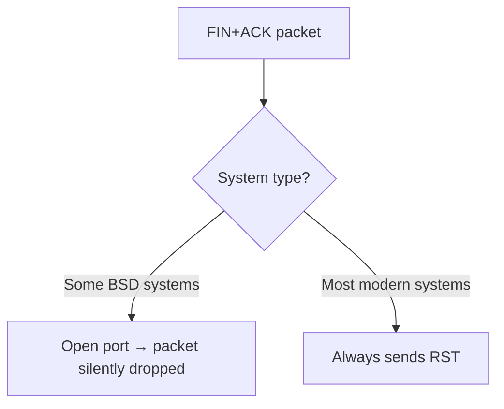

> ⚠️ **In practice:** on most targets found in modern networks this scan **doesn't work**, since they send **RST regardless** of port state, making it impossible to distinguish open ports.

> 🎓 **Why learn it anyway?** To understand port-scanning mechanics and the "hacker mindset" more deeply — investigating how different systems respond to non-standard input.

```bash
sudo nmap -sM TARGET_IP
```

### 🧪 Hint for the hands-on task

Remember how many flags are set in the Maimon scan (2: FIN + ACK).

---

## 🔑 TCP ACK, Window, and custom scans

### 🔓 TCP ACK scan

| | |
|---|---|
| Option | `-sA` |
| Flag set | Only **ACK** |

> 🧩 **Why does it work?** A packet with the ACK flag is normally only sent to **acknowledge data already received**. Here no data was received — the target considers this **unexpected** and **sends RST regardless of the port's state**.

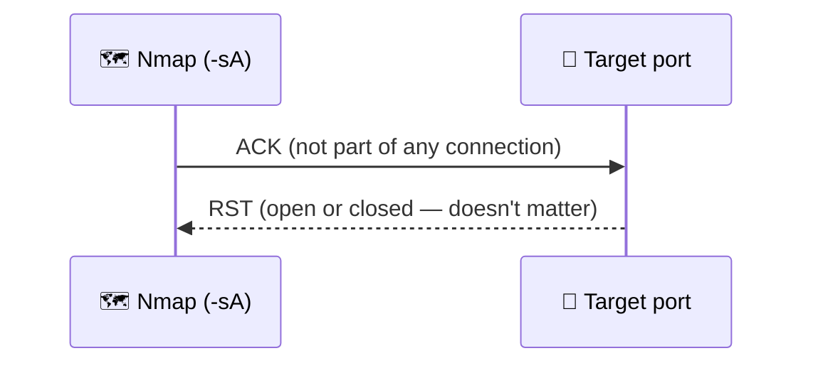

> ❗ **Useless in a simple setup:** without a firewall, an ACK scan can't tell you which port is **open** — every port simply shows as **"unfiltered"**.

#### 🧱 Its real value: mapping firewall rules

Against a target with a firewall, an ACK scan behaves differently:

| Result | Meaning |
|--------|---------|
| 🟢 **Unfiltered** | This port is **not blocked** by the firewall |
| 🟡 **Filtered** | This port **is blocked** by the firewall |

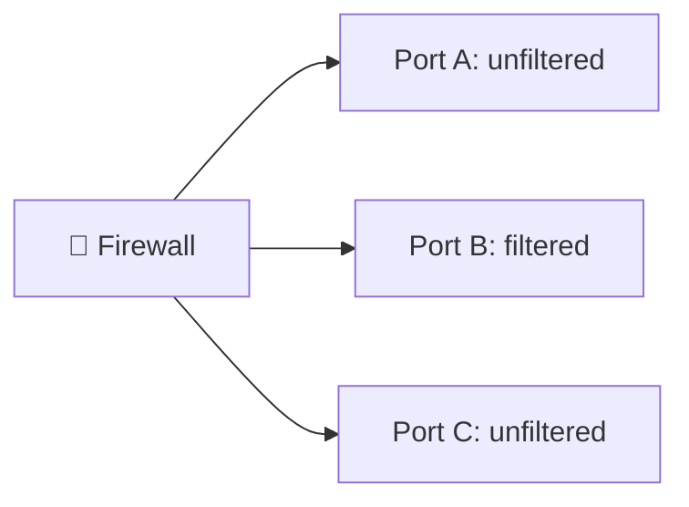

> 🎯 **Key idea:** an ACK scan reveals how the **firewall rules** are configured, not whether a **service** exists. A port being "unfiltered" doesn't mean a service is actually running there.

### 🪟 TCP Window scan

| | |
|---|---|
| Option | `-sW` |
| Flag set | **Same as ACK** (ACK) |
| Difference | Examines the **TCP Window field** in the returned RST |

> 🔬 On some systems, the Window field's value differs depending on whether the port is open or closed. This gives an **extra detail** beyond a plain ACK scan.

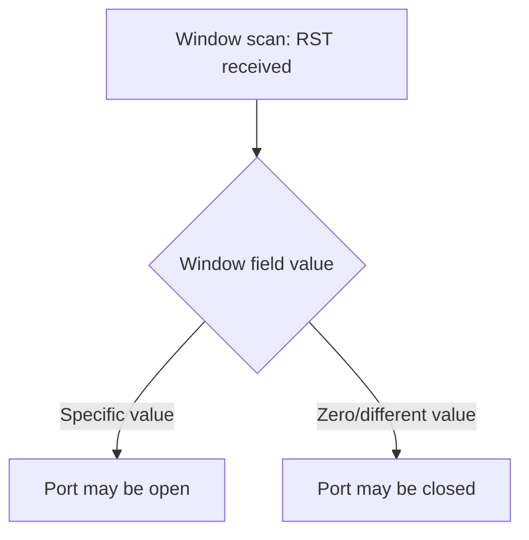

> ⚠️ In a simple setup with no firewall, the Window scan also provides **no extra information** — every port may show as "closed". Behind a firewall, though, it can show **different labeling** than the ACK scan (for example "closed" vs "unfiltered"), giving a clearer picture of which ports aren't blocked.

### 🛠️ Custom scan

You can build your own flag combination:

```bash
nmap --scanflags FLAG_NAMES TARGET_IP
```

Examples:

```bash
nmap --scanflags RSTSYNFIN TARGET_IP   # SYN + RST + FIN
nmap --scanflags RST TARGET_IP          # RST only
```

> 🧠 When building a custom scan, it's important to know in advance **how each flag combination behaves on different systems** so you can interpret the results correctly.

### ⚠️ An important reminder

> 🧩 **ACK and Window scans only reveal firewall rules, not whether a service exists.** Even if a firewall doesn't block a port, no service may actually be running there (for example, if firewall rules haven't been updated after a service change).

### 🧪 Hint for the hands-on task

Remember how many flags are set in a Window scan (1) and what to write after `--scanflags` for the Reset flag (`RST`).

---

## 🎭 Spoofing and decoys

### 🪪 IP spoofing

> ⚠️ **Core requirement:** this only helps in a setup where you can **capture the responses** yourself. Scanning from a random network with a spoofed IP means the responses **won't route back to you**, and results will be unreliable.

```bash
nmap -S SPOOFED_IP TARGET_IP
nmap -e NET_INTERFACE -Pn -S SPOOFED_IP TARGET_IP
```

| Option | Meaning |
|--------|---------|
| `-S SPOOFED_IP` | Spoof the source IP address |
| `-e NET_INTERFACE` | Explicitly specify the network interface to use |
| `-Pn` | Explicitly disable ping scan (since no real reply is expected back) |

### 🔄 The three-step logic

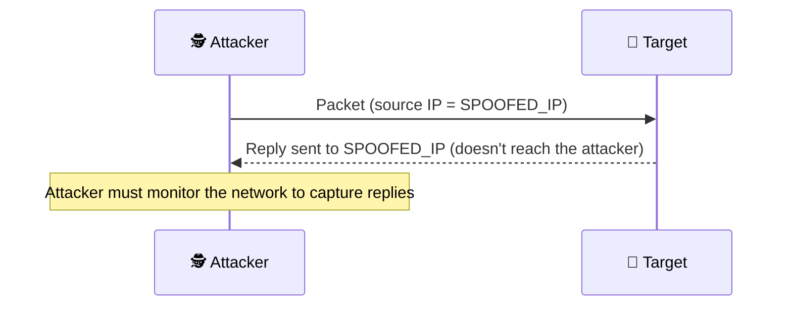

1. The attacker sends a packet with a spoofed source IP.
2. The target replies to the **spoofed IP address**.
3. The attacker must **capture the replies** themselves (by monitoring the network).

### 🪪 MAC spoofing

```bash
nmap --spoof-mac SPOOFED_MAC TARGET_IP
```

> 🔗 Only possible when the attacker and target are on the **same Ethernet (802.3) or WiFi (802.11) network**.

### 🎭 Decoy scan

Spoofing only works in a limited number of situations. An alternative: use **decoys** so the scan appears to come from **many sources**, hiding the real attacker's IP among them.

```bash
nmap -D 10.10.0.1,10.10.0.2,ME TARGET_IP
```

| Element | Meaning |
|---------|---------|
| `10.10.0.1`, `10.10.0.2` | Specific decoy IPs |
| `ME` | Marks where **your own IP** appears in the order |
| `RND` | Generates a random decoy IP |

```bash
nmap -D 10.10.0.1,10.10.0.2,RND,RND,ME TARGET_IP
```

> 🔀 In this example, the 3rd and 4th source IPs are **randomized each run**, and the 5th is the attacker's own IP.

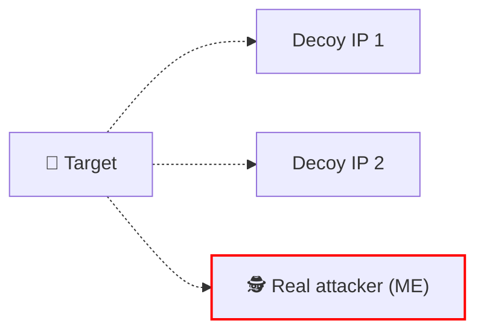

> 👁️ As a result, the target sees the scan coming from **3 different sources**, making it harder to pinpoint the real attacker.

### 🧪 Hint for the hands-on task

Use `-S` to make a scan appear to come from a specific spoofed IP, and the `-D ...,ME` format to add several decoys while including your own IP.

---

## 🧩 Fragmented packets

### 🧱 What do a firewall and an IDS check?

| | What it inspects |
|---|---|
| 🧱 **Firewall** | IP header + transport layer header (some go deeper and inspect application data too) |
| 🕵️ **IDS** | IP + transport headers **+ the data's content** (looking for malicious signatures) |

### ✂️ Why fragment packets?

> 💡 **Goal:** split the data into small pieces so a firewall/IDS **can't recognize** the packet. Some older or simpler systems **fail to properly reassemble** fragments or don't inspect them thoroughly.

```bash
nmap -f TARGET_IP          # 8-byte fragments
nmap -f -f TARGET_IP        # or -ff: 16-byte fragments
nmap --mtu N TARGET_IP      # N must be a multiple of 8
```

| Option | Fragment size |
|--------|----------------|
| `-f` | **8 bytes** (or less) |
| `-ff` (`-f -f`) | **16 bytes** |
| `--mtu N` | Custom size, must be a **multiple of 8** |

### 🧮 A calculation example

The TCP header is **24 bytes** (minimum: 20 bytes). With `-f` (8-byte fragments):

```
24 ÷ 8 = 3 fragments
```

With `-ff` (16-byte fragments):

```
24 bytes → fragment 1: 16 bytes, fragment 2: 8 bytes (2 fragments)
```

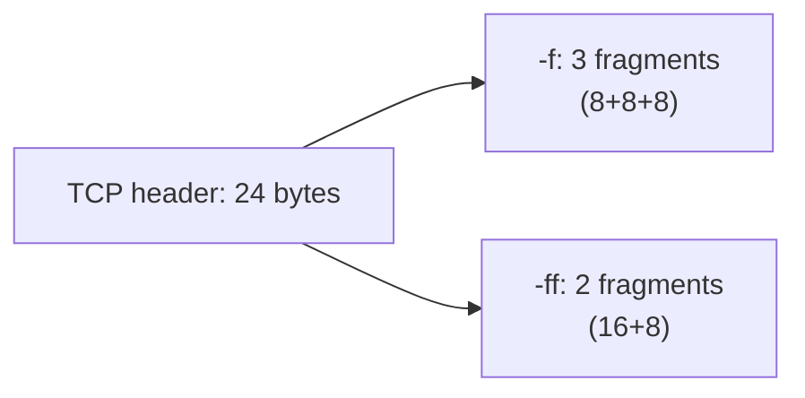

### 🔄 The opposite approach: making packets bigger

```bash
nmap --data-length NUM TARGET_IP
```

Adding extra data to packets to make them look **innocuous** (similar to ordinary traffic).

### 🧪 Hint for the hands-on task

If a TCP segment is 64 bytes, calculate the number of IP fragments produced with `-ff` (16-byte fragments): `64 ÷ 16`.

---

## 🧟 Idle/Zombie scan

### 🤔 Why does it exist?

IP spoofing has a limitation: you need to be able to **capture the responses**. The **idle (zombie) scan** solves this differently — you no longer need to monitor network traffic yourself.

### 🖨️ What is a zombie host?

An **idle system** — connected to the network but generating **little traffic** (the classic example: a rarely used network printer).

```bash
nmap -sI ZOMBIE_IP TARGET_IP
```

### 🔑 Key concept: IP ID

Every IP packet header has an **IP ID** field. On most systems, this value **increments by 1** with each packet sent. The idle scan uses this increment as a **hidden "counter"**.

### 🔄 The three-step process

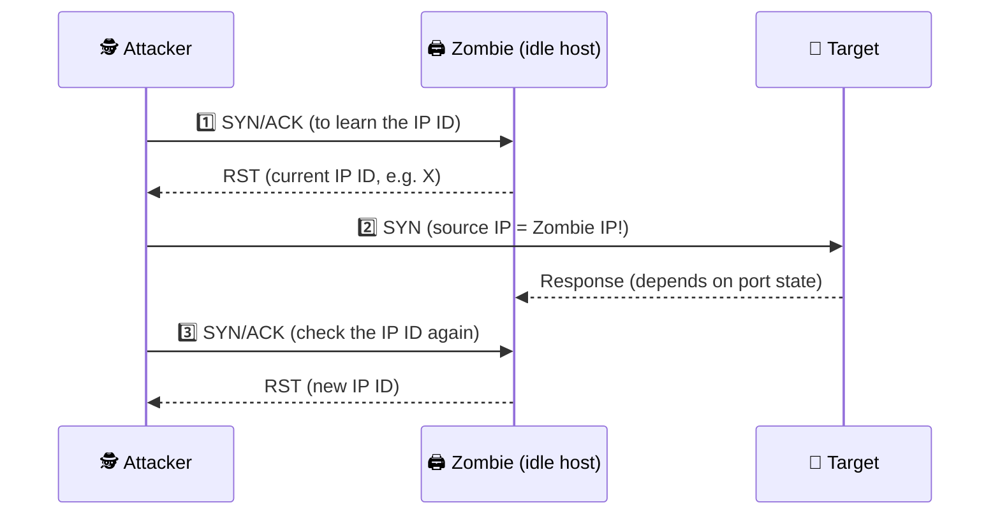

### 🎲 Three scenarios

| Scenario | Target's reaction | Zombie's reaction | IP ID change |
|----------|---------------------|-----------------------|-----------------|
| 🔴 Port **closed** | Sends **RST** to the zombie | Doesn't respond (unexpected RST) | **+1** (only from steps 1 and 3) |
| 🟢 Port **open** | Sends **SYN/ACK** to the zombie | Responds with **RST** to this unexpected packet | **+2** (the extra RST at step 3) |
| 🟡 Firewall **blocks** | No response at all | Doesn't respond | **+1** (same result as closed) |

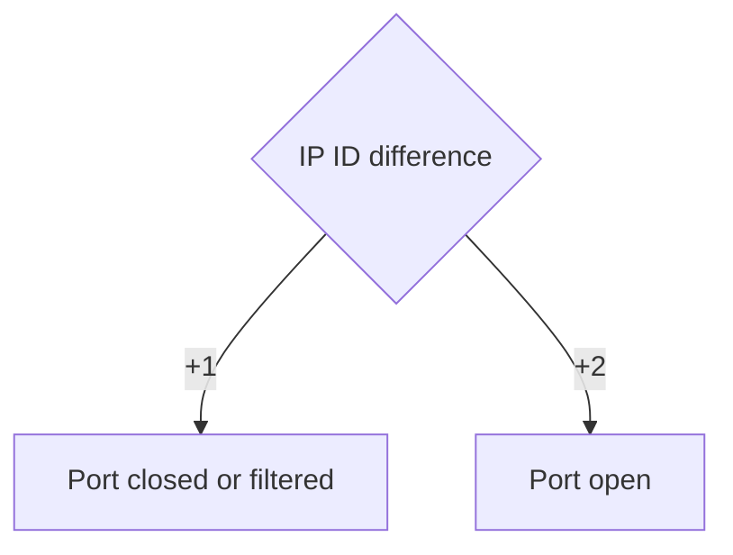

### ⚠️ Why does the host need to be "idle"?

> 🧠 If the chosen "zombie" host is generating **its own active traffic** (incrementing IP ID from its own normal activity), the results will be **unreliable**. That's why picking a **rarely used** device matters.

### 🕵️ Why is it stealthy?

The target only ever sees the **zombie's IP address**, never the attacker's real IP.

### 🧪 Hint for the hands-on task

Write the printer's IP you want to use as the zombie host after the `-sI` option.

---

## 🔬 Getting more details

### 💬 `--reason`: show Nmap's logic

```bash
sudo nmap -sS --reason TARGET_IP
```

Nmap shows the **reason** behind each conclusion, for example:

| Observation | Reason |
|-------------|--------|
| Host is up | `received arp-response` |
| Port is open | `syn-ack` |
| Port is closed | `reset` |

### 📢 Verbosity: `-v` / `-vv`

```bash
sudo nmap -sS -vv TARGET_IP
```

Shows the scan's progress **in real time**: which phase has started, which ports have been discovered, and so on.

### 🐛 Debugging: `-d` / `-dd`

```bash
sudo nmap -sS -d TARGET_IP
```

> 📜 **Warning:** `-d` output is **too long to fit on one screen**. Use it when you need very deep technical detail.

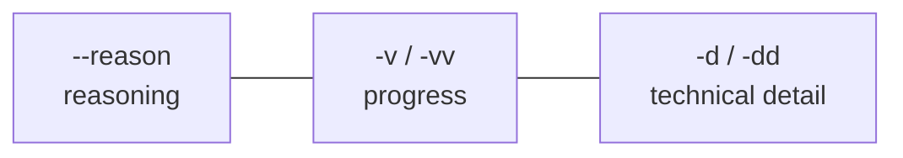

### 🧪 Hint for the hands-on task

Using `--reason`, find the reason word (usually `syn-ack`) shown next to open ports.

---

## 📊 Summary: scan types and options

| Scan type | Example command |
|-----------|------------------|
| TCP Null Scan | `sudo nmap -sN TARGET_IP` |
| TCP FIN Scan | `sudo nmap -sF TARGET_IP` |
| TCP Xmas Scan | `sudo nmap -sX TARGET_IP` |
| TCP Maimon Scan | `sudo nmap -sM TARGET_IP` |
| TCP ACK Scan | `sudo nmap -sA TARGET_IP` |
| TCP Window Scan | `sudo nmap -sW TARGET_IP` |
| Custom TCP Scan | `sudo nmap --scanflags URGACKPSHRSTSYNFIN TARGET_IP` |
| Spoofed Source IP | `sudo nmap -S SPOOFED_IP TARGET_IP` |
| Spoofed MAC Address | `--spoof-mac SPOOFED_MAC` |
| Decoy Scan | `nmap -D DECOY_IP,ME TARGET_IP` |
| Idle (Zombie) Scan | `sudo nmap -sI ZOMBIE_IP TARGET_IP` |
| Fragmentation (8 bytes) | `-f` |
| Fragmentation (16 bytes) | `-ff` |

| Option | Purpose |
|--------|---------|
| `--source-port PORT_NUM` | Specify the source port number |
| `--data-length NUM` | Append random data to a packet |
| `--reason` | Explain the reasoning behind Nmap's conclusion |
| `-v` / `-vv` | Verbose / very verbose output |
| `-d` / `-dd` | Debugging / more debugging detail |

### 🧠 Which scans follow which logic?

| Group | Scans | Logic |
|-------|-------|-------|
| 🤫 **Provoking a response from closed ports** | Null, FIN, Xmas | Only a **closed** port replies (RST) |
| 🔔 **Response from both states** | Maimon, ACK, Window | Open and closed ports can (in theory) behave differently |

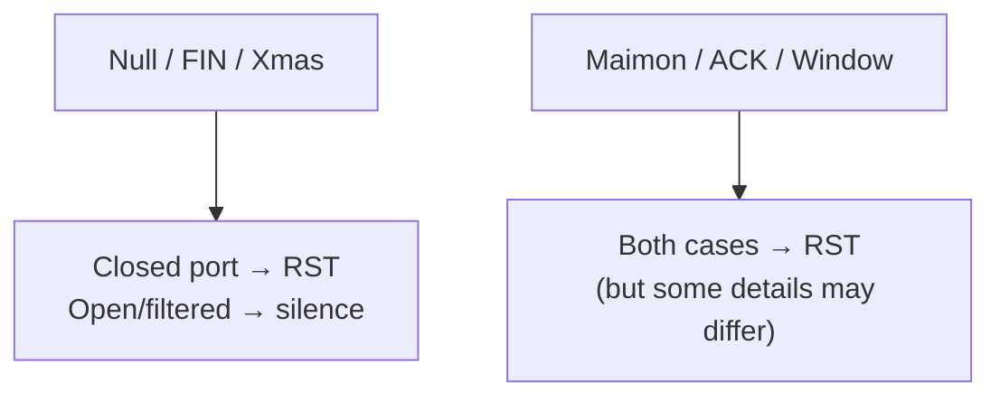

---

## 🛡️ The defender's view

> 📎 This section is based on general knowledge.

| Technique | Detection / defensive measure |
|-----------|-------------------------------|
| Null/FIN/Xmas scans | Use a **stateful firewall** — it practically blocks flag combinations other than SYN |
| ACK/Window scans | Regularly audit firewall rules, close unnecessary "unfiltered" ports |
| IP/MAC spoofing | **Egress/ingress filtering** (RFC 2827/BCP 38) — reject spoofed-source packets at network edges |
| Decoy scan | IDS rules that correlate similar traffic patterns arriving from multiple sources |
| Idle/Zombie scan | Make IP ID incrementation unpredictable (most modern OSes already use **randomized IP IDs**, which makes this attack harder) |
| Fragmentation | Enable **fragment reassembly** on the IDS/firewall so the full packet is inspected |
| General | Anomaly-detecting IDS/IPS, rate-limiting, log correlation |

---

## 📖 Glossary

| Term | Short explanation |
|------|-------------------|
| **Null scan** | A scan with no flags set (`-sN`) |
| **FIN scan** | A scan with only the FIN flag (`-sF`) |
| **Xmas scan** | A scan with FIN+PSH+URG flags (`-sX`) |
| **Maimon scan** | A scan with FIN+ACK flags (`-sM`) |
| **ACK scan** | A scan with only the ACK flag, used to map firewall rules (`-sA`) |
| **Window scan** | Similar to ACK scan, but examines the Window field in the RST (`-sW`) |
| **Custom scan** | A user-defined flag combination (`--scanflags`) |
| **Stateless firewall** | A firewall that inspects single packets without tracking connection state |
| **Stateful firewall** | A smarter firewall that tracks the full state of a connection |
| **IDS** | Intrusion Detection System — inspects network behavior and signatures |
| **IP spoofing** | Faking a packet's source IP address |
| **MAC spoofing** | Faking a packet's source MAC address |
| **Decoy scan** | Making a scan appear to come from several fake sources |
| **Idle/Zombie scan** | Scanning via an idle (low-traffic) third host, hiding the real source |
| **IP ID** | A field in the IP header that identifies packets (also used for fragmentation) |
| **Fragmentation** | Splitting a packet into smaller pieces (to evade firewalls/IDS) |
| **MTU** | Maximum Transmission Unit — the maximum size of a packet |
| **--reason** | An option showing how Nmap reached its conclusion |
| **Verbosity (-v/-vv)** | Detailed output about scan progress |
| **Debugging (-d/-dd)** | The most detailed technical output level |

---

## 📝 Test yourself

<details>
<summary><b>1. How many flags are set in the Null, FIN, and Xmas scans?</b></summary>

Null: 0, FIN: 1, Xmas: 3 (FIN+PSH+URG).
</details>

<details>
<summary><b>2. Which port state do these three scans detect with certainty, and which not?</b></summary>

Only "closed" is detected with certainty (RST arrives). Open and filtered can't be distinguished — both show as "open|filtered".
</details>

<details>
<summary><b>3. Which flags does the Maimon scan set, and why doesn't it work on most modern systems?</b></summary>

FIN+ACK. Most modern systems always send RST regardless of port state, so the open/closed difference doesn't show up.
</details>

<details>
<summary><b>4. What is an ACK scan useful for, and what is it not useful for?</b></summary>

Useful for discovering firewall rules (which ports aren't blocked). Not useful for confirming a service is actually running there.
</details>

<details>
<summary><b>5. How does a Window scan differ from an ACK scan?</b></summary>

It uses the same ACK flag, but additionally examines the TCP Window field in the returned RST — sometimes giving an extra clue about open/closed state.
</details>

<details>
<summary><b>6. What's the core limitation of IP spoofing?</b></summary>

Responses go to the spoofed IP, so the attacker must monitor network traffic themselves to see the result.
</details>

<details>
<summary><b>7. How does a decoy scan work?</b></summary>

It makes the scan appear to come from several IP addresses (some real, some random) so the real source gets lost among them.
</details>

<details>
<summary><b>8. Why is fragmentation done, and what's the difference between `-f` and `-ff`?</b></summary>

It's done so a firewall/IDS can't recognize the packet. `-f` creates 8-byte fragments, `-ff` creates 16-byte fragments.
</details>

<details>
<summary><b>9. What do +1 and +2 IP ID increases mean in an idle/zombie scan?</b></summary>

+1: the port is closed or filtered. +2: the port is open (the zombie sent an extra RST).
</details>

<details>
<summary><b>10. What's the difference between `--reason`, `-v`, and `-d`?</b></summary>

`--reason` shows why Nmap reached its conclusion, `-v`/`-vv` shows detailed scan progress, `-d`/`-dd` gives the deepest technical debug detail.
</details>

---

## 📚 Sources

- TryHackMe: [Nmap Advanced Port Scans room](https://tryhackme.com/room/nmap03) (do the hands-on part there yourself)
- [Internet Protocol - Wikipedia](https://en.wikipedia.org/wiki/Internet_Protocol)
- [Nmap - official site](https://nmap.org/)
- [Nmap - manual](https://nmap.org/book/man.html)
- [Nmap - Wikipedia](https://en.wikipedia.org/wiki/Nmap)
- [TCP - Wikipedia](https://en.wikipedia.org/wiki/Transmission_Control_Protocol)

> ℹ️ These notes were written in my own words for personal learning. The diagrams were drawn with Mermaid. The room's specific IP addresses and exact task answers (specific port numbers) are not included; explanations and hints are given instead.
