# 🔍 Nmap Basic Port Scans: Detailed Study Notes

> How TCP Connect, TCP SYN, and UDP scans work, port states, and tuning options.
> Written while working through the TryHackMe **"Nmap Basic Port Scans"** room.


---

## 📋 About the room

| | |
|---|---|
| 🧭 Type | Walkthrough |
| 🟢 Difficulty | Easy |
| 🏷️ Tags | Linux |
| 💳 Subscription | Premium |
| 🔗 Room | [tryhackme.com/room/nmap02](https://tryhackme.com/room/nmap02) |
| 🎯 Goal | How TCP connect, TCP SYN and UDP port scans work |
| 📍 Place | Room 2 of the Network Security module's Nmap series |

---

## 📑 Table of Contents

1. [Introduction: steps of an Nmap scan](#-introduction-steps-of-an-nmap-scan)
2. [TCP and UDP ports](#-tcp-and-udp-ports)
3. [TCP flags](#-tcp-flags)
4. [TCP Connect scan](#-tcp-connect-scan)
5. [TCP SYN scan](#-tcp-syn-scan)
6. [UDP scan](#-udp-scan)
7. [Fine-tuning scope and performance](#-fine-tuning-scope-and-performance)
8. [Summary: scan types and options](#-summary-scan-types-and-options)
9. [The defender's view](#-the-defenders-view)
10. [Glossary](#-glossary)
11. [Test yourself](#-test-yourself)
12. [Sources](#-sources)

> ⚖️ **Legal notice:** The examples use the placeholder `TARGET_IP`. Port scanning should only be done on systems **you own or are explicitly authorized to test**. SYN scans, aggressive timing templates (`-T4`, `-T5`), and full port scans (`-p-`) **leave traces and can trigger IDS/IPS alerts**.

---

## 🎯 Introduction: steps of an Nmap scan

This room is the **second** in the Nmap series:

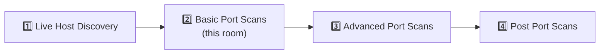

In the previous room we saw the **three steps** of an Nmap scan so far:

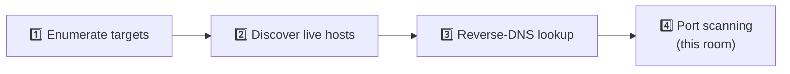

**Next step:** checking which ports are **open** (listening) and which are **closed**. This room explains three types of port scans:

| # | Scan type | Option |
|---|-----------|--------|
| 1 | **TCP Connect** scan | `-sT` |
| 2 | **TCP SYN** scan | `-sS` |
| 3 | **UDP** scan | `-sU` |

It also covers specifying ports, scan timing, and the number of parallel probes.

---

## 🔌 TCP and UDP ports

Just as an IP address identifies a **host** on a network, a **TCP or UDP port** identifies a **network service** running on that host.

### 📌 Key rules

- Each port number is usually tied to a specific service (for example, **HTTP → TCP 80**, **HTTPS → TCP 443**).
- An administrator can choose a different port number if needed.
- **On the same IP address**, only **one service** can listen on a given TCP or UDP port at a time.

| Protocol | Default port | Service |
|----------|---------------|---------|
| DNS | UDP **53** | Domain name resolution |
| SSH | TCP **22** | Secure remote access |
| HTTP | TCP **80** | Web |
| HTTPS | TCP **443** | Encrypted web |

### 🚥 A simplified two-state view

| State | Meaning |
|-------|---------|
| 🟢 **Open** | A service is listening on the port |
| 🔴 **Closed** | No service is listening on the port |

### 🧩 But in reality: Nmap's 6 states

Accounting for firewalls, Nmap uses a more precise set of **six states**:

| # | State | Explanation |
|---|-------|--------------|
| 1 | 🟢 **Open** | A service is listening on the given port |
| 2 | 🔴 **Closed** | No service, but the port is **accessible** (not blocked by a firewall) |
| 3 | 🟡 **Filtered** | Nmap **can't tell** if it's open or closed — usually a firewall blocks Nmap's probe or the response |
| 4 | ⚪ **Unfiltered** | The port is accessible, but open/closed is unknown (seen with an ACK scan, `-sA`) |
| 5 | 🟠 **Open\|Filtered** | Nmap can't decide between open and filtered |
| 6 | 🟤 **Closed\|Filtered** | Nmap can't decide between closed and filtered |

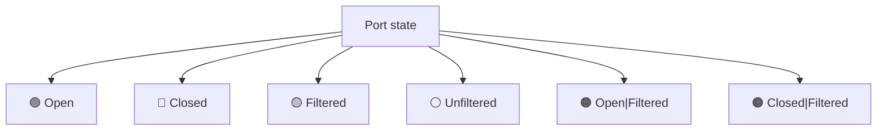

> 🎯 **The most interesting state for a pentester: `Open`.** An open port means there's a service there worth investigating, possibly misconfigured.

### 🧪 Hint for the hands-on task

Find DNS's default UDP port and SSH's default TCP port in the table above. Remember how many port states Nmap distinguishes (6).

---

## 🚩 TCP flags

To understand the difference between TCP scans, we need to look at the **TCP header**.

| Property | Value |
|----------|-------|
| TCP header size | **24 bytes** (first portion) |
| Defined in | **RFC 793** |
| Port fields | **16 bits (2 bytes)** each: source and destination port |
| Sequence/ack numbers | **32 bits (4 bytes)** each |

### 🏳️ Six main flags

A flag being "set" means its value is **1**:

| Flag | Name | Meaning |
|------|------|---------|
| **URG** | Urgent | The incoming data is **urgent** and should be processed immediately, without waiting on previous segments |
| **ACK** | Acknowledgement | The acknowledgement number is significant — confirms **receipt** of a segment |
| **PSH** | Push | Asks TCP to pass the data to the application **promptly** |
| **RST** | Reset | **Resets** the connection — a firewall or a port with no listening service can send it |
| **SYN** | Synchronize | **Initiates the 3-way handshake**, synchronizes sequence numbers |
| **FIN** | Finish | The sender **has no more data** to send |

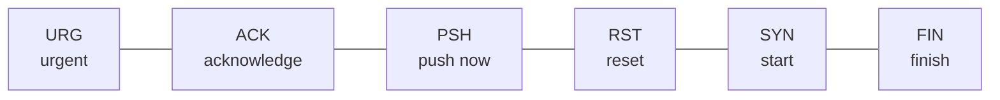

> 🔑 **The three most important ones for Nmap's scans: SYN, ACK, RST.** The first step of starting a TCP connection is sending a packet with the **SYN** flag set.

### 🧪 Hint for the hands-on task

Remember the Reset flag's three-letter abbreviation (RST) and which flag appears in the **first packet** of the TCP 3-way handshake (SYN).

---

## 🤝 TCP Connect scan

**TCP Connect scan** works by **completing the full 3-way handshake**.

### 🔄 A normal TCP connection

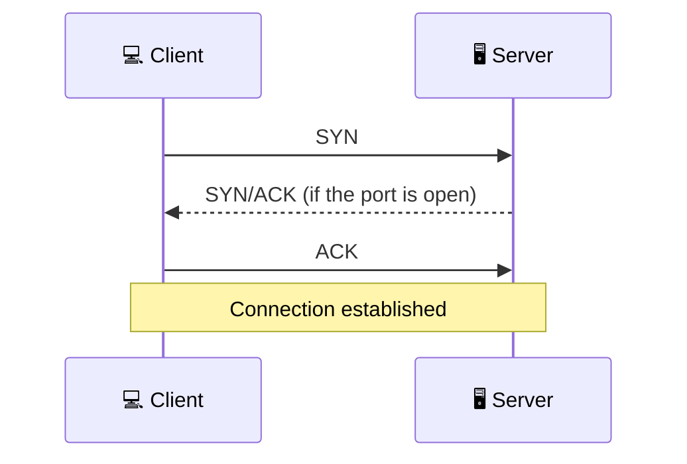

Nmap's goal isn't to **establish** a connection, it's to **learn** whether the port is open. So as soon as the state is confirmed, Nmap sends **RST/ACK** to **tear it down** immediately.

```bash
nmap -sT TARGET_IP
```

### 👤 Who can use it?

> ⚠️ **Important rule:** If you're **not a privileged user** (not root or a sudoer), TCP Connect scan is the **only option** to discover open TCP ports.

### 📊 What it looks like in Wireshark

| Port state | Traffic pattern |
|-------------|------------------|
| 🔴 Closed | Nmap sends `SYN` → target replies with **RST/ACK** |
| 🟢 Open | Nmap sends `SYN` → target replies with **SYN/ACK** → Nmap sends `ACK` (connection fully established) → immediately torn down with **RST/ACK** |

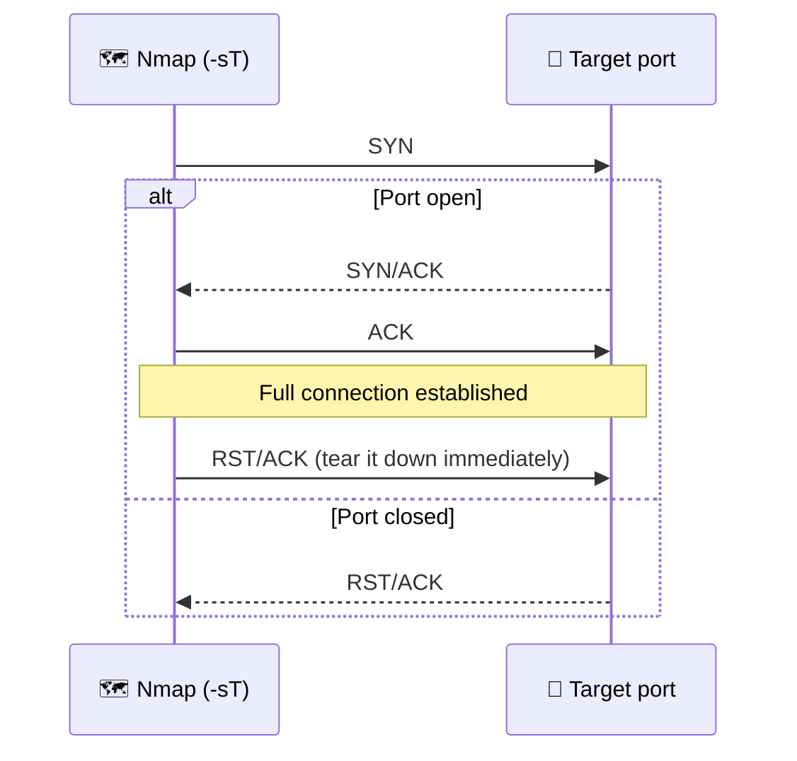

> 📦 By default, Nmap checks the **1000 most common ports**.

### 💻 Example result

```bash
nmap -sT TARGET_IP
```

The output shows **PORT / STATE / SERVICE** columns: which port is open and the likely service name.

### ⚙️ Extra options

| Option | Explanation |
|--------|-------------|
| `-F` | **Fast mode** — check the **100 most common ports** instead of 1000 |
| `-r` | Scan ports in **sequential order** (not random) — useful to observe how ports open, for example during a target's boot process |

### 🧪 Hint for the hands-on task

Compare the same target against an earlier scan: which port is **newly open**? Check Nmap's **guessed service name** (for example `pop3`) in the `SERVICE` column.

---

## 🥷 TCP SYN scan

### 🔐 Why does it exist?

Unprivileged users are limited to Connect scan. But the **default scan mode is SYN scan**, and running it requires a **privileged (root/sudoer) user**.

### 🔄 How does it differ?

SYN scan **doesn't complete the 3-way handshake** — the connection is torn down as soon as the server responds.

```bash
sudo nmap -sS TARGET_IP
```

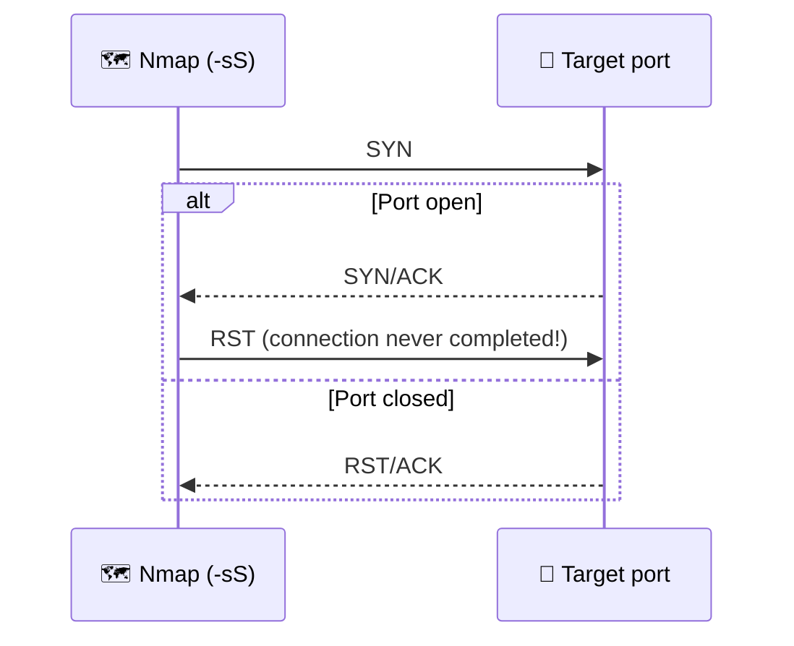

### 🕵️ Why is it considered "stealthier"?

> 💡 Because a full TCP connection is **never established**, there's a **lower chance** the scan gets logged. Some applications only log **completed** connections.

### ⚖️ Connect vs SYN: spotting the difference

| | TCP Connect (`-sT`) | TCP SYN (`-sS`) |
|---|---|---|
| Handshake | **Fully completed** (SYN → SYN/ACK → ACK) | **Not completed** (SYN → SYN/ACK → RST) |
| Permission needed | None | **Privileged (root/sudo)** |
| Logging likelihood | Higher | Lower |
| Default mode | Only for unprivileged users | **Default with root/sudo** |
| Result accuracy | Same | Same |

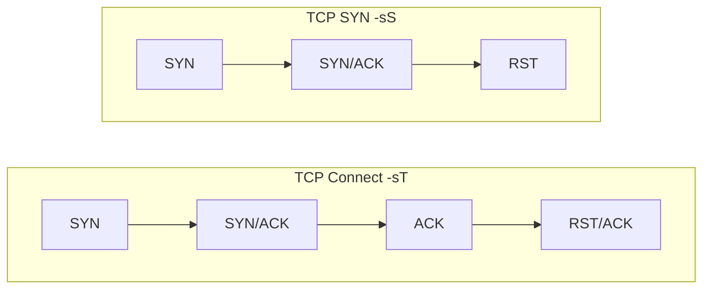

> ✅ **The result is the same:** SYN scan finds the same open ports as Connect scan, but a **full TCP connection is never established** with the target.

### 🧪 Hint for the hands-on task

Find the **newly installed service** on a target compared to an earlier scan. Nmap's service name is a guess (for example, `irc` based on the port number).

---

## 📡 UDP scan

### 🔌 How is UDP different?

**UDP is a connectionless protocol** — no handshake is required. So there's **no guarantee** a service listening on a UDP port will respond to packets.

### 🧭 The core logic: silence shows openness

| Packet sent | If port is open | If port is closed |
|--------------|-------------------|----------------------|
| UDP packet | **No response at all** | **ICMP Type 3, Code 3** (Destination Unreachable, Port Unreachable) |

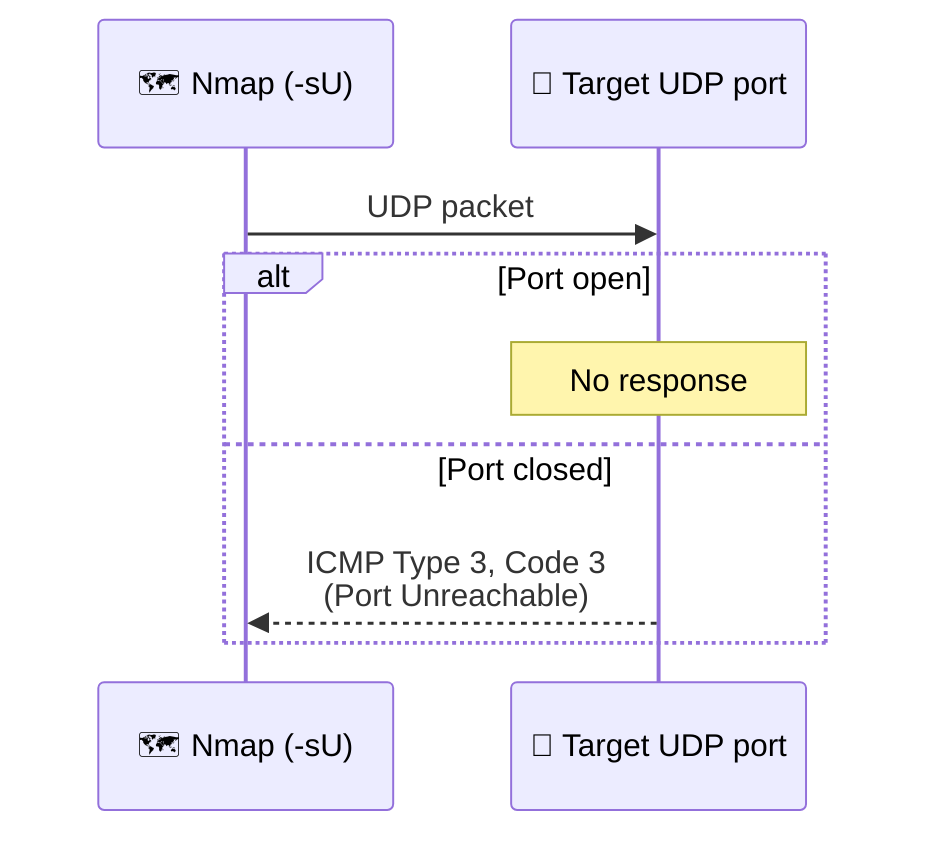

> 🧠 **The logic is inverted:** in TCP, a response confirms an open port. In UDP, **silence** (no response at all) leads Nmap to **assume the port is "open"**, because no ICMP error arrived.

```bash
sudo nmap -sU TARGET_IP
```

> 🔀 A UDP scan can also be **combined with a TCP scan** in the same command.

### ⏱️ Why is a UDP scan so slow?

Since no reply comes back for open ports, Nmap has to **wait for a timeout**, which can drastically extend the total scan time (sometimes **measured in minutes**).

### 🤔 An ambiguous state: `open|filtered`

If neither a response nor an ICMP error arrives (for example, if a firewall blocks ICMP), Nmap marks the port as **`open|filtered`** — it can't **confirm** it's open, but it also can't **rule out** that it's closed.

### 🧪 Hint for the hands-on task

Use `-F` to speed up a UDP scan (the 100 most common UDP ports). Find the newly opened port in the `PORT` column and its service name in `SERVICE`.

---

## ⚙️ Fine-tuning scope and performance

### 🎯 Choosing ports

| Format | Example | Result |
|--------|---------|--------|
| 📋 **List** | `-p22,80,443` | Only ports 22, 80, 443 |
| 📏 **Range** | `-p1-1023` | All ports from 1 to 1023 |
| 🌐 **All ports** | `-p-` | All **65535** ports |
| ⚡ **Most common** | `-F` | The **100** most common ports |
| 🔝 **Top N** | `--top-ports 10` | The **10** most common ports |

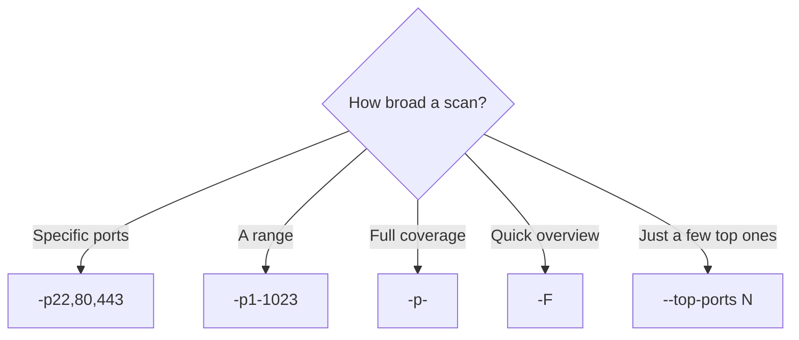

### ⏱️ Timing templates (`-T0` – `-T5`)

| Value | Name | Speed | When to use |
|-------|------|-------|-------------|
| `-T0` | Paranoid | Slowest | Maximum stealth — waits **5 minutes** between probes |
| `-T1` | Sneaky | Very slow | **Real engagements** where stealth matters |
| `-T2` | Polite | Slow | To conserve network resources |
| `-T3` | Normal | **Default** | Standard scanning |
| `-T4` | Aggressive | Fast | Often used in **CTFs and practice targets** |
| `-T5` | Insane | Fastest | Trades **accuracy for speed** (risk of packet loss) |

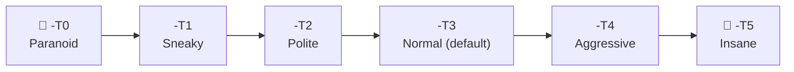

> ⚠️ **Trade-off:** `-T5` is fastest, but **results may be less accurate** since packet loss is more likely. `-T0`/`-T1` are chosen to avoid IDS alerts, but they're **very slow**.

### 📊 Controlling packet rate

```bash
--min-rate <number>
--max-rate <number>
```

Example: `--max-rate 10` → **no more than 10 packets per second**.

### 🧵 Controlling parallelism

```bash
--min-parallelism <number>
--max-parallelism <number>
```

Example: `--min-parallelism=512` → Nmap tries to maintain at least **512 probes in parallel** (for host discovery and port probes).

### 🧪 Hint for the hands-on task

Apply the port-selection format (`-pSTART-END`) to scan all TCP ports between 5000 and 5500. Remember the option that forces at least 64 parallel probes (`--min-parallelism`) and the slowest/most cautious mode (`-T0`).

---

## 📊 Summary: scan types and options

### 🔎 The three core scan types

| Scan type | Example command |
|-----------|------------------|
| TCP Connect Scan | `nmap -sT TARGET_IP` |
| TCP SYN Scan | `sudo nmap -sS TARGET_IP` |
| UDP Scan | `sudo nmap -sU TARGET_IP` |

### ⚙️ Scope and performance options

| Option | Purpose |
|--------|---------|
| `-p-` | All ports |
| `-p1-1023` | Ports 1 to 1023 |
| `-F` | Top 100 most common ports |
| `-r` | Scan ports in sequential order |
| `-T<0-5>` | `-T0` slowest, `-T5` fastest |
| `--max-rate 50` | Rate ≤ 50 packets/sec |
| `--min-rate 15` | Rate ≥ 15 packets/sec |
| `--min-parallelism 100` | At least 100 probes in parallel |

### 🧭 Which scan to choose when?

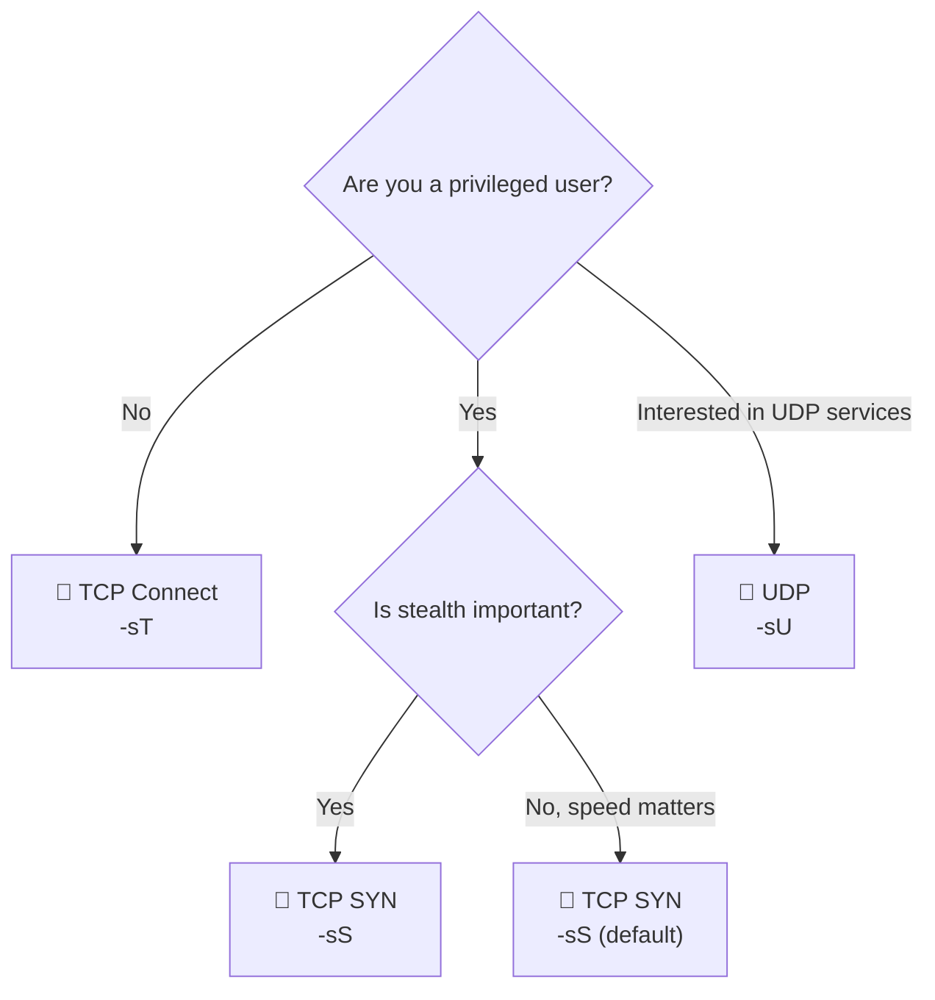

---

## 🛡️ The defender's view

> 📎 This section is based on general knowledge.

| Scan type | Detection / defensive measure |
|-----------|-------------------------------|
| TCP Connect | Look for short, sequential connections across completed-connection logs and application-level logs |
| TCP SYN | IDS/IPS rules looking for **half-open handshakes** (SYN sent, no following ACK) |
| UDP | Monitor the generation of many "port unreachable" ICMP messages in a short time |
| Aggressive timing (`-T4`/`-T5`) | Detect many connection attempts to different ports in a short window (a port-scan signature) |
| General | Rate-limiting, tools like fail2ban, honeypot ports, disabling unnecessary services |

---

## 📖 Glossary

| Term | Short explanation |
|------|-------------------|
| **Port** | A number identifying a specific network service on a host |
| **Open / Closed** | A port has a listening service / doesn't (simplified view) |
| **Filtered** | State can't be determined because of a firewall |
| **Unfiltered** | Accessible, but open/closed is unknown (seen with an ACK scan) |
| **TCP header** | The first 24 bytes of a TCP segment |
| **SYN / ACK / RST / FIN / PSH / URG** | The TCP header's six flags |
| **3-way handshake** | SYN → SYN/ACK → ACK sequence to set up a TCP connection |
| **TCP Connect scan** | Checking port state via a full handshake (`-sT`) |
| **TCP SYN scan** | Checking port state via a half-open handshake (`-sS`) |
| **UDP scan** | Checking port state via UDP packets and ICMP responses (`-sU`) |
| **Connectionless** | A protocol that works without establishing a connection (UDP) |
| **ICMP Type 3 / Code 3** | Destination Unreachable / Port Unreachable error |
| **Privileged user** | A user who can run as root or via sudo |
| **Timing template (-T0…-T5)** | Predefined profiles controlling scan speed |
| **Rate control** | Limiting packets per second with `--min-rate`/`--max-rate` |
| **Parallelism** | The number of simultaneous probes, via `--min-parallelism`/`--max-parallelism` |
| **IDS/IPS** | Intrusion detection/prevention systems |

---

## 📝 Test yourself

<details>
<summary><b>1. How many port states does Nmap distinguish, and what are they?</b></summary>

Six: Open, Closed, Filtered, Unfiltered, Open|Filtered, Closed|Filtered.
</details>

<details>
<summary><b>2. Which port state is most interesting for a pentester?</b></summary>

Open.
</details>

<details>
<summary><b>3. Which flag appears in the first packet of the TCP 3-way handshake?</b></summary>

SYN.
</details>

<details>
<summary><b>4. How does a TCP Connect scan (-sT) work?</b></summary>

It completes the full 3-way handshake (SYN → SYN/ACK → ACK), then tears the connection down with RST/ACK.
</details>

<details>
<summary><b>5. How does TCP SYN scan (-sS) differ from Connect scan?</b></summary>

It doesn't complete the handshake — as soon as SYN/ACK arrives, it sends RST to tear it down. This requires a privileged user and is logged less often.
</details>

<details>
<summary><b>6. Which scan type is an unprivileged user limited to?</b></summary>

TCP Connect scan (-sT), since SYN scan requires privileged access.
</details>

<details>
<summary><b>7. What's expected for an open vs closed port in a UDP scan?</b></summary>

An open port usually gives no reply. A closed port returns ICMP Type 3, Code 3 (Port Unreachable).
</details>

<details>
<summary><b>8. Why is a UDP scan much slower than a TCP scan?</b></summary>

Since no reply comes for open ports, Nmap has to wait for a timeout on each probe.
</details>

<details>
<summary><b>9. What does the `-F` option do?</b></summary>

Scans the 100 most common ports instead of the default 1000 (fast mode).
</details>

<details>
<summary><b>10. Which timing template is slowest, which is fastest, and why be cautious with speed?</b></summary>

`-T0` (paranoid) is slowest, `-T5` (insane) is fastest. `-T5` can trade accuracy for speed, since the risk of packet loss increases.
</details>

---

## 📚 Sources

- TryHackMe: [Nmap Basic Port Scans room](https://tryhackme.com/room/nmap02) (do the hands-on part there yourself)
- [List of TCP and UDP port numbers - Wikipedia](https://en.wikipedia.org/wiki/List_of_TCP_and_UDP_port_numbers)
- [Nmap - official site](https://nmap.org/)
- [Nmap - manual](https://nmap.org/book/man.html)
- [Nmap - Wikipedia](https://en.wikipedia.org/wiki/Nmap)
- [TCP - Wikipedia](https://en.wikipedia.org/wiki/Transmission_Control_Protocol)
- [UDP - Wikipedia](https://en.wikipedia.org/wiki/User_Datagram_Protocol)
- [RFC 793 - TCP](https://datatracker.ietf.org/doc/html/rfc793.html)

> ℹ️ These notes were written in my own words for personal learning. The diagrams were drawn with Mermaid. The room's specific IP addresses and exact task answers (specific port numbers) are not included; explanations and hints are given instead.
