# 🗺️ Nmap Live Host Discovery: Detailed Study Notes

> Finding which systems are online with ARP, ICMP, and TCP/UDP before port-scanning.
> Written while working through the TryHackMe **"Nmap Live Host Discovery"** room.


---

## 📋 About the room

| | |
|---|---|
| 🧭 Type | Walkthrough |
| 🟡 Difficulty | Medium |
| 🏷️ Tags | Linux |
| 💳 Subscription | Free |
| 🔗 Room | [tryhackme.com/room/nmap01](https://tryhackme.com/room/nmap01) |
| 🎯 Goal | Discover live hosts using ARP, ICMP and TCP/UDP ping scans |
| 📍 Place | Room 1 of the Network Security module's Nmap series |

---

## 📑 Table of Contents

1. [Introduction: what is Nmap and why does it matter?](#-introduction-what-is-nmap-and-why-does-it-matter)
2. [Subnetworks](#-subnetworks)
3. [Enumerating targets](#-enumerating-targets)
4. [How to discover live hosts: a protocol overview](#-how-to-discover-live-hosts-a-protocol-overview)
5. [Nmap host discovery using ARP](#-nmap-host-discovery-using-arp)
6. [Nmap host discovery using ICMP](#-nmap-host-discovery-using-icmp)
7. [Nmap host discovery using TCP and UDP](#-nmap-host-discovery-using-tcp-and-udp)
8. [Reverse-DNS lookup](#-reverse-dns-lookup)
9. [Summary: command table](#-summary-command-table)
10. [The defender's view](#-the-defenders-view)
11. [Glossary](#-glossary)
12. [Test yourself](#-test-yourself)
13. [Sources](#-sources)

> ⚖️ **Legal notice:** The examples use placeholders `TARGET_IP`/`TARGET_SUBNET`. Scanning should only be done on networks and systems **you own or are explicitly authorized to test**. ARP scans, ICMP probes, and SYN/ACK packets **leave traces and can generate logs** on the network.

---

## 🎯 Introduction: what is Nmap and why does it matter?

Targeting a network raises two key questions:

| # | Question |
|---|----------|
| 1️⃣ | Which systems are **up**? |
| 2️⃣ | Which **services** are running on them? |

This room answers the **first question**. The second is answered in the next rooms of the Nmap series (port scanning).

### 🗂️ The Nmap series

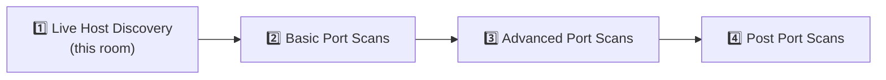

> ⏱️ **Why host discovery first?** Port-scanning an offline system wastes time and creates unnecessary network "noise".

### 🧰 Three approaches in this room

| Approach | Explanation |
|----------|-------------|
| 🔗 **ARP scan** | Uses ARP requests to find live hosts |
| 📶 **ICMP scan** | Uses ICMP requests to identify live hosts |
| 🔌 **TCP/UDP ping scan** | Sends packets to TCP/UDP ports and checks the response |

Two extra tools are also introduced: **`arp-scan`** and **`masscan`** — they overlap with Nmap's host discovery.

### 🧑‍💻 About Nmap

| | |
|---|---|
| 👤 Creator | Gordon Lyon (**Fyodor**) |
| 📅 First release | 1997 |
| 🏷️ Full name | **N**etwork **Map**per |
| 💳 License | Free, open source, **GPL** |
| 🏆 Status | An **industry-standard** network mapping tool |

> 🧩 Nmap's **scripting engine (NSE)** extends its functionality: from service fingerprinting to exploiting vulnerabilities.

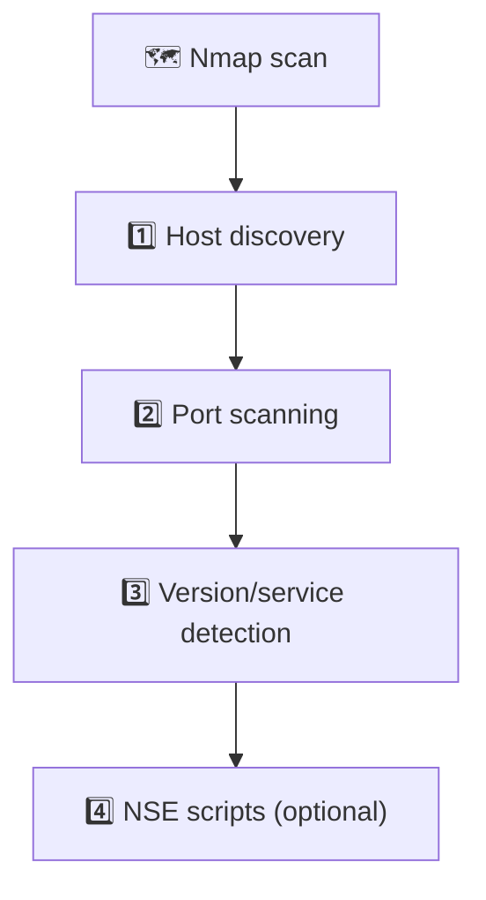

---

## 🧩 Subnetworks

### 🔑 Two terms

| Term | Meaning |
|------|---------|
| 🔌 **Network segment** | A group of computers connected via a shared medium (Ethernet switch, WiFi access point) — a **physical** connection |
| 🌐 **Subnetwork (subnet)** | One or more segments joined and using the **same router** — a **logical** connection |

### 📏 Two common subnet sizes

| Subnet | Mask | Approx. hosts |
|--------|------|----------------|
| `/16` | `255.255.0.0` | ~65,000 |
| `/24` | `255.255.255.0` | ~250 |

> 📚 For more on subnetting: Task 2 of TryHackMe's *Intro to LAN* room.

### 🔗 ARP: why does it only work within its own subnet?

ARP (Address Resolution Protocol) finds a **MAC (hardware) address** so that link-layer communication is possible. A host replying to an ARP query is **online**.

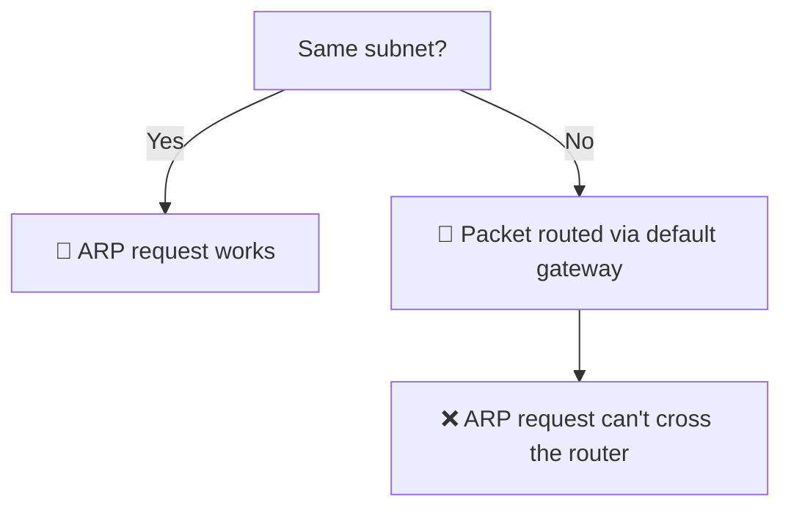

> 🧱 **Core rule:** ARP is a **link-layer protocol**, so its packets are **bound to their subnet**. Packets to a target on another subnet are routed via the **default gateway**, but ARP requests **cannot cross it**.

### 🧪 Example in the network simulator

In the room's simulator, when `computer1` sends a **broadcast ARP Request** to the whole network (asking for `computer6`'s MAC address):

| Question | Answer |
|----------|--------|
| How many devices see the request? | All devices on the same segment (via the switch) |
| Does `computer6` receive it? | Only **if it's on the same segment** |

> 💡 This shows that an ARP broadcast only reaches devices **on the same physical segment** — it doesn't cross the router.

---

## 🎯 Enumerating targets

Nmap accepts targets as a **list, range, or subnet**.

| Method | Example | Result |
|--------|---------|--------|
| 📋 **List** | `TARGET_IP scanme.nmap.org example.com` | 3 IPs scanned |
| 📏 **Range** | `10.11.12.15-20` | 6 IPs (`.15`–`.20`) |
| 🌐 **Subnet** | `TARGET_IP/30` | 4 IPs |
| 📄 **From a file** | `nmap -iL list_of_hosts.txt` | Hosts listed in the file |

### 🔍 Viewing the list without scanning

```bash
nmap -sL TARGETS
```

> 📡 This option doesn't **send** any probe packets, it just lists the targets Nmap would scan. By default, though, Nmap sends a **reverse-DNS** query for each target (names can reveal information). Add `-n` to skip DNS.

```bash
nmap -sL -n TARGET_SUBNET
```

### 🧮 Calculation examples

| Target expression | How many IPs? |
|--------------------|----------------|
| `/29` subnet | 8 IPs (3 host bits: 2³ = 8) |
| `10.10.0-255.101-125` | `125-101+1 = 25` hosts per subnet, **256 subnets** × 25 = **6400** IPs |

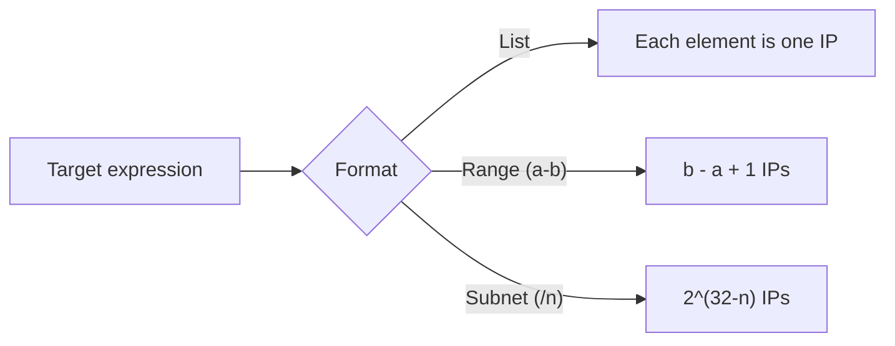

---

## 🔬 How to discover live hosts: a protocol overview

Looking at the TCP/IP layers bottom-up, host discovery uses **four protocols**:

| Layer | Protocol |
|-------|----------|
| 🔗 Link Layer | **ARP** |
| 🌐 Network Layer | **ICMP** |
| 🚚 Transport Layer | **TCP** |
| 🚚 Transport Layer | **UDP** |

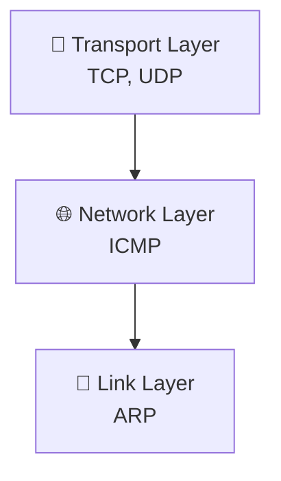

### 📌 A quick reminder

| Protocol | How it works |
|----------|---------------|
| **ARP** | Sends a request to the broadcast address, asking the computer with a specific IP for its MAC address |
| **ICMP** (ping) | **Type 8 (Echo)** request, **Type 0 (Echo Reply)** response |
| **TCP/UDP** | Sending packets to specific ports and checking for a response (especially useful when ICMP Echo is blocked) |

> 🔗 **Important rule:** If the target is on the **same subnet**, an ARP query **must precede** ICMP Echo (the MAC address is needed first).

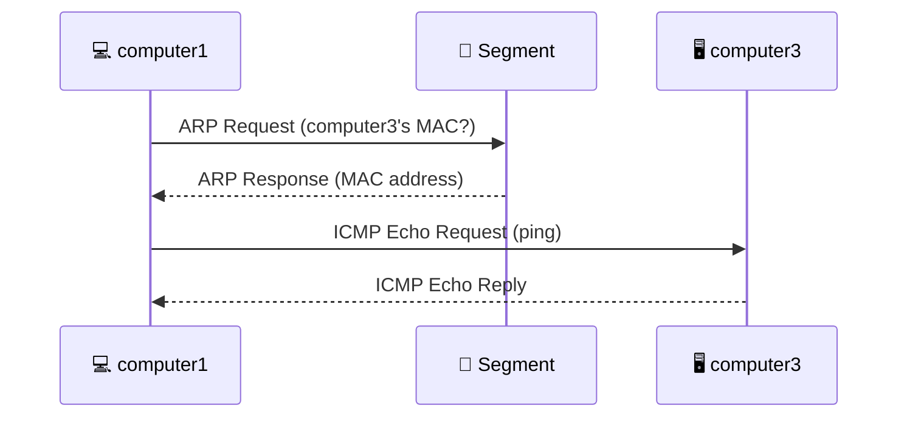

### 🧪 Simulator examples

| Scenario | Result |
|----------|--------|
| `computer1` pings `computer3` | First an **ARP Request**, then an **ARP Response**, finally the ping reply |
| `computer2` pings `computer5` | The first ARP Request is answered by the **router** (for routing), the second ARP Request directly by **computer5** |
| Sending the same ping again | **No new ARP Request needed** — the result is already cached |

> 🧠 **Takeaway:** ARP results are **cached**. Repeated contact with the same target doesn't require a fresh ARP query each time.

---

## 🔗 Nmap host discovery using ARP

Without any host-discovery option specified, Nmap follows this **default logic**:

| Condition | Nmap's behavior |
|-----------|-------------------|
| **Privileged** user + local network (Ethernet) | **ARP** requests |
| **Privileged** user + outside the local network | ICMP echo + TCP ACK (port 80) + TCP SYN (port 443) + ICMP timestamp |
| **Unprivileged** user + outside the local network | TCP 3-way handshake (SYN → port 80, 443) |

> 👤 **Privileged user:** `root` or a user who can run `sudo` (`sudoers`).

### ⚙️ Host discovery only (no port scan)

```bash
nmap -sn TARGETS
```

### 🔗 ARP scan only

```bash
sudo nmap -PR -sn TARGET_SUBNET
```

| Element | Meaning |
|---------|---------|
| `-PR` | Use **only** ARP scanning |
| `-sn` | **Don't** port-scan, host discovery only |

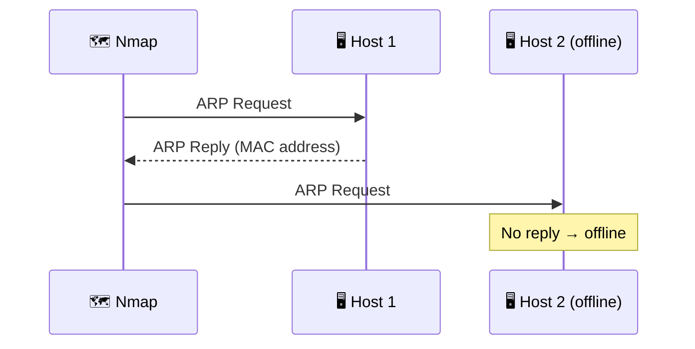

> 🧠 **Why does the ARP scan show MAC addresses?** Because you're on the same subnet, the ARP reply includes the host's MAC. Scanning from a different subnet, the MAC address **won't appear** (because ARP doesn't work there).

### 🛠️ Alternative tool: `arp-scan`

```bash
arp-scan --localnet   # or shorthand:
arp-scan -l
```

| Option | Meaning |
|--------|---------|
| `-l` / `--localnet` | Send ARP requests to all valid IPs on the local network |
| `-I INTERFACE` | Choose a specific network interface (for example `eth0`) |

```bash
sudo arp-scan -I eth0 -l
```

> 📦 `arp-scan` isn't installed on the AttackBox by default, but can be added with `apt install arp-scan`.

When run around the same time, `nmap -PR -sn` and `arp-scan` produce **similar results** and **similar traffic patterns** (verifiable with Wireshark).

### 🧪 Hint for the hands-on task

In the simulator, send an ARP Request from `computer1` to each of the 8 other devices (try each one separately). Notice how many are **on the same segment** — only those will respond.

---

## 📶 Nmap host discovery using ICMP

### 1️⃣ ICMP Echo (`-PE`)

The simplest approach: send a **ping** (ICMP Type 8) to every IP and wait for an **Echo Reply** (Type 0).

```bash
sudo nmap -PE -sn TARGET_SUBNET
```

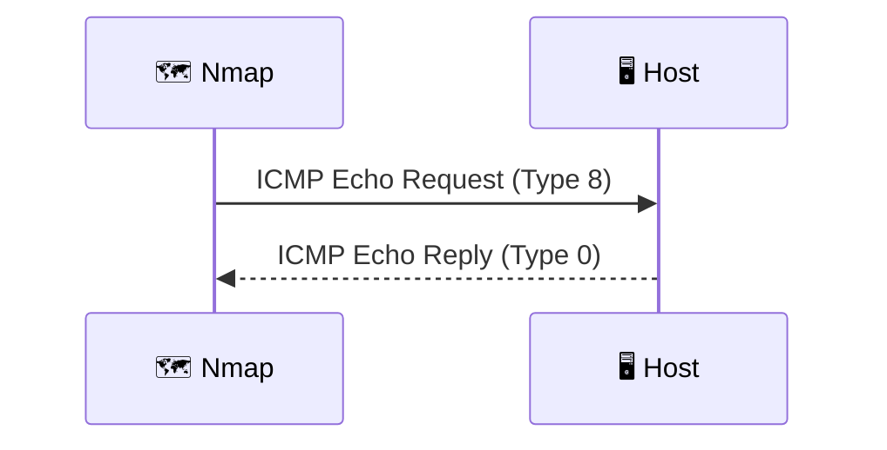

> ⚠️ **Reliability issue:** Many firewalls block ICMP echo. Recent Windows versions are configured with a **host firewall that blocks ICMP echo requests by default**.

#### 🔍 Same subnet vs different subnet

| Situation | What shows up in the result? |
|-----------|-------------------------------|
| Scanning **from the same subnet** | Hosts' **MAC addresses** also appear (because ARP ran in the background) |
| Scanning **from a different subnet** | Only "Host is up" — **no MAC address** |

> 🧠 Interesting nuance: on the same subnet, Nmap sometimes doesn't even need to send ICMP, because the **ARP reply already confirms** the host is online.

### 2️⃣ ICMP Timestamp (`-PP`)

An alternative when ICMP echo is blocked: send a **Timestamp request** (Type 13), expect a **Timestamp reply** (Type 14).

```bash
sudo nmap -PP -sn TARGET_SUBNET
```

### 3️⃣ ICMP Address Mask (`-PM`)

Another alternative: send an **Address Mask request** (Type 17), expect an **Address Mask reply** (Type 18).

```bash
sudo nmap -PM -sn TARGET_SUBNET
```

> ⚠️ **Practical observation:** This scan type often gets **no response at all**, because the target or a firewall on the path blocks this ICMP type — even when other scans show the hosts are online. This shows why it's important to **try another method when one is blocked**.

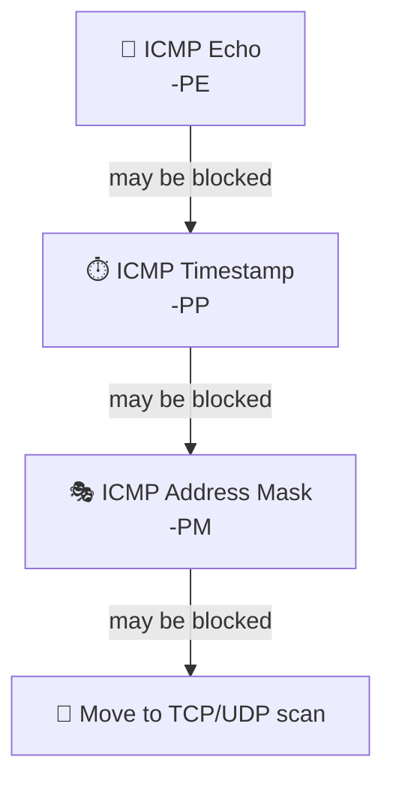

### 📊 Comparing ICMP options

| Option | ICMP request type | ICMP reply type |
|--------|---------------------|---------------------|
| `-PE` | Echo (8) | Echo Reply (0) |
| `-PP` | Timestamp (13) | Timestamp Reply (14) |
| `-PM` | Address Mask (17) | Address Mask Reply (18) |

### 🧪 Hint for the hands-on task

Remember all three options (`-PE`, `-PP`, `-PM`) — the room tests each one with a separate question.

---

## 🔌 Nmap host discovery using TCP and UDP

### 1️⃣ TCP SYN Ping (`-PS`)

Sends a packet with the **SYN flag** set (default port 80). Expected responses:

| Port state | Response |
|-------------|----------|
| 🟢 Open | **SYN/ACK** |
| 🔴 Closed | **RST** |

> 🧠 **Key logic:** the port's actual state doesn't matter — **any response** confirms the host is online.

```bash
nmap -PS -sn TARGET_SUBNET      # default port 80
nmap -PS21 -sn TARGET_SUBNET    # port 21
nmap -PS21-25 -sn TARGET_SUBNET # ports 21-25
nmap -PS80,443,8080 -sn TARGET_SUBNET
```

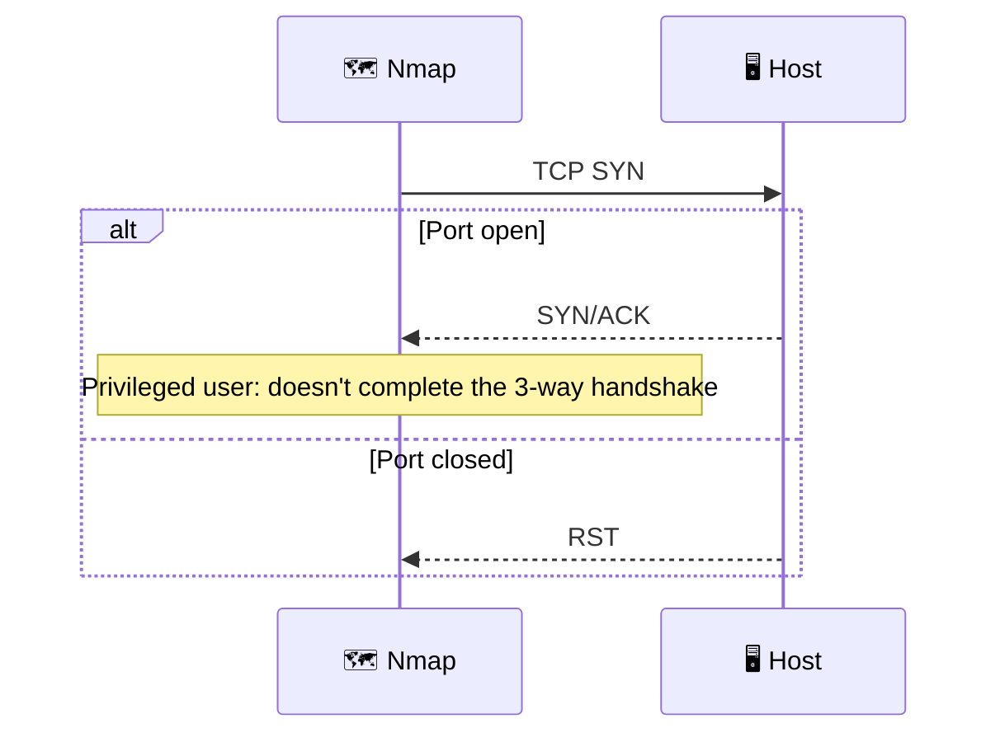

> 👤 **Privileged vs unprivileged:** A privileged user **doesn't need to complete** the full 3-way handshake even if the port is open. An unprivileged user, if the port is open, **must complete it**.

### 2️⃣ TCP ACK Ping (`-PA`)

Sends a packet with the **ACK flag** set. This is **only possible for a privileged user** (if an unprivileged user tries, Nmap falls back to a 3-way handshake).

```bash
sudo nmap -PA -sn TARGET_SUBNET     # default port 80
sudo nmap -PA21 -sn TARGET_SUBNET
sudo nmap -PA21-25 -sn TARGET_SUBNET
sudo nmap -PA80,443,8080 -sn TARGET_SUBNET
```

> 🧩 **Why does it work?** An ACK-flagged packet isn't part of **any active connection**, so the target replies with **RST** regardless of whether the port is open or closed. That reply confirms the host is online.

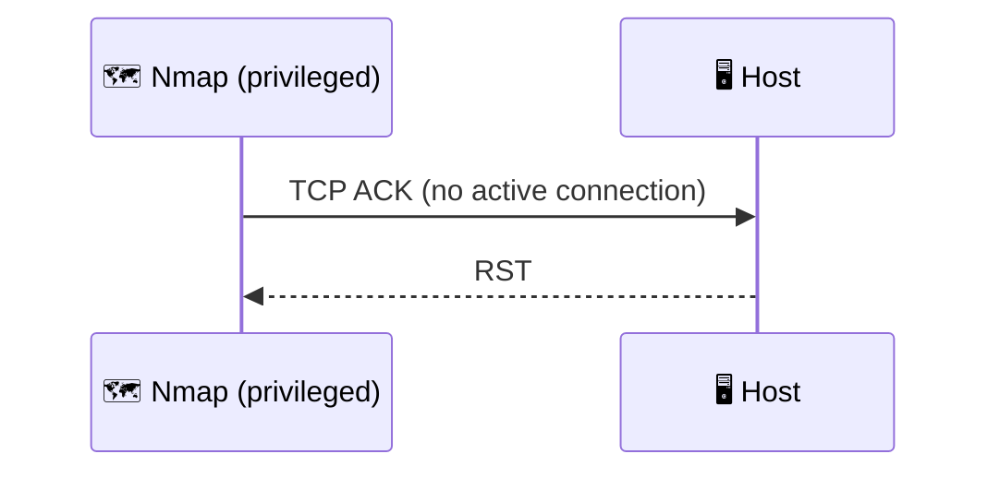

### 3️⃣ UDP Ping (`-PU`)

Sends a **UDP packet**. The logic is **the opposite of TCP SYN**:

| Port state | Response |
|-------------|----------|
| 🟢 Open | **No response** (expected!) |
| 🔴 Closed | **ICMP port unreachable** |

```bash
nmap -PU -sn TARGET_SUBNET
```

> 🧠 Nmap sometimes picks **uncommon/less-used UDP ports** since they're **more likely to be closed**, which triggers the ICMP "port unreachable" response that confirms the host is online.

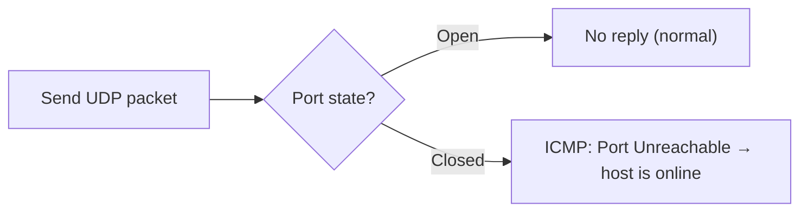

### ⚖️ Comparing the three TCP/UDP methods

| Method | Option | Privilege needed | Response indicator |
|--------|--------|--------------------|----------------------|
| **TCP SYN Ping** | `-PS` | Not required (unprivileged can use it too) | SYN/ACK **or** RST |
| **TCP ACK Ping** | `-PA` | **Privileged required** | RST |
| **UDP Ping** | `-PU` | — | ICMP port unreachable (on a closed port) |

### 🚀 Masscan: a fast alternative

**Masscan** uses a similar approach, but with a **much more aggressive packet rate**.

```bash
masscan TARGET_SUBNET -p443
masscan TARGET_SUBNET -p80,443
masscan TARGET_SUBNET -p22-25
masscan TARGET_SUBNET --top-ports 100
```

> 📦 Not installed on the AttackBox by default, can be added with `apt install masscan`.

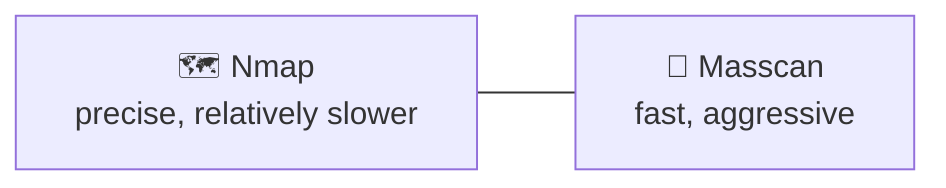

### 🧪 Hint for the hands-on task

What option would you write for a TCP SYN ping scan against the Telnet port (23)? (Recall the `-PS` + port number format.)

---

## 🔎 Reverse-DNS lookup

| Option | Behavior |
|--------|----------|
| *(default)* | Reverse-DNS lookup for **online** hosts only |
| `-n` | **Don't** send any DNS query |
| `-R` | Reverse-DNS lookup for **all** hosts (including offline ones) |
| `--dns-servers DNS_SERVER` | Use a specific DNS server |

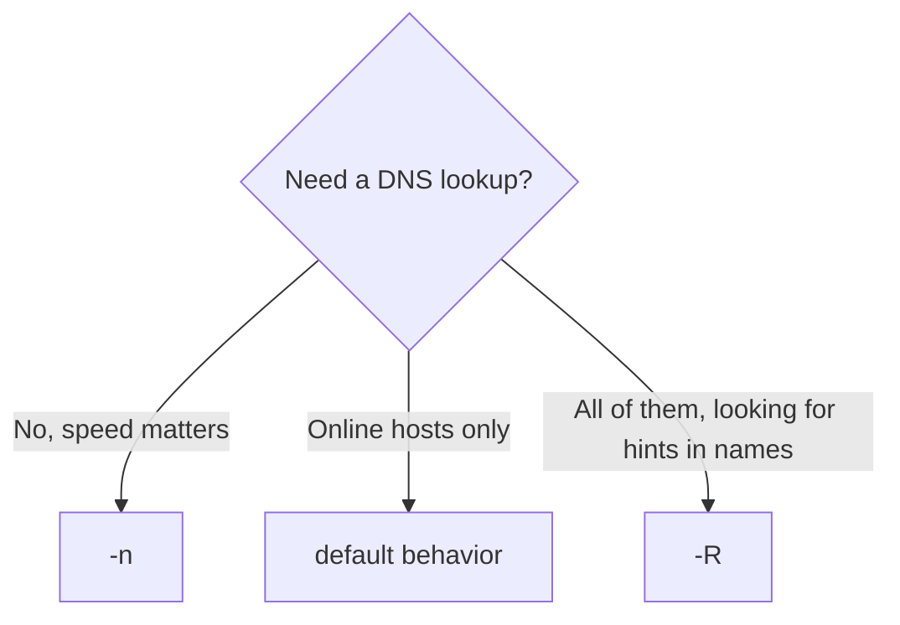

> 💡 **Why does it matter?** Hostnames can reveal a lot: department, server role, technology, etc. So reverse-DNS is **useful for a pentester**, but it's a step that generates **extra traffic** on the network.

### 🧪 Hint for the hands-on task

If you want a reverse-DNS query for **every** possible host in a subnet (online or not), which option do you add?

---

## 📊 Summary: command table

| Scan type | Example command |
|-----------|------------------|
| ARP Scan | `sudo nmap -PR -sn TARGET_SUBNET` |
| ICMP Echo Scan | `sudo nmap -PE -sn TARGET_SUBNET` |
| ICMP Timestamp Scan | `sudo nmap -PP -sn TARGET_SUBNET` |
| ICMP Address Mask Scan | `sudo nmap -PM -sn TARGET_SUBNET` |
| TCP SYN Ping Scan | `sudo nmap -PS22,80,443 -sn TARGET_SUBNET` |
| TCP ACK Ping Scan | `sudo nmap -PA22,80,443 -sn TARGET_SUBNET` |
| UDP Ping Scan | `sudo nmap -PU53,161,162 -sn TARGET_SUBNET` |

> 📌 **Don't forget `-sn`** — otherwise Nmap will automatically move on to **port-scanning** the hosts it finds.

| Option | Purpose |
|--------|---------|
| `-n` | No DNS lookup |
| `-R` | Reverse-DNS for all hosts |
| `-sn` | Host discovery only (no port scan) |

### 🧭 Which method to choose when?

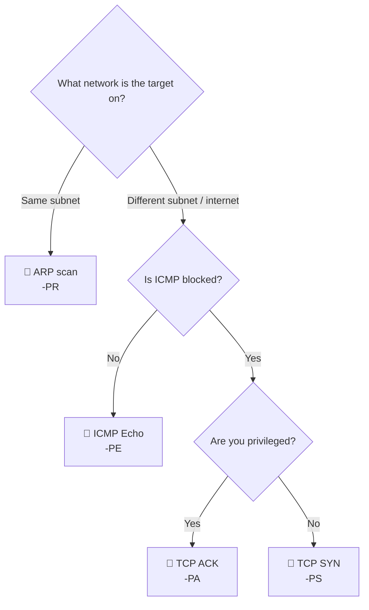

---

## 🛡️ The defender's view

> 📎 This section is based on general knowledge.

| Scan type | Detection / defensive measure |
|-----------|-------------------------------|
| ARP scan | Monitor high volumes of ARP requests, guard against ARP spoofing |
| ICMP Echo/Timestamp/Mask | Block unnecessary ICMP types on the firewall (in balance — blocking everything also hinders diagnostics) |
| TCP SYN/ACK ping | IDS/IPS rules that detect SYN floods and port-scan patterns |
| UDP ping | Monitor unusual UDP traffic and the frequency of "port unreachable" replies |
| Reverse-DNS queries | Detect spikes in internal DNS log volume |
| General | Honeypots/decoy hosts, rate-limiting, host firewall rules |

---

## 📖 Glossary

| Term | Short explanation |
|------|-------------------|
| **Nmap** | A network mapping and host/port discovery tool |
| **Network segment** | A group of devices connected via a shared medium (physical) |
| **Subnet** | A logical part of a network sharing the same router |
| **ARP** | A link-layer protocol that finds MAC addresses |
| **ICMP** | A messaging protocol for network diagnostics |
| **Echo / Echo Reply** | ICMP ping request (Type 8) / reply (Type 0) |
| **Timestamp / Timestamp Reply** | ICMP time request (Type 13) / reply (Type 14) |
| **Address Mask / Reply** | ICMP subnet mask request (Type 17) / reply (Type 18) |
| **TCP SYN/ACK/RST** | TCP flags: start / acknowledge / reset a connection |
| **3-way handshake** | SYN → SYN/ACK → ACK sequence to set up a TCP connection |
| **Privileged user** | A user who can run as root or via sudo |
| **Host discovery** | The stage of finding which systems are online |
| **Port scanning** | The stage of finding which ports are open |
| **arp-scan** | A dedicated ARP-based host discovery tool |
| **Masscan** | A very fast, aggressive port/host scanner |
| **Reverse-DNS** | A query that finds a hostname from an IP address |
| **NSE** | Nmap Scripting Engine, which extends Nmap's functionality |
| **Wireshark / tcpdump** | Tools for capturing and analyzing network traffic |

---

## 📝 Test yourself

<details>
<summary><b>1. Why is host discovery done before port scanning?</b></summary>

Port-scanning an offline system wastes time and creates unnecessary network "noise".
</details>

<details>
<summary><b>2. Why does an ARP scan only work on the same subnet?</b></summary>

ARP is a link-layer protocol, and its packets are bound to their subnet — they can't cross a router.
</details>

<details>
<summary><b>3. What role does ARP play when pinging a host on the same subnet?</b></summary>

Before sending ICMP Echo, an ARP Request/Response happens first to learn the target's MAC address.
</details>

<details>
<summary><b>4. What do the options `-PR`, `-PE`, `-PP`, `-PM`, `-PS`, `-PA`, `-PU` mean?</b></summary>

Host discovery via ARP, ICMP Echo, ICMP Timestamp, ICMP Address Mask, TCP SYN, TCP ACK, and UDP.
</details>

<details>
<summary><b>5. What's the main difference between TCP SYN ping and TCP ACK ping?</b></summary>

SYN ping can be used by an unprivileged user too (the handshake must then be completed). ACK ping is only for a privileged user and always expects an RST reply.
</details>

<details>
<summary><b>6. What's expected for an open vs closed port in a UDP ping?</b></summary>

An open port usually gives no reply. A closed port returns an ICMP "port unreachable" message, which confirms the host is online.
</details>

<details>
<summary><b>7. What is the `-sn` option for?</b></summary>

To perform host discovery only, without moving on to a port scan.
</details>

<details>
<summary><b>8. What's the difference between `-n` and `-R`?</b></summary>

`-n` sends no DNS query at all. `-R` sends a reverse-DNS query for all hosts, including offline ones.
</details>

<details>
<summary><b>9. Why does the ICMP Address Mask scan often return no results?</b></summary>

Because this ICMP type is frequently blocked by the target or a firewall on the path, even when the host is actually online.
</details>

<details>
<summary><b>10. What's Masscan's main difference from Nmap?</b></summary>

Masscan uses a similar approach but sends packets at a much more aggressive rate to finish scans quickly.
</details>

---

## 📚 Sources

- TryHackMe: [Nmap Live Host Discovery room](https://tryhackme.com/room/nmap01) (do the hands-on part there yourself)
- [Address Resolution Protocol - Wikipedia](https://en.wikipedia.org/wiki/Address_Resolution_Protocol)
- [arp-scan - GitHub](https://github.com/royhills/arp-scan)
- [arp-scan - User Guide](https://github.com/royhills/arp-scan/wiki/arp-scan-User-Guide)
- [ICMP - Wikipedia](https://en.wikipedia.org/wiki/Internet_Control_Message_Protocol)
- [Nmap - official site](https://nmap.org/)
- [Nmap - manual](https://nmap.org/book/man.html)
- [Nmap - Wikipedia](https://en.wikipedia.org/wiki/Nmap)
- [TCP - Wikipedia](https://en.wikipedia.org/wiki/Transmission_Control_Protocol)
- [UDP - Wikipedia](https://en.wikipedia.org/wiki/User_Datagram_Protocol)

> ℹ️ These notes were written in my own words for personal learning. The diagrams were drawn with Mermaid. The room's specific task answers (exact IPs, host counts, etc.) are not included; the calculation logic is explained instead.
