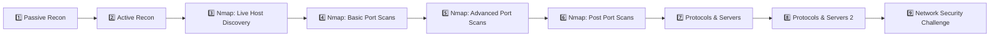
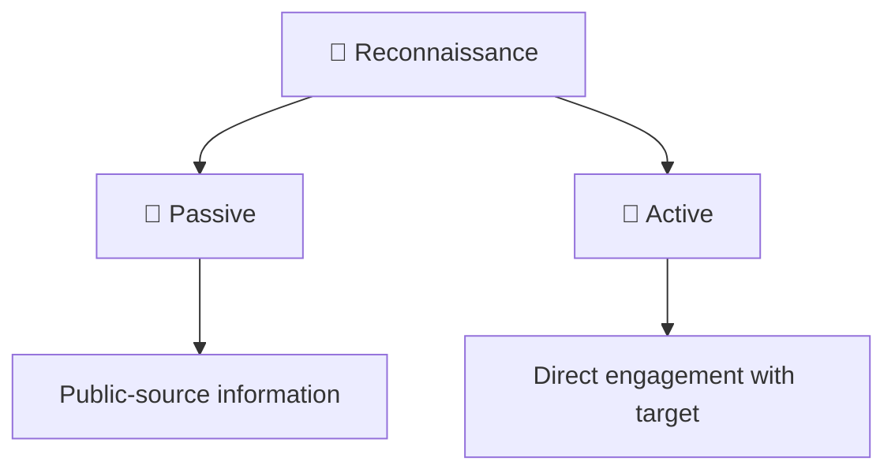
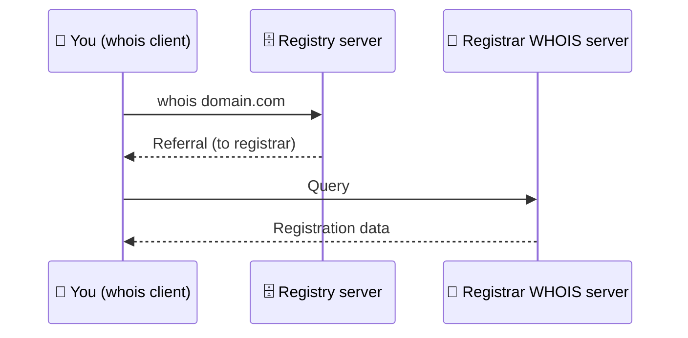
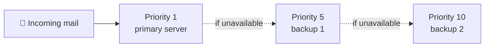
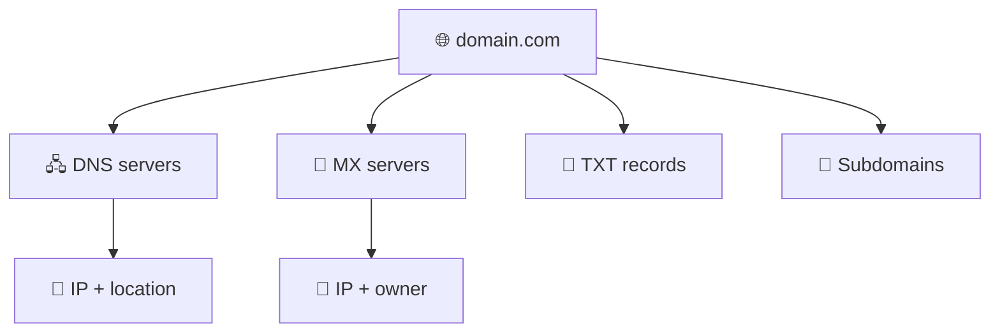
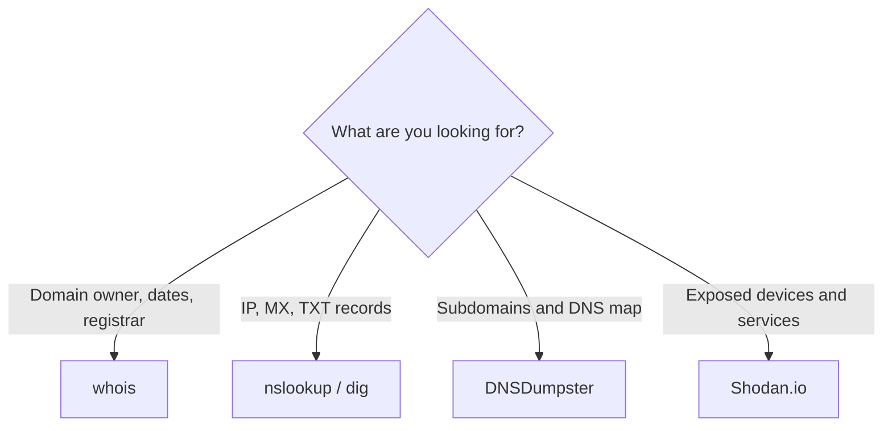

# 🔭 Passive Reconnaissance: Detailed Study Notes

> Techniques and tools for gathering information without directly touching the target.
> Written while working through the TryHackMe **"Passive Reconnaissance"** room.


---

## 📋 About the room

| | |
|---|---|
| 🧭 Type | Walkthrough |
| 🟢 Difficulty | Easy |
| 🏷️ Tags | Linux |
| 💳 Subscription | Free |
| 🔗 Room | [tryhackme.com/room/passiverecon](https://tryhackme.com/room/passiverecon) |
| 🎯 Goal | Passive recon with `whois`, `nslookup`, `dig`, DNSDumpster and Shodan |

---

## 📑 Table of Contents

1. [Introduction and the Network Security module](#-introduction-and-the-network-security-module)
2. [Passive vs active reconnaissance](#-passive-vs-active-reconnaissance)
3. [WHOIS](#-whois)
4. [nslookup and dig](#-nslookup-and-dig)
5. [DNSDumpster](#-dnsdumpster)
6. [Shodan.io](#-shodanio)
7. [Summary: command table](#-summary-command-table)
8. [The defender's view](#-the-defenders-view)
9. [Glossary](#-glossary)
10. [Test yourself](#-test-yourself)
11. [Sources](#-sources)

> ⚖️ **Legal notice:** Passive recon uses lawful public information sources, but once you move to **active** steps you need explicit **written permission**. These notes are for **authorized testing, education and defense** only.

---

## 🎯 Introduction and the Network Security module

This is the **first room** of TryHackMe's **Network Security** module. The module sequence:



### 🛠️ What will you learn in this room?

**3 command-line tools:**

| Tool | Used for |
|------|----------|
| `whois` | Querying WHOIS servers (domain registration info) |
| `nslookup` | Querying DNS servers |
| `dig` | Querying DNS servers (more detailed) |

**2 online services:**

| Service | Used for |
|---------|----------|
| **DNSDumpster** | Shows subdomain and DNS information in one place |
| **Shodan.io** | A search engine for internet-connected devices |

> 💡 All of this is **public information**, so it doesn't alert the target.

### 📚 Prerequisites

- Basic networking knowledge
- Basic familiarity with the command line
- Helpful modules: *Network Fundamentals*, *Linux Fundamentals*

### ⚠️ Practical notes

- This room has **no target virtual machine (VM)**. Queries go to **public WHOIS and DNS servers** for domains owned by TryHackMe.
- You need to start the **AttackBox**, especially for tasks 3 and 4.
- Without a subscription the AttackBox may not have internet access, so you'd need a **VPN** for questions that require the internet.

---

## 🧭 Passive vs active reconnaissance

> 📜 In *The Art of War*, Sun Tzu says that if you know the enemy and know yourself, victory isn't in doubt. For an attacker, that means gathering information about the target. **For a defender, it means knowing what an adversary could discover about your systems.**

**Reconnaissance (recon)** is a preliminary survey to gather information about a target. It's the first step of the **Unified Kill Chain** and serves to gain an initial foothold.



### 🤫 Passive reconnaissance

Relies on publicly available knowledge **without directly engaging the target**.

> 🔭 **Analogy:** looking at the target's territory **from afar** without setting foot on it.

**Examples:**
- Looking up a domain's DNS records on a public DNS server
- Reading job ads related to the target
- Reading news articles about the company

### 📡 Active reconnaissance

Requires **direct engagement** with the target and can't be done discreetly.

> 🚪 **Analogy:** **checking the locks** on doors and windows.

**Examples:**
- Connecting to company servers (HTTP, FTP, SMTP)
- Calling the company to get information (social engineering)
- Entering the premises pretending to be a repairman

### ⚖️ Comparison

| | 🤫 Passive | 📡 Active |
|---|---|---|
| Contact with target | None | Yes |
| Stealth | High | Low |
| Legal risk | Low | **High**, permission is essential |
| Example | WHOIS, DNS records, news | Connecting to a server, phoning |

> ⚠️ Active recon is invasive. Without **proper legal authorization** you can quickly get into legal trouble.

### 🧪 Self-check: scenarios

| Scenario | Type |
|----------|------|
| Visiting the target's social media page to collect employee names | 🤫 Passive |
| Pinging the web server's IP to see whether ICMP is blocked | 📡 Active |
| Meeting the target's IT admin at a party and asking about their systems | 📡 Active |

---

## 🪪 WHOIS

**WHOIS** is a request-response protocol (**RFC 3912**). A WHOIS server listens on **TCP port 43**. The **registrar** maintains WHOIS records for the domains it leases.

### 🔍 What can you learn?

| Information | Explanation |
|-------------|-------------|
| 🏢 **Registrar** | Which registrar the domain was registered through |
| 👤 **Registrant contact** | Name, organization, address, phone (unless hidden by a privacy service) |
| 📅 **Dates** | Creation, update and expiration dates |
| 🖧 **Name Server** | Servers that resolve the domain |

### 💻 Usage

```bash
whois DOMAIN_NAME
whois tryhackme.com
```



### 🧠 How to read the output

1. **Redirect lines:** the query first goes to the registry, then is referred to the registrar's WHOIS server that holds the records.
2. **Dates:** show the domain's age and whether it's renewed in time.
3. **Registrar and registrant:** who manages it, who owns it.
4. **Admin and tech contacts** (may not show fully in the output).
5. **Name Servers:** where to query for DNS records.

### 🎯 Value for a pentester

The data can reveal **new attack surfaces**, for example social engineering or technical attacks. If the **scope** allows it, the admin's email server or the DNS servers could be examined further.

### 🔒 Privacy nuance

- Because automated tools abuse WHOIS to harvest email addresses, many WHOIS services **redact emails**.
- Many registrants subscribe to **privacy services** to avoid spam. In that case the privacy provider's name appears instead of the owner's.

### 🧪 Hint for the hands-on task

In the `whois tryhackme.com` output, look at three things: **Creation Date**, **Registrar WHOIS Server / URL**, and the **Name Server** lines.

---

## 🌐 nslookup and dig

WHOIS gave general domain information, including DNS servers. Now we **query DNS records**.

### 🔧 nslookup

**nslookup** = *Name Server Look Up*.

```bash
nslookup DOMAIN_NAME
nslookup -type=A tryhackme.com 1.1.1.1
nslookup OPTIONS DOMAIN_NAME SERVER
```

| Parameter | Explanation |
|-----------|-------------|
| **OPTIONS** | Query type (for example `-type=A`) |
| **DOMAIN_NAME** | The domain you look up |
| **SERVER** | The DNS server to query |

### 🌍 Public DNS servers

| Provider | Addresses |
|----------|-----------|
| Cloudflare | `1.1.1.1`, `1.0.0.1` |
| Google | `8.8.8.8`, `8.8.4.4` |
| Quad9 | `9.9.9.9`, `149.112.112.112` |

### 📒 DNS record types

| Type | Result | Why it's useful |
|------|--------|-----------------|
| **A** | IPv4 addresses | Finding the target's IPs |
| **AAAA** | IPv6 addresses | IPv6 presence |
| **CNAME** | Canonical Name | Domain aliases |
| **MX** | Mail servers | Understanding email infrastructure |
| **SOA** | Start of Authority | Administrative info about the zone |
| **TXT** | Text records | Various configuration and verification data |

### 📌 A records

From one domain name you can get **several IPv4 addresses**. Each IP, **if it's within scope**, can later be checked separately from a security standpoint.

### 📧 MX records

```bash
nslookup -type=MX tryhackme.com
```

- **MX** shows the mail exchange servers.
- Each server has a **priority number**. **Lower number = higher priority.** A mail server tries the lowest-numbered one first and moves to the next if it's unavailable.
- In the example, mail is handled by **Google**. In such cases you don't expect outdated, vulnerable mail server versions. In other cases, though, you may find poorly secured or unpatched mail servers.



### 🕵️ TXT and other records

Other types such as `-type=txt` should also be tried, since they may hold **unexpected information**.

### 🔬 dig

**dig** = *Domain Information Groper*. It gives more detail than `nslookup` (for example **TTL** is shown by default).

```bash
dig DOMAIN_NAME
dig DOMAIN_NAME TYPE
dig @SERVER DOMAIN_NAME TYPE
dig @1.1.1.1 tryhackme.com MX
```

| Parameter | Explanation |
|-----------|-------------|
| **SERVER** | The DNS server to query |
| **DOMAIN_NAME** | The domain you look up |
| **TYPE** | The DNS record type |

### ⚖️ nslookup vs dig

| | nslookup | dig |
|---|---|---|
| Output | Simple | More detailed (TTL, etc.) |
| Server choice | At the end | At the start with `@SERVER` |
| Use | Quick checks | Deeper DNS analysis |

### 🧪 Hint for the hands-on task

Query the **TXT records** of `thmlabs.com`. `nslookup -type=txt` or `dig ... txt` is enough.

---

## 🗺️ DNSDumpster

`nslookup` and `dig` **can't discover subdomains on their own**. Yet subdomains such as `wiki.` or `webmail.` can hold a lot of information. Subdomains that aren't updated regularly often lead to **vulnerable services**.

### Ways to find subdomains

| Way | Note |
|-----|------|
| 🔎 Use several search engines | One isn't enough, you need to go through tens of results |
| 🔨 Brute-force queries | Checking which subdomains have DNS records (time-consuming) |
| 🌐 An online service like **DNSDumpster** | Fast and visual |

### ✨ What does DNSDumpster provide?

- 🖧 The domain's DNS servers
- 🔢 Domain names resolved to IPs, plus **geolocation**
- 📧 MX records, each with IP, owner and location
- 📝 TXT records
- 🌳 The data as a **graph** (DNS and MX branching to servers)
- 🧩 Subdomains not found by an ordinary DNS query (for example `blog.`)
- 📤 A beta feature to export the graph



> 🖼️ **Note:** The DNSDumpster and Shodan screenshots in the original file live in an `Images/` folder. To include them in your own repo, put **screenshots you took yourself** in that folder.

---

## 🛰️ Shodan.io

**Shodan.io** tries to connect to **every reachable device online** and stores the responses in a **searchable database**. So it's not a web page search engine, it's a **search engine for "things"**.

### 🔍 What can one record tell you?

| Information | Explanation |
|-------------|-------------|
| 🔢 IP address | The device's address |
| 🏢 Hosting company | Where it's hosted |
| 🌍 Geographic location | Country, city |
| 🖥️ Server type and version | For example a web server and its version |

### 🎯 Two points of view

| Role | Use |
|------|-----|
| 🕵️ **Pentester** | Gather info about a client's network **without connecting directly** |
| 🛡️ **Defender** | Find the organization's **devices left exposed** to the internet |

### 💡 Tips

- You can also search Shodan for IPs obtained from DNS lookups (they may change quickly).
- Search options are explained on Shodan's **help** page.
- TryHackMe has a separate **Shodan** room.
- **No premium account is needed** to answer the questions.

### 🧪 Hint for the hands-on task

In Shodan's **statistics (Facets/Top)** section look at the breakdown by country and by port. You can see the most common ports for Apache and nginx there.

---

## 📊 Summary: command table

| Purpose | Command example |
|---------|-----------------|
| WHOIS record | `whois tryhackme.com` |
| DNS A records | `nslookup -type=A tryhackme.com` |
| DNS MX records (at a specific server) | `nslookup -type=MX tryhackme.com 1.1.1.1` |
| DNS TXT records | `nslookup -type=TXT tryhackme.com` |
| DNS A records (dig) | `dig tryhackme.com A` |
| DNS MX records (at a specific server) | `dig @1.1.1.1 tryhackme.com MX` |
| DNS TXT records (dig) | `dig tryhackme.com TXT` |

### 🧰 Which tool when?



> 💡 The power of these tools is that they let you collect a lot of information **without connecting directly** to the target. Once you master the search options and get used to reading results, the amount of information can be huge.

---

## 🛡️ The defender's view

> 📎 This section is based on general knowledge.

| Risk | Defensive measure |
|------|-------------------|
| Personal data in WHOIS | Use a **privacy service** |
| Unnecessary subdomains left exposed | Keep a subdomain inventory and remove old ones |
| Sensitive info in TXT records | Review DNS records regularly |
| Forgotten devices exposed to the internet | Search Shodan for **your own organization** |
| Technology leaks through job ads | Avoid unnecessary technical detail in postings |

---

## 📖 Glossary

| Term | Short explanation |
|------|-------------------|
| **Reconnaissance** | Preliminary information gathering about a target |
| **Passive recon** | Recon without direct contact with the target |
| **Active recon** | Recon that requires direct contact with the target |
| **Unified Kill Chain** | A framework describing the stages of an attack |
| **Social engineering** | Tricking people into giving information or access |
| **WHOIS** | Protocol providing domain registration info (RFC 3912, TCP 43) |
| **Registrar** | The company that registers domains |
| **Registrant** | The domain's owner |
| **Name Server** | A server that answers DNS queries for the domain |
| **DNS** | The system translating domain names to IP addresses |
| **A / AAAA** | IPv4 / IPv6 records |
| **MX** | Mail exchange server record |
| **TXT** | Text record |
| **CNAME** | Domain alias |
| **SOA** | The zone's authority record |
| **TTL** | How long a record may be cached |
| **Subdomain** | A sub-part of a main domain (for example `blog.domain.com`) |
| **DNSDumpster** | An online service for DNS and subdomain recon |
| **Shodan** | A search engine for internet-connected devices |
| **AttackBox** | TryHackMe's browser-based attack machine |
| **Scope** | The boundary of targets authorized for testing |
| **OSINT** | Open-source intelligence |

---

## 📝 Test yourself

<details>
<summary><b>1. What is the main difference between passive and active recon?</b></summary>

Passive recon relies on public sources without direct contact with the target. Active recon requires direct engagement and legal authorization.
</details>

<details>
<summary><b>2. Is reading the target's social media and news articles passive or active?</b></summary>

Passive.
</details>

<details>
<summary><b>3. Which port does WHOIS listen on, and which RFC defines it?</b></summary>

TCP 43, RFC 3912.
</details>

<details>
<summary><b>4. Which four main pieces of information does WHOIS give?</b></summary>

Registrar, registrant contact, creation/update/expiration dates, and name servers.
</details>

<details>
<summary><b>5. Why do some WHOIS records show no personal info?</b></summary>

Because of spam and automated harvesting, services redact emails, and registrants use privacy services.
</details>

<details>
<summary><b>6. What does the priority number in an MX record mean?</b></summary>

The order of mail servers. A lower number means higher priority, and if it's unavailable the next server is tried.
</details>

<details>
<summary><b>7. What is dig's main advantage over nslookup?</b></summary>

It gives more detailed output, for example showing TTL by default.
</details>

<details>
<summary><b>8. Why aren't nslookup/dig enough to find subdomains, and what helps?</b></summary>

They only query names you already know. To find subdomains you need search engines, brute-forcing or services like DNSDumpster.
</details>

<details>
<summary><b>9. How does Shodan differ from an ordinary search engine?</b></summary>

It indexes internet-connected devices and services instead of web pages.
</details>

<details>
<summary><b>10. How can a defender use Shodan?</b></summary>

To find and close devices and services their own organization has left exposed to the internet.
</details>

---

## 📚 Sources

- TryHackMe: [Passive Reconnaissance room](https://tryhackme.com/room/passiverecon) (do the hands-on part there yourself)
- [dig - Linux manual](https://linux.die.net/man/1/dig)
- [nslookup - Linux manual](https://linux.die.net/man/1/nslookup)
- [whois - Linux manual](https://linux.die.net/man/1/whois)
- [DNSDumpster](https://dnsdumpster.com/)
- [Shodan](https://www.shodan.io/)
- [WHOIS - Wikipedia](https://en.wikipedia.org/wiki/WHOIS)
- [Domain Name System - Wikipedia](https://en.wikipedia.org/wiki/Domain_Name_System)

> ℹ️ These notes were written in my own words for personal learning. The diagrams are redrawn with Mermaid. The room's flag and task answers are not included.
