# 🧨 Protocols and Servers 2: Detailed Study Notes

> Attacks against passwords and cleartext traffic; mitigation via SSH and SSL/TLS.
> Written while working through the TryHackMe **"Protocols and Servers 2"** room.

🌐 Languages: [Azərbaycanca](protocols-and-servers-2.md) | **English**

---

## 📋 About the room

| | |
|---|---|
| 🧭 Type | Walkthrough |
| 🟡 Difficulty | Medium |
| 🏷️ Tags | Linux |
| 💳 Subscription | Premium |
| 🔗 Room | [tryhackme.com/room/protocolsandservers2](https://tryhackme.com/room/protocolsandservers2) |
| 🎯 Goal | Sniffing, MITM and password attacks; mitigation via SSH and SSL/TLS |
| 📍 Place | Room 8 of the Network Security module |

---

## 📑 Table of Contents

1. [Introduction: CIA and DAD](#-introduction-cia-and-dad)
2. [Sniffing attack](#-sniffing-attack)
3. [Man-in-the-Middle (MITM) attack](#-man-in-the-middle-mitm-attack)
4. [Transport Layer Security (TLS)](#-transport-layer-security-tls)
5. [Secure Shell (SSH)](#-secure-shell-ssh)
6. [Password attack](#-password-attack)
7. [Summary: protocol and Hydra table](#-summary-protocol-and-hydra-table)
8. [Glossary](#-glossary)
9. [Test yourself](#-test-yourself)
10. [Sources](#-sources)

> ⚖️ **Legal notice:** This room covers attack techniques (sniffing, MITM, password attacks). These should only be tried **on your own systems or in a lab environment you are explicitly authorized to test**. The examples use placeholders like `TARGET_IP` and `USERNAME`. These notes are for **defense and understanding**.

---

## 🎯 Introduction: CIA and DAD

In the previous room (**Protocols and Servers**) we covered Telnet, HTTP, FTP, SMTP, POP3 and IMAP. Servers implementing these protocols face various attacks:

| # | Attack type |
|---|-------------|
| 1 | 🕵️ **Sniffing** (network packet capture) |
| 2 | 🥷 **Man-in-the-Middle (MITM)** |
| 3 | 🔑 **Password attack** (authentication attack) |
| 4 | 🐞 **Vulnerabilities** (not covered here, has its own module) |

### 🛡️ The CIA triad

To understand what we're protecting, consider the **CIA** triad:

| Letter | Term | Meaning |
|--------|------|---------|
| **C** | **Confidentiality** | Keeping communication content accessible only to intended parties |
| **I** | **Integrity** | Assuring data is accurate, consistent and complete on arrival |
| **A** | **Availability** | Being able to access the service when needed |

> 🏦 Confidentiality matters most to an intelligence agency, integrity to online banking, and availability to an ad-funded platform.

### 💥 DAD: the attacker's goal

Opposite to CIA, an attacker aims for **DAD**:

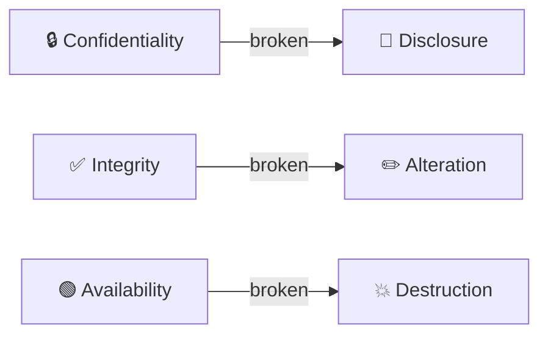

| CIA | When broken (DAD) | Example attack |
|-----|---------------------|-----------------|
| Confidentiality | **Disclosure** | Network packet capture (sniffing), password attacks |
| Integrity | **Alteration** | Man-in-the-Middle |
| Availability | **Destruction** | Denial of Service (DoS) |

> 🧩 **A vulnerability by itself** only creates a risk; damage occurs only when it's **exploited**. This room focuses not on vulnerabilities but on three attacks (sniffing, MITM, password) **inherent to protocol design and server implementation**.

### 🗺️ Room map

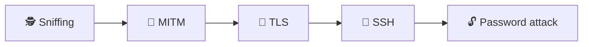

---

## 🕵️ Sniffing attack

**Sniffing** means using a network packet capture tool to collect information about the target. If a protocol communicates in **cleartext**, a third party can capture and analyze the exchanged data: the content of private messages, login credentials, and so on.

### ⚙️ Requirements

- An **Ethernet (802.3)** network card
- Proper permissions: **root on Linux**, **administrator on Windows**

### 🛠️ Tools

| Tool | Type | Explanation |
|------|------|-------------|
| **Tcpdump** | CLI | Free, open source, ported to many OSes |
| **Wireshark** | GUI | Free, open source, Linux/macOS/Windows |
| **Tshark** | CLI | A command-line alternative to Wireshark |

> 💡 Specialized tools for capturing passwords and full messages exist, but Tcpdump and Wireshark can achieve it too with a bit of extra effort.

### 🎯 Prerequisite: access to the traffic

This attack requires **access to the traffic between two communicating systems**:

| Path | Explanation |
|------|-------------|
| 🔌 Wiretap | Physically tapping the network link |
| 🔀 Port mirroring | Mirroring a switch port |
| 🥷 A successful MITM | The attacker inserts themself (next section) |

### 💻 Tcpdump example: capturing POP3 traffic

```bash
sudo tcpdump port 110 -A
```

| Part | Meaning |
|------|---------|
| `sudo` | Packet capture requires **root** |
| `port 110` | Filter for **POP3** traffic only |
| `-A` | Show packets in **ASCII** |

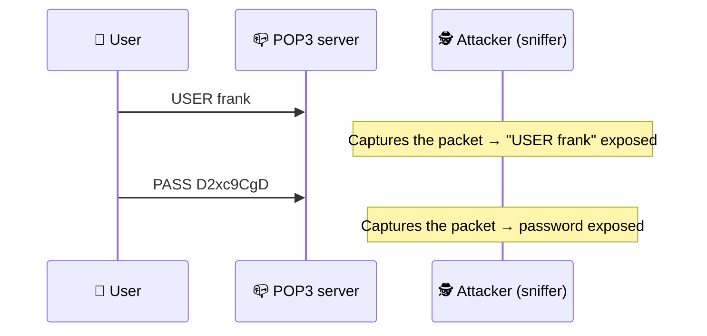

In the output, the **username and password appear clearly in separate packets**: one carries `USER ...`, the other `PASS ...`.

### 🖼️ With Wireshark

The same result can be achieved in Wireshark by typing the protocol's name (for example `pop`) in the **filter field**. Once filtered, the username and password show up in the relevant packets.

### 🛡️ Mitigation

> ⚠️ **Any protocol that uses cleartext** is vulnerable to this attack. The only requirement is that the attacker can access the traffic between the two systems.

**Solution: add an encryption layer.**

| Protocol | Encryption addition |
|----------|---------------------|
| HTTP, FTP, SMTP, POP3, IMAP, etc. | **TLS (Transport Layer Security)** |
| Telnet | Replaced by **SSH** |

### 🧪 Hints for the hands-on tasks

- Which filter do you need to add to `tcpdump` to capture **only Telnet** traffic? (Recall Telnet's default port.)
- In Wireshark, the simplest filter to show **only IMAP** traffic is the protocol's **name**.

---

## 🥷 Man-in-the-Middle (MITM) attack

In a **MITM** attack, a victim (**A**) believes they're communicating with a legitimate destination (**B**), but is unknowingly communicating with **an attacker (E)**.

### 💰 Classic example

A wants to transfer $20 to M. **E** intercepts this message and **alters the value**. B receives the modified message and acts on it.

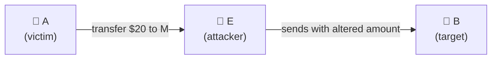

### 🧩 Why is it possible?

If the two parties don't **confirm the authenticity and integrity of each message**, this attack is relatively easy. Some protocols don't offer secure authentication or integrity checking, and some have inherent insecurities making them susceptible.

> ⚠️ **Any time you browse over HTTP**, you're susceptible to MITM, and **you can't recognize it**.

### 🛠️ Tools

| Tool | Role |
|------|------|
| **Ettercap** | A MITM tool (3 interfaces: traditional CLI, GUI, ncurses) |
| **Bettercap** | A modern MITM tool (3 ways to invoke: Web UI, interactive session, scripting) |

MITM can also affect other cleartext protocols (**FTP, SMTP, POP3**).

### 🛡️ Mitigation

This attack requires **cryptography** to counter:

- Proper **authentication**
- **Encryption or signing** of exchanged messages

With **Public Key Infrastructure (PKI)** and trusted root certificates, **TLS** protects against MITM.

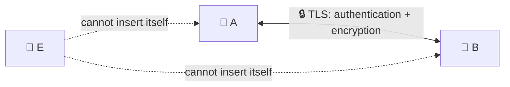

### 🧪 Hints for the hands-on tasks

Find the **number of interfaces/invocation methods** on Ettercap's and Bettercap's official sites (both offer 3).

---

## 🔐 Transport Layer Security (TLS)

This section teaches the standard solution to protect against **sniffing and MITM**.

### 📜 A short history

| Year | Event |
|------|-------|
| 1994 | Netscape introduces **SSL** (driven by the need for online shopping) |
| 1996 | **SSL 3.0** released |
| 1999 | **TLS** introduced, offering stronger security |

> 🔁 SSL and TLS are closely related, so one is sometimes used for the other. **TLS is more secure** and has practically replaced SSL, but "SSL" is still widely used, so the two are often referred to together as "**SSL/TLS**". All modern servers use TLS.

### 🧱 Where it fits in the OSI model

The protocols we covered earlier operate at the **application layer**. Encryption is added at the **presentation layer**. As a result, data is transmitted as **ciphertext** instead of its original form.

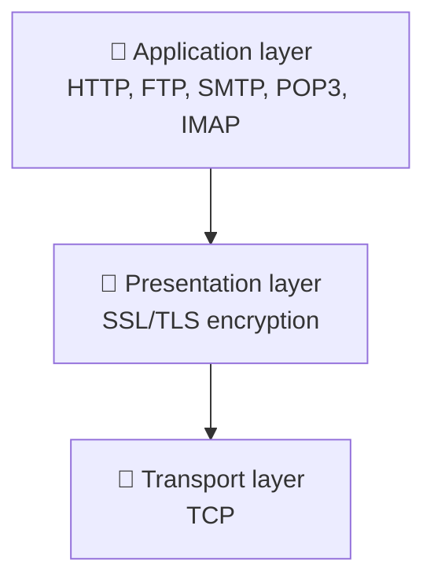

### 📊 Encrypted versions of the protocols

| Protocol | Default port | Secured name | Default port with TLS |
|----------|---------------|---------------|------------------------|
| HTTP | 80 | **HTTPS** | 443 |
| FTP | 21 | **FTPS** | 990 |
| SMTP | 25 | **SMTPS** | 465 |
| POP3 | 110 | **POP3S** | 995 |
| IMAP | 143 | **IMAPS** | 993 |

### 🌐 HTTPS: an extra step

Plain HTTP needs **two steps**:

1. Establish a TCP connection
2. Send HTTP requests (`GET`, `POST`, etc.)

HTTPS adds **one more step** in between:

1. Establish a TCP connection
2. **Establish an SSL/TLS connection**
3. Send HTTP requests

### 🤝 The SSL/TLS handshake

Based on **RFC 6101**, the SSL connection setup can be simplified into four steps:

| # | Step | Sent by | Purpose |
|---|------|---------|---------|
| 1 | **ClientHello** | Client | Announces its capabilities, such as supported algorithms |
| 2 | **ServerHello** + certificate + **ServerKeyExchange** + **ServerHelloDone** | Server | Sends chosen parameters, its certificate (for identification), extra key material, and signals it's done negotiating |
| 3 | **ClientKeyExchange** + **ChangeCipherSpec** | Client | Sends final key material and signals it's switching to encryption |
| 4 | **ChangeCipherSpec** | Server | Signals it's switching to encryption too |

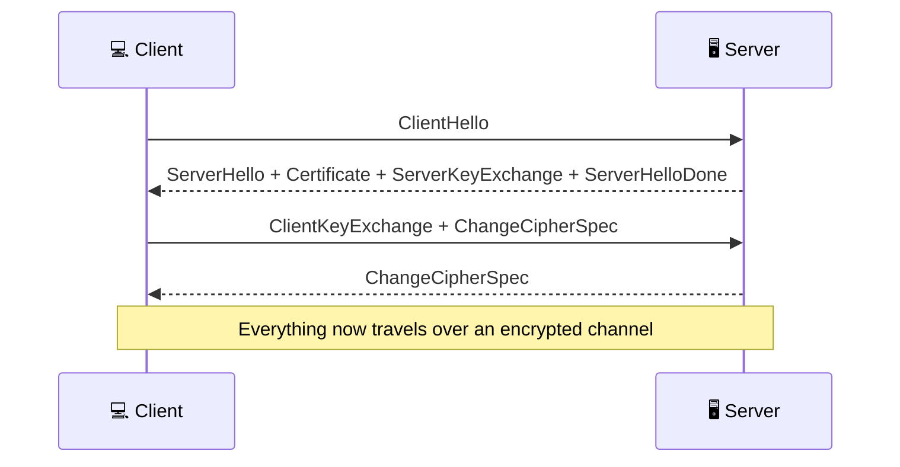

> 🧠 **In simple terms:** the client and a server with a public certificate **agree on a secret key**. It's generated securely enough that a third party watching the channel couldn't discover it. All further communication is encrypted with that key.

### 📜 Certificate trust

For HTTPS to work, we rely on **public certificates signed by trusted certificate authorities (CAs)**. When visiting a site, the browser expects the server to present a **certificate signed by a trusted CA**.

A certificate carries three main pieces of information:

| Field | What it shows |
|-------|---------------|
| 👤 Issued to | The company using this certificate |
| 🏛️ Issued by | The certificate authority (CA) that signed it |
| 📅 Validity period | The certificate shouldn't be expired |

> 🙌 The browser **checks the certificate automatically**, we don't have to do it by hand. This ensures we're talking to the correct server and that the communication is secure.

### 🧪 Hint for the hands-on task

DNS can be secured with TLS too. Look for the **three-letter acronym** for this protocol (DNS + "over" + TLS).

---

## 🔑 Secure Shell (SSH)

**SSH** was created to provide a **secure way** to administer systems remotely, letting you connect securely to another system over a network and execute commands.

### 🛡️ What does the "S" give you?

| № | Guarantee |
|---|-----------|
| 1️⃣ | You can confirm the remote server's **identity** |
| 2️⃣ | Exchanged messages are **encrypted** and only decryptable by the intended recipient |
| 3️⃣ | Both sides can detect any **modification** of the messages |

These three guarantees are confidentiality and integrity, provided through cryptography.

### 🔧 Requirements

| Component | Value |
|-----------|-------|
| SSH server | Listens on **port 22** by default |
| Authentication type 1 | Username + password |
| Authentication type 2 | A key pair (the server must recognize the matching public key) |

### 💻 Connecting

```bash
ssh USERNAME@TARGET_IP
```

After connecting, you're asked for a password (or a key is used). Once authenticated, you get access to the remote terminal. **All commands travel over the encrypted channel.**

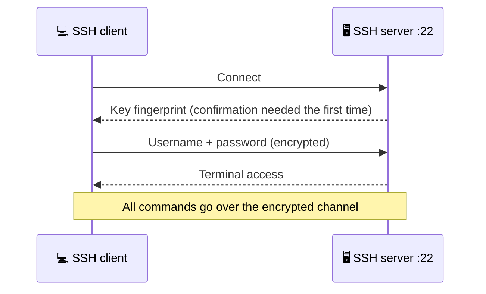

### 🔏 Fingerprint confirmation on first connection

The first time you connect, you must confirm the SSH server's **public key fingerprint**. This is to **protect against MITM**.

> ⚠️ SSH usually has **no third party** (like a CA) checking the key's validity, so you must verify it **manually**. Getting the fingerprint through a trusted channel beforehand (for example, directly from the server admin) is the most reliable way.

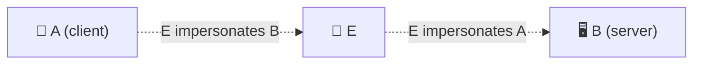

### 📦 SCP: file transfer over SSH

**SCP (Secure Copy Protocol)** is based on SSH.

```bash
# Download from remote
scp USERNAME@TARGET_IP:/path/to/file.tar.gz ~

# Upload to remote
scp local_file.txt USERNAME@TARGET_IP:/home/USERNAME/
```

| Example | What it does |
|---------|---------------|
| `scp user@ip:/home/user/archive.tar.gz ~` | Remote file → local home directory |
| `scp backup.tar.bz2 user@ip:/home/user/` | Local file → remote directory |

### 🔄 Secure variants of FTP

| Variant | Based on | Default port |
|---------|----------|---------------|
| **FTPS** | SSL/TLS | 990 |
| **SFTP** | SSH | 22 (same as SSH) |

### 🧪 Hint for the hands-on task

After connecting, use `uname -r` to find the kernel version. Remember the `scp` syntax; the size of the transferred file is shown on screen in **KB**.

---

## 🔓 Password attack

### 🪪 What is authentication?

**Authentication** means **proving** you are who you claim to be. For example, logging into POP3 with `USER` and `PASS`, the server verifies your identity **with the password**.

### 🧩 The three bases of authentication

| № | Type | Example |
|---|------|---------|
| 1️⃣ | **Something you know** | A password, a PIN |
| 2️⃣ | **Something you have** | A SIM card, an RFID card, a USB dongle |
| 3️⃣ | **Something you are** | A fingerprint, an iris |

This room focuses on attacks against the **first category (something you know)**.

### 😬 Weak passwords are still common

From the 2013 **Adobe breach** (150 million username/password pairs), the top 10 passwords were:

| # | Password |
|---|----------|
| 1 | `123456` |
| 2 | `123456789` |
| 3 | `password` |
| 4 | `adobe123` |
| 5 | `12345678` |
| 6 | `qwerty` |
| 7 | `1234567` |
| 8 | `111111` |
| 9 | `photoshop` |
| 10 | `123123` |

> 😅 Only two relate to Adobe, the rest are **generic and weak**. Decades later, `123456` and `qwerty` are still common choices.

### ⚔️ Three types of password attacks

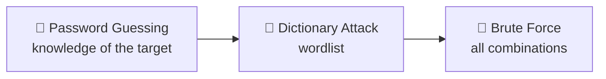

| Type | Explanation |
|------|-------------|
| 🎯 **Password Guessing** | Requires knowledge about the target (pet's name, birth year, etc.) |
| 📖 **Dictionary Attack** | Trying **all valid words** from a dictionary or wordlist |
| 🔨 **Brute Force** | Trying **all possible character combinations** — time grows **exponentially** with character count |

> 🗣️ For a French-speaking target, a **French wordlist** might be more effective than an English one.

### 📚 Wordlists

Over the years, hackers have compiled lists of leaked passwords from breaches. Example: the **RockYou list**, found on the AttackBox at `/usr/share/wordlists/rockyou.txt`.

### 🐉 THC Hydra

**Hydra** automates a **dictionary attack** against a target service using a wordlist. It supports FTP, POP3, IMAP, SMTP, SSH and many HTTP-related methods.

#### 💻 General syntax

```bash
hydra -l USERNAME -P wordlist.txt SERVER SERVICE
```

| Option | Meaning |
|--------|---------|
| `-l USERNAME` | The target username |
| `-P wordlist.txt` | The list of passwords to try |
| `SERVER` | The target's hostname or IP |
| `SERVICE` | The service to attack (ftp, ssh, imap, etc.) |

#### 🧩 Examples

```bash
hydra -l USERNAME -P /usr/share/wordlists/rockyou.txt TARGET_IP ftp
hydra -l USERNAME -P /usr/share/wordlists/rockyou.txt ftp://TARGET_IP   # same as above
hydra -l USERNAME -P /usr/share/wordlists/rockyou.txt TARGET_IP ssh
```

#### ⚙️ Extra options

| Option | Meaning |
|--------|---------|
| `-s PORT` | Use a non-default port |
| `-V` / `-vV` | Show each username/password pair being tried |
| `-t n` | Number of parallel connections (for example `-t 16`) |
| `-d` | Debug — shows details, such as a closed port or timeout |

> ⏹️ Once the password is found, you can stop the process with `Ctrl + C`.

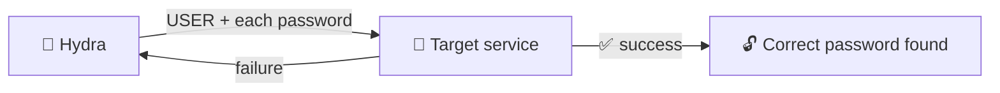

### 🛡️ Mitigation against password attacks

| Measure | Explanation |
|---------|-------------|
| 📏 **Password Policy** | Minimum complexity requirements |
| 🔒 **Account Lockout** | Lock the account after a number of failed attempts |
| ⏱️ **Throttling** | Delay between attempts — tolerable for a human, a major obstacle for automated tools |
| 🧩 **CAPTCHA** | A test machines struggle to solve (works well for GUI logins) |
| 🪪 **Certificate-based login** | Require a public certificate instead of a password (works well with SSH) |
| 📱 **Two-Factor Authentication (2FA)** | An extra code via email, app or SMS |
| 🌍 **Other approaches** | For example, IP-based geolocation checks |

> ✅ **The best approach combines several of these.**

### 🧪 Hint for the hands-on task

Run Hydra against the IMAP service using the known username from the room. On success, the output shows a line with **host, login and password**.

---

## 📊 Summary: protocol and Hydra table

### 🔐 Cleartext and encrypted versions

| Protocol | TCP port | Application | Data security |
|----------|----------|-------------|----------------|
| FTP | 21 | File transfer | Cleartext |
| **FTPS** | 990 | File transfer | **Encrypted** |
| HTTP | 80 | World Wide Web | Cleartext |
| **HTTPS** | 443 | World Wide Web | **Encrypted** |
| IMAP | 143 | Email (MDA) | Cleartext |
| **IMAPS** | 993 | Email (MDA) | **Encrypted** |
| POP3 | 110 | Email (MDA) | Cleartext |
| **POP3S** | 995 | Email (MDA) | **Encrypted** |
| **SFTP** | 22 | File transfer | **Encrypted** |
| **SSH** | 22 | Remote access and file transfer | **Encrypted** |
| SMTP | 25 | Email (MTA) | Cleartext |
| **SMTPS** | 465 | Email (MTA) | **Encrypted** |
| Telnet | 23 | Remote access | Cleartext |

### 🐉 Hydra options summary

| Option | Explanation |
|--------|-------------|
| `-l username` | Provide the login name |
| `-P WordList.txt` | Specify the password list |
| `server service` | Set the target address and service |
| `-s PORT` | For a non-default service port |
| `-V` / `-vV` | Show the username/password combos tried |
| `-d` | Show debug output |

---

## 📖 Glossary

| Term | Short explanation |
|------|-------------------|
| **CIA triad** | Confidentiality, Integrity, Availability |
| **DAD** | Disclosure, Alteration, Destruction — the attacker's goal |
| **Sniffing** | Capturing and analyzing network packets |
| **Packet capture** | The act of capturing packets |
| **Tcpdump / Wireshark / Tshark** | Packet capture tools (CLI/GUI) |
| **Port mirroring** | Mirroring a switch port's traffic |
| **MITM** | Man-in-the-Middle, an interception attack |
| **Ettercap / Bettercap** | MITM tools |
| **SSL / TLS** | Security protocols that encrypt communication |
| **Ciphertext** | Encrypted text |
| **Handshake** | The negotiation process between client and server to set up encryption |
| **ClientHello / ServerHello** | Steps of the TLS handshake |
| **Certificate Authority (CA)** | A trusted body that signs certificates |
| **PKI** | Public Key Infrastructure |
| **SSH** | A secure remote access protocol (port 22) |
| **SCP** | A file transfer protocol over SSH |
| **Fingerprint** | A key's unique verification mark |
| **SFTP / FTPS** | Secure versions of FTP (SSH-based / TLS-based) |
| **Authentication** | Proof of identity |
| **Password Guessing** | Guessing a password using knowledge of the target |
| **Dictionary Attack** | Trying passwords from a wordlist |
| **Brute Force** | Trying every possible combination |
| **Wordlist** | A list of passwords to try (for example RockYou) |
| **Hydra** | An automated login/password attack tool |
| **Account Lockout** | Locking an account after failed attempts |
| **Throttling** | Adding a delay between attempts |
| **CAPTCHA** | A human-vs-machine test |
| **2FA** | Two-factor authentication |

---

## 📝 Test yourself

<details>
<summary><b>1. What are the three parts of the CIA triad?</b></summary>

Confidentiality, Integrity, Availability.
</details>

<details>
<summary><b>2. What is DAD the opposite of, and what does it stand for?</b></summary>

The opposite of CIA: Disclosure, Alteration, Destruction — the outcomes an attacker aims for.
</details>

<details>
<summary><b>3. Under what condition is a sniffing attack possible?</b></summary>

The protocol must use cleartext, and the attacker must have access to the traffic between the two systems.
</details>

<details>
<summary><b>4. What happens in a MITM attack?</b></summary>

The victim believes they're talking to a legitimate party, but an attacker has inserted themselves and intercepts or alters the messages.
</details>

<details>
<summary><b>5. What is the relationship between SSL and TLS?</b></summary>

They're closely related; TLS is more secure and has practically replaced SSL, but "SSL" is still widely used as a term.
</details>

<details>
<summary><b>6. What's HTTPS's extra step compared to HTTP?</b></summary>

Establishing an **SSL/TLS connection** after the TCP connection and before sending HTTP requests.
</details>

<details>
<summary><b>7. What are the four main steps of the TLS handshake?</b></summary>

ClientHello; ServerHello (+ certificate + ServerKeyExchange + ServerHelloDone); ClientKeyExchange + ChangeCipherSpec; the server's ChangeCipherSpec.
</details>

<details>
<summary><b>8. What are SSH's three main guarantees?</b></summary>

Confirming the server's identity, encrypting messages, and detecting modification of messages.
</details>

<details>
<summary><b>9. Why must the fingerprint be confirmed on first SSH connection?</b></summary>

To protect against MITM, since there's usually no third party verifying the key's validity.
</details>

<details>
<summary><b>10. What's the difference between a dictionary attack and brute force?</b></summary>

A dictionary attack uses a known word/password list. Brute force tries every possible character combination and takes much longer.
</details>

<details>
<summary><b>11. What is Hydra's basic syntax?</b></summary>

`hydra -l username -P wordlist.txt server service`
</details>

<details>
<summary><b>12. Name some defenses against password attacks.</b></summary>

Password policy, account lockout, throttling, CAPTCHA, certificate-based login, two-factor authentication.
</details>

---

## 📚 Sources

- TryHackMe: [Protocols and Servers 2 room](https://tryhackme.com/room/protocolsandservers2) (do the hands-on part there yourself)
- [DNS over TLS - Wikipedia](https://en.wikipedia.org/wiki/DNS_over_TLS)
- [Hydra - GitHub](https://github.com/vanhauser-thc/thc-hydra)
- [Hydra - Kali Tools](https://www.kali.org/tools/hydra/)
- [Man-in-the-middle attack - Wikipedia](https://en.wikipedia.org/wiki/Man-in-the-middle_attack)
- [RFC 6101 - SSL 3.0](https://datatracker.ietf.org/doc/html/rfc6101)
- [Sniffing attack - Wikipedia](https://en.wikipedia.org/wiki/Sniffing_attack)
- [Transport Layer Security - Wikipedia](https://en.wikipedia.org/wiki/Transport_Layer_Security)

> ℹ️ These notes were written in my own words for personal learning. The diagrams were drawn with Mermaid. The room's lab credentials, flags and password answers are not included.
