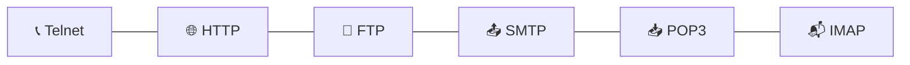
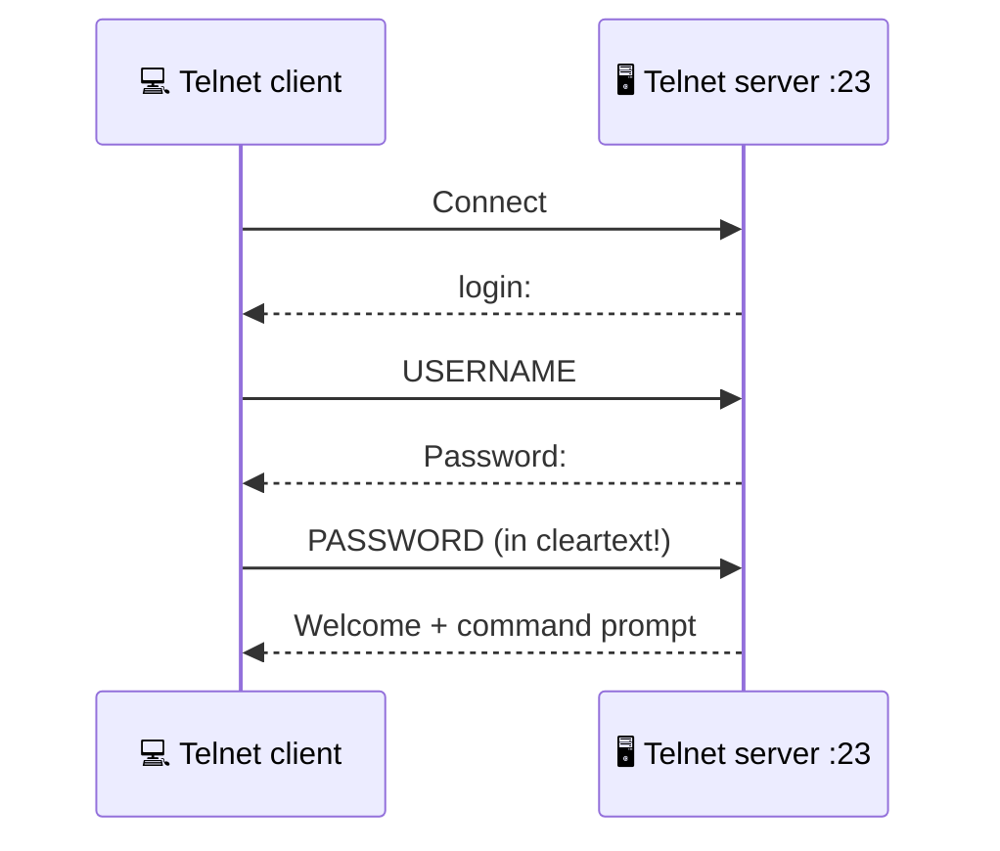
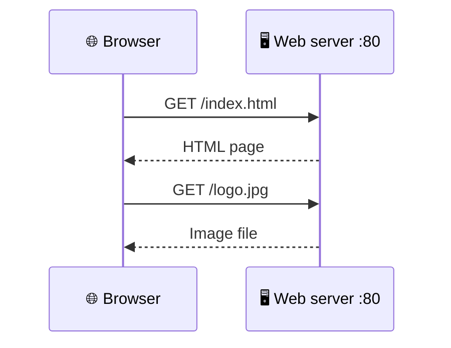
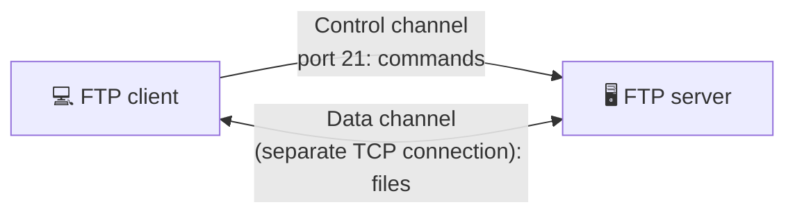
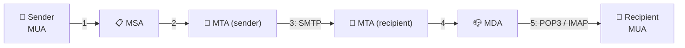
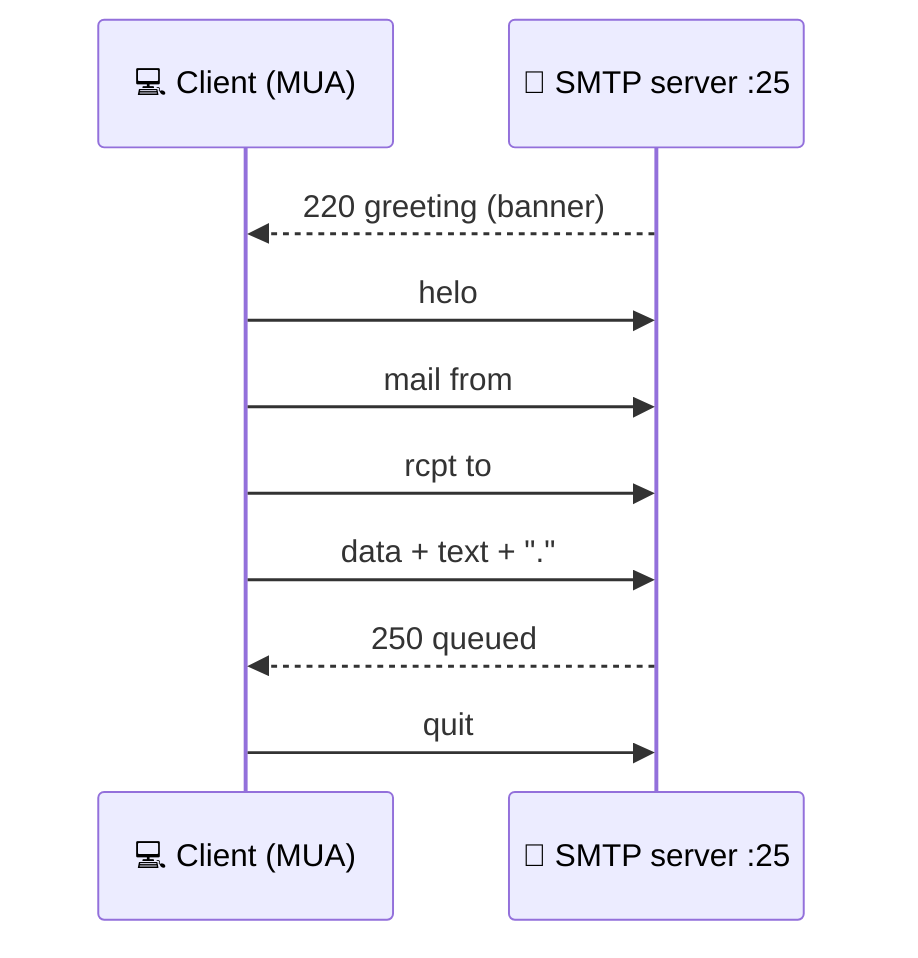
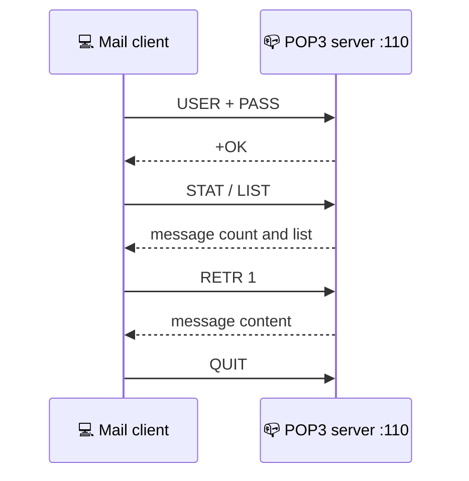
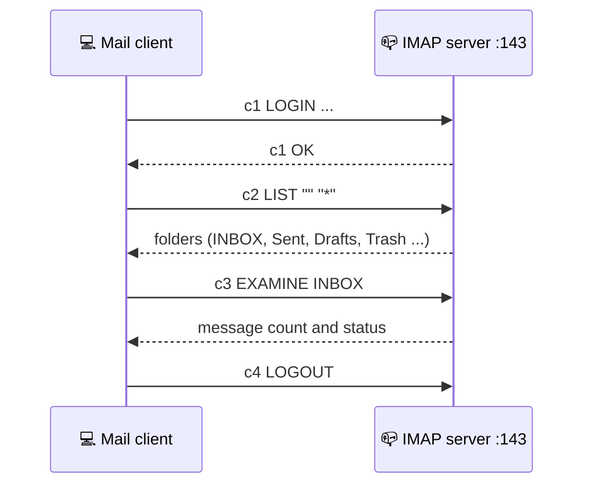
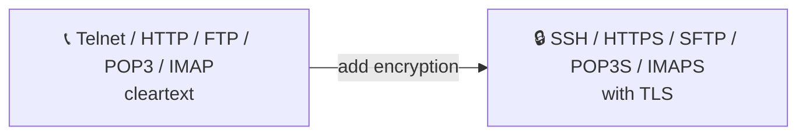

# 🧬 Protocols and Servers: Detailed Study Notes

> How Telnet, HTTP, FTP, SMTP, POP3 and IMAP work "under the hood", and the cleartext problem.
> Written while working through the TryHackMe **"Protocols and Servers"** room.

🌐 Languages: [Azərbaycanca](protocols-and-servers.md) | **English**

---

## 📋 About the room

| | |
|---|---|
| 🧭 Type | Walkthrough |
| 🟢 Difficulty | Easy |
| 🏷️ Tags | Linux |
| 💳 Subscription | Premium |
| 🔗 Room | [tryhackme.com/room/protocolsandservers](https://tryhackme.com/room/protocolsandservers) |
| 🎯 Goal | HTTP, FTP, POP3, SMTP, IMAP protocols and their related insecurities |
| 📍 Place | Room 7 of the Network Security module |

---

## 📑 Table of Contents

1. [Introduction](#-introduction)
2. [Telnet](#-telnet)
3. [HTTP](#-http)
4. [FTP](#-ftp)
5. [How email works](#-how-email-works)
6. [SMTP](#-smtp)
7. [POP3](#-pop3)
8. [IMAP](#-imap)
9. [Summary: protocol table](#-summary-protocol-table)
10. [Defense: from cleartext to secure variants](#-defense-from-cleartext-to-secure-variants)
11. [Glossary](#-glossary)
12. [Test yourself](#-test-yourself)
13. [Sources](#-sources)

> ⚖️ **Legal notice:** The examples use placeholders such as `TARGET_IP`, `USERNAME`, `PASSWORD`. Connect only to systems **you own or have written permission to test**. These notes are for education and defense.

---

## 🎯 Introduction

The room introduces several widely used protocols:



**Approach:** for each protocol, we "speak" its language using a simple **Telnet** client to see the **low-level process** usually hidden behind a graphical interface (GUI).

> 🎯 **The goal isn't to memorize commands**, it's to get a closer look at how a protocol behaves while working.

**Main theme: cleartext.** All these protocols send data, **including passwords, unencrypted**.

---

## 📞 Telnet

**Telnet** is an application-layer protocol used to connect to another computer's **virtual terminal**. A user can log into another computer's console, run programs, start batch processes and perform system administration remotely.

### 🔄 How does it work?

| Step | Description |
|------|-------------|
| 1️⃣ | The Telnet server listens on **port 23** |
| 2️⃣ | The user connects and is asked for a **login name** |
| 3️⃣ | A **password** is requested (not shown on screen) |
| 4️⃣ | If authentication succeeds, a welcome message and a **command prompt** appear |

> 💲 A `$` in the prompt means a **non-root** terminal.

```bash
telnet TARGET_IP
```



### 🚨 The core problem

**All communication** between client and server is **unencrypted**. Anyone capturing the traffic (for example with Wireshark) can easily see the **username and password**. An interesting nuance: the username is echoed back from the server (so it shows on your screen) but the password isn't. So someone watching your screen can't see the password, yet **everything is readable on the network**.

> ❌ Telnet is no longer considered a secure option.
> ✅ **Secure alternative: SSH.**

---

## 🌐 HTTP

**HTTP (Hypertext Transfer Protocol)** is the protocol for transferring web pages. A browser connects to a web server to request HTML pages, images and other files, submit forms and upload files.



Because HTTP sends and receives data in **cleartext**, you can talk to a web server with Telnet (or Netcat) too. The only difference is that you **type the HTTP commands yourself** instead of the browser.

### 💻 An HTTP request via Telnet

```bash
telnet TARGET_IP 80
```
```text
GET /index.html HTTP/1.1
host: telnet
(press Enter twice)
```

| Part | Explanation |
|------|-------------|
| `GET /index.html HTTP/1.1` | Request a specific page |
| `GET / HTTP/1.1` | Request the default page |
| `host: ...` | A host value (any name works) |
| Enter **twice** | Marks the end of the request |

**Result:** the response contains the page plus **lots of information browsers don't normally show**: the `Server:` header (server type and version), date, content type, size, etc. If the page isn't found, a **404** error comes back.

### 🏗️ What does HTTP need?

| Side | Examples |
|------|----------|
| 🖥️ **HTTP server** | Apache, nginx (free, open source), IIS (closed source, license required) |
| 🌐 **HTTP client (browser)** | Chrome, Edge, Firefox, Safari |

### 🧪 Hint for the hands-on task

Over Telnet on port 80, request **`/flag.thm`** with `GET` and look at the response body.

---

## 📁 FTP

**FTP (File Transfer Protocol)** was developed to make **file transfer** efficient between different computers with different systems. It also uses **cleartext**, so Telnet or Netcat can act as an FTP client.

### 💻 An FTP session via Telnet

```bash
telnet TARGET_IP 21
```

| Command | What it does |
|---------|--------------|
| `USER USERNAME` | Username |
| `PASS PASSWORD` | Password |
| `SYST` | Shows the system type (for example UNIX) |
| `STAT` | Extra status information |
| `PASV` | Switches to **passive mode** |
| `TYPE A` | **ASCII** transfer mode |
| `TYPE I` | **Binary** transfer mode |
| `QUIT` | Ends the session |

> 📌 The `STAT` output lines **"Control connection is plain text"** and **"Data connections will be plain text"** directly confirm the cleartext problem.

### 🔀 Two channels: control and data

FTP creates a **separate connection** for transfers, which is why you can't transfer files with plain Telnet.



| FTP mode | How the data channel is established |
|----------|-------------------------------------|
| **Active** | Data originates from the server's **port 20** |
| **Passive** | Data originates from a client port **above 1023** |

### 💻 With a real FTP client

```bash
ftp TARGET_IP
```

| Command | What it does |
|---------|--------------|
| `ls` | List files |
| `ascii` / `binary` | Choose transfer mode (ascii for text) |
| `get FILENAME` | Download a file (a separate data channel opens) |
| `mget PATTERN` | Download several files |
| `exit` / `quit` | Leave |

### 🧰 FTP software

| Kind | Examples |
|------|----------|
| FTP server | vsftpd, ProFTPD, uFTP |
| FTP client | Linux console client, **FileZilla** (GUI), some browsers |

> ⚠️ FTP transmits login details, commands and files in **cleartext**, making it an easy target for attackers.

### 🧪 Hint for the hands-on task

The room provides login details. Connect with an FTP client, list the files with `ls`, and download the `.thm` flag file with `get`/`mget`.

---

## 📮 How email works

Delivering email over the internet needs **four components**:

| Abbreviation | Name | Role |
|--------------|------|------|
| **MUA** | Mail User Agent | The email client (Outlook, Thunderbird, a phone app) |
| **MSA** | Mail Submission Agent | Accepts the message from the client and checks for errors |
| **MTA** | Mail Transfer Agent | Forwards the message to the recipient's server |
| **MDA** | Mail Delivery Agent | Delivers and stores the message in the recipient's mailbox |



### 📬 Postal analogy

| Postal mail | Email |
|-------------|-------|
| You (sending a letter) | **MUA** |
| Post office clerk checks the letter | **MSA** |
| Local post office and the destination country's post office | **MTA** |
| The recipient's mailbox | **MDA** |
| The recipient checks the box and takes the letter | **MUA** |

### 🔌 Which protocol where?

| Protocol | Talks to |
|----------|----------|
| **SMTP** | An MTA (sending) |
| **POP3 / IMAP** | An MDA (downloading/reading) |

---

## 📤 SMTP

**SMTP (Simple Mail Transfer Protocol)** is for communicating with an MTA server. Since it's cleartext, you can connect with Telnet and send a message, acting as an email client.

| Property | Value |
|----------|-------|
| Default port | **25** |
| Security | Cleartext |

### 💻 Session flow

```bash
telnet TARGET_IP 25
```

| Step | Command | Meaning |
|------|---------|---------|
| 1️⃣ | `helo HOSTNAME` | Introduce yourself |
| 2️⃣ | `mail from:<sender@example.com>` | The sender |
| 3️⃣ | `rcpt to:<recipient@example.com>` | The recipient |
| 4️⃣ | `data` | Start the message body |
| 5️⃣ | type the text | Subject (`subject:`) and body |
| 6️⃣ | **a line with a single dot `.`** | End of message (`<CR><LF>.<CR><LF>`) |
| 7️⃣ | `quit` | Leave |

The server **queues** the message.



> 🏷️ **Banner:** an SMTP server sends information about itself (name, software) when you connect. This is useful for understanding the service type.

> 💡 You don't need to memorize SMTP commands. The point is to see what a mail client does behind the scenes.

### 🧪 Hint for the hands-on task

Connect to the target's SMTP port and look carefully at the **first greeting line (banner)**.

---

## 📥 POP3

**POP3 (Post Office Protocol v3)** is the protocol for **downloading email messages from an MDA server**. The client connects to the POP3 server, authenticates, downloads new messages and (optionally) deletes them.

| Property | Value |
|----------|-------|
| Default port | **110** |
| Security | Cleartext |

### 💻 Commands

```bash
telnet TARGET_IP 110
```

| Command | What it does |
|---------|--------------|
| `USER USERNAME` | Username |
| `PASS PASSWORD` | Password |
| `STAT` | Message count and mailbox size: `+OK nn mm` |
| `LIST` | List messages |
| `RETR 1` | Retrieve message 1 |
| `QUIT` | Leave |

> 📖 Per RFC 1939, the `STAT` reply has the form `+OK nn mm`, where **nn** is the number of messages and **mm** is the mailbox size (octets/bytes).



### ⚠️ Characteristics and limits

- The username and password go in **cleartext**, so a third party watching the network can capture them.
- By default the client **deletes the message after downloading it**. This can be changed in client settings.
- Accessing the same account from **several clients** over POP3 is inconvenient, since you lose track of read/unread messages.
- To keep all mailboxes synchronized, **IMAP** is more suitable.

### 🧪 Hint for the hands-on task

Connect to the POP3 server with the room's details and, after authenticating, look at the `STAT` reply. The two numbers describe the mailbox state.

---

## 📬 IMAP

**IMAP (Internet Message Access Protocol)** is **more sophisticated** than POP3. It keeps email **synchronized across multiple devices and clients**. For example, if you mark a message as read on your smartphone, that change is saved on the server and reflected on your laptop too.

| Property | Value |
|----------|-------|
| Default port | **143** |
| Security | Cleartext |

### 💻 IMAP commands

```bash
telnet TARGET_IP 143
```

In IMAP, **each command is preceded by a random string (tag)** so replies can be tracked (`c1`, `c2`, `c3` ...).

| Command | What it does |
|---------|--------------|
| `c1 LOGIN USERNAME PASSWORD` | Log in (in cleartext!) |
| `c2 LIST "" "*"` | List mail folders |
| `c3 EXAMINE INBOX` | Examine the inbox (read-only) |
| `c4 LOGOUT` | Leave |



> 🚨 In the `LOGIN` command the username and password appear in **cleartext**. Anyone watching network traffic can learn them.

### ⚖️ POP3 vs IMAP

| | POP3 | IMAP |
|---|---|---|
| Port | 110 | 143 |
| Where do messages stay? | Usually downloaded then deleted | **Kept on the server** |
| Multi-device use | Difficult | **Synchronized** |
| Read/unread status | Not tracked | Stored on the server |
| Complexity | Simple | More complex |

### 🧪 Hint for the hands-on task

The default IMAP port is in the protocol table above.

---

## 📊 Summary: protocol table

The protocols covered, in alphabetical order:

| Protocol | TCP port | Application | Data security |
|----------|----------|-------------|---------------|
| **FTP** | 21 | File transfer | Cleartext |
| **HTTP** | 80 | World Wide Web | Cleartext |
| **IMAP** | 143 | Email (MDA) | Cleartext |
| **POP3** | 110 | Email (MDA) | Cleartext |
| **SMTP** | 25 | Email (MTA) | Cleartext |
| **Telnet** | 23 | Remote access | Cleartext |

> 🧠 Other protocols interest attackers too, for example **SMB** (shared access to files and printers across networks). One room, or even a whole module, can't cover all network protocols.

> ⏭️ The next room (**Protocols and Servers 2**) covers attacks against these protocols and **mitigation steps**.

---

## 🛡️ Defense: from cleartext to secure variants

> 📎 This section is based on general knowledge.

| Cleartext protocol | Secure alternative |
|--------------------|--------------------|
| **Telnet** (23) | **SSH** (22) |
| **HTTP** (80) | **HTTPS** (443) |
| **FTP** (21) | **SFTP** (over SSH) or **FTPS** (with TLS) |
| **SMTP** (25) | With TLS (**STARTTLS** or SMTPS/submission ports) |
| **POP3** (110) | **POP3S** (995) |
| **IMAP** (143) | **IMAPS** (993) |

| Measure | Purpose |
|---------|---------|
| Disable legacy services | Such as Telnet and cleartext FTP |
| Enforce encryption | Reject access without TLS |
| Strong authentication | Strong passwords, MFA where possible |
| Reduce banner information | Don't needlessly reveal server versions |
| Monitor traffic | Detect unusual connections |



---

## 📖 Glossary

| Term | Short explanation |
|------|-------------------|
| **Protocol** | A set of rules systems use to talk to each other |
| **Cleartext** | Unencrypted text |
| **Telnet** | A cleartext remote terminal protocol (port 23) |
| **SSH** | The secure alternative to Telnet |
| **HTTP** | The web page transfer protocol (port 80) |
| **Status 404** | Page not found |
| **Apache / nginx / IIS** | Popular web servers |
| **FTP** | File Transfer Protocol (port 21) |
| **Control / Data channel** | FTP's command channel / file channel |
| **Active / Passive mode** | FTP modes for how the data channel is set up |
| **ASCII / Binary mode** | FTP text / binary file transfer mode |
| **MUA** | Mail User Agent, the email client |
| **MSA** | Mail Submission Agent |
| **MTA** | Mail Transfer Agent |
| **MDA** | Mail Delivery Agent |
| **SMTP** | Email sending protocol (port 25) |
| **POP3** | Email download protocol (port 110) |
| **IMAP** | Synchronized email access protocol (port 143) |
| **Banner** | The introduction text a service sends on connect |
| **Octet** | 8 bits, i.e. 1 byte |
| **SMB** | A protocol for sharing files and printers on a network |
| **Wireshark** | A network traffic analysis tool |
| **TLS** | A security protocol that encrypts communication |

---

## 📝 Test yourself

<details>
<summary><b>1. What common security problem do the protocols in this room share?</b></summary>

All send data, including login details, in **cleartext**, so anyone watching the network traffic can read it.
</details>

<details>
<summary><b>2. What is the secure alternative to Telnet?</b></summary>

SSH.
</details>

<details>
<summary><b>3. How can you request a page from a web server using Telnet?</b></summary>

On port 80, type `GET / HTTP/1.1` (or a specific file path), give a `host:` value and press Enter twice.
</details>

<details>
<summary><b>4. Which header in an HTTP response interests us, and why?</b></summary>

The `Server:` header. It shows the web server's type and version.
</details>

<details>
<summary><b>5. What do FTP's control and data channels mean?</b></summary>

The control channel (port 21) carries commands. The data channel is a separate TCP connection for file transfers.
</details>

<details>
<summary><b>6. What's the difference between FTP's active and passive modes?</b></summary>

In active mode data originates from the server's port 20. In passive mode it originates from a client port above 1023.
</details>

<details>
<summary><b>7. What do MUA, MSA, MTA and MDA stand for?</b></summary>

Client, submission agent, transfer agent and delivery agent.
</details>

<details>
<summary><b>8. How does SMTP mark the end of a message?</b></summary>

With a line containing a single dot (`<CR><LF>.<CR><LF>`).
</details>

<details>
<summary><b>9. What is the main difference between POP3 and IMAP?</b></summary>

POP3 usually downloads and deletes messages and isn't suited to multiple devices. IMAP keeps messages on the server and synchronizes across devices.
</details>

<details>
<summary><b>10. Which secure variant replaces each cleartext protocol?</b></summary>

Telnet → SSH, HTTP → HTTPS, FTP → SFTP/FTPS, POP3 → POP3S, IMAP → IMAPS, SMTP → with TLS.
</details>

---

## 📚 Sources

- TryHackMe: [Protocols and Servers room](https://tryhackme.com/room/protocolsandservers) (do the hands-on part there yourself)
- [File Transfer Protocol - Wikipedia](https://en.wikipedia.org/wiki/File_Transfer_Protocol)
- [HTTP - Wikipedia](https://en.wikipedia.org/wiki/HTTP)
- [IMAP - Wikipedia](https://en.wikipedia.org/wiki/Internet_Message_Access_Protocol)
- [POP - Wikipedia](https://en.wikipedia.org/wiki/Post_Office_Protocol)
- [SMTP - Wikipedia](https://en.wikipedia.org/wiki/Simple_Mail_Transfer_Protocol)
- [Telnet - Wikipedia](https://en.wikipedia.org/wiki/Telnet)

> ℹ️ These notes were written in my own words for personal learning. The diagrams were drawn with Mermaid. The room's flags, lab account credentials and task answers are not included.
