# 🕵️ Walking An Application: Detailed Study Notes

> Manually reviewing a web application using only the browser's own tools — no scanners, no automation.
> Written while working through the TryHackMe **"Walking An Application"** room.

🌐 Languages: [Azərbaycanca](walking-an-application.md) | **English**

---

## 📋 About the room

| | |
|---|---|
| 🧭 Type | Walkthrough |
| 🟢 Difficulty | Easy |
| 🏷️ Tags | Web |
| 💳 Subscription | Premium |
| 🔗 Room | [tryhackme.com/room/walkinganapp](https://tryhackme.com/room/walkinganapp) |
| 🎯 Goal | Manually review a web application for security issues using only browser tools |

---

## 📑 Table of Contents

1. [Introduction: automation isn't enough](#-introduction-automation-isnt-enough)
2. [Exploring the website](#-exploring-the-website)
3. [Viewing the page source](#-viewing-the-page-source)
4. [DevTools: Inspector](#-devtools-inspector)
5. [DevTools: Debugger](#-devtools-debugger)
6. [DevTools: Network](#-devtools-network)
7. [DevTools: Storage](#-devtools-storage)
8. [Summary: which tab does what](#-summary-which-tab-does-what)
9. [The defender's view](#-the-defenders-view)
10. [Glossary](#-glossary)
11. [Test yourself](#-test-yourself)
12. [Sources](#-sources)

> ⚖️ **Legal notice:** All techniques in this room should only be tried on web applications **you own or are explicitly authorized to test**. Searching for hidden pages, reading directory listings, or bypassing client-side restrictions without authorization can be considered **unauthorized access**.

---

## 🎯 Introduction: automation isn't enough

This room teaches how to review a web application **without automated scanners or tools**, using only the browser's own **developer tools**.

> 💡 **Core idea:** automated security tools and scripts often **miss potential vulnerabilities and useful information**. Manual review can find what they don't.

### 🎓 Learning objectives

| # | Skill |
|---|-------|
| 1️⃣ | View a site's **human-readable source code** |
| 2️⃣ | Inspect page elements and change them to **reveal blocked content** |
| 3️⃣ | Inspect and control a page's **JavaScript flow** |
| 4️⃣ | Identify the **network requests** a page makes |
| 5️⃣ | Identify **locally stored data** by a website |

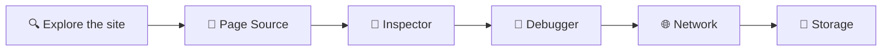

### 📚 Prerequisites

- The *Web Application Basics* room
- The *HTTP In Detail* room

---

## 🔍 Exploring the website

As a pentester, the first step is to **find the interactive parts** — login forms, search fields, upload features, and so on. That starts simply by **browsing the site**.

### 📋 Building a site review table

It's useful to log each page/feature:

| Field | Explanation |
|-------|-------------|
| **Feature** | The feature's name (Home, Login, Dashboard, etc.) |
| **URL** | That feature's address |
| **Summary** | What it does, what fields it has, notable details |

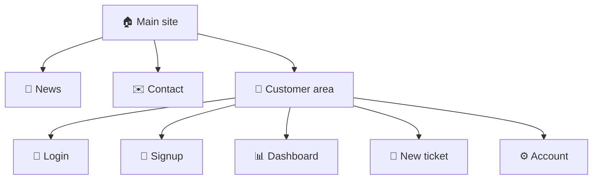

> 🔎 **Details worth noting:**
> - URL parameters (like `?id=1`) — hints for trying different values
> - Restricted content such as "premium" or "members-only"
> - File upload features (potentially risky functionality)
> - Sensitive flows like password reset or signup

### 🧪 Hint for the hands-on task

Note the **endpoint** (URL path) for creating a new ticket while browsing the site.

---

## 📄 Viewing the page source

The **Page Source** is the human-readable code returned from the server to the browser: **HTML + CSS + JavaScript**.

### 👀 How to view it

| Method | Explanation |
|--------|-------------|
| Right-click → "View Page Source" | The most common method |
| `view-source:URL` | A prefix typed in the address bar (for example `view-source:https://example.com/`) |

> ⚠️ **Important distinction:** Page Source shows the **initial** HTML. It doesn't show the **live** state as changed by JavaScript and user interaction — that's what Inspector is for (below).

### 💬 Comments

Text between `<!-- ... -->` in HTML is a **comment** — developer notes or explanations for other programmers. These **aren't displayed** on the page but remain in the source code.

> 🔎 **Why does this matter?** Comments can accidentally leave behind **hidden URLs, TODO notes, old account details**, or development info.

```html
<!-- This page is temporary, the new version is at /new-page -->
```

### 🔗 Links

Links in HTML use `<a href="...">`. Looking carefully at the source can reveal **hidden links not shown** in the navigation menu.

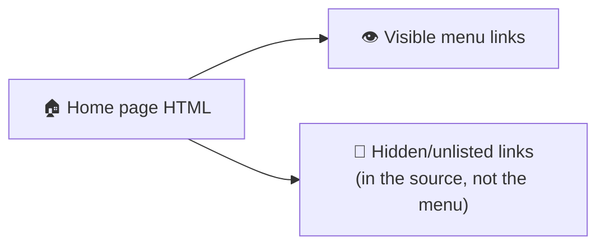

### 📁 External files and directory listings

CSS, JavaScript, and image files are usually stored in a **shared folder** (for example `/assets/`). Trying to open that folder directly:

| Result | Meaning |
|--------|---------|
| 🚫 403 Forbidden / blank page | The server is properly configured |
| 📋 Shows a **directory listing** | **Misconfiguration** — **every file** in the folder becomes public |

> ⚠️ **Risk:** with directory listing enabled, content that shouldn't be public — **backup files, source code, config files** — may be exposed.

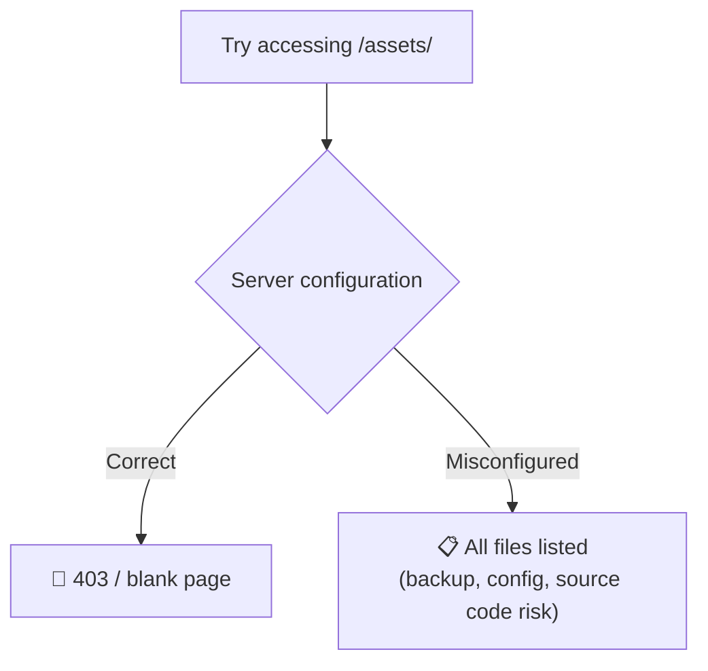

### 🏗️ Framework detection

Most sites aren't built from scratch — they're built on a **framework** (pre-made code). Page Source comments can reveal the framework's name and **version**.

> 🎯 **Why does it matter?** Knowing the **specific version** lets you search for **publicly known vulnerabilities** (CVEs) affecting it. An outdated version → a potential target.

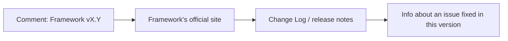

### 🧪 Hint for the hands-on task

- Read the **comments near the top** of the page — they may reference another page.
- Look carefully at the words in the **welcome message** — some words might actually be hidden links.
- Try opening the folder where static files are stored (found via CSS/JS paths) directly.
- Find the framework comment near the **bottom** of the page, visit the framework's site, and read the **Change Log** — it may hint at an issue affecting the old version and how to exploit the fix.

---

## 🧩 DevTools: Inspector

**Developer Tools (DevTools)** exist in every modern browser — built for developers to debug, but also very valuable for a pentester.

This room focuses on three main tabs: **Inspector**, **Debugger**, **Network** (plus **Storage**).

### 🔓 Opening it

Varies by browser, usually `F12` or right-click → "Inspect".

### 👁️ What is Inspector for?

Page Source is **static** — it shows what the server first sent. But CSS, JavaScript, and user interaction can **change** the page. **Inspector** shows the page's **current, live state** and lets you **interact with elements**.

### 🧱 A paywall example

Some content is covered by a **"paywall"** — a floating box with a message like "premium subscription required".

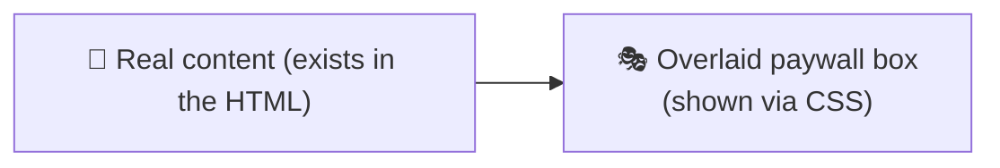

### 🛠️ Revealing content by changing CSS

1. **Right-click → Inspect** on the paywall element.
2. Find the relevant `DIV` element (for example `class="premium-customer-blocker"`).
3. Find the `display: block` line in the styles panel.
4. Click the word `block` and type **`none`**.

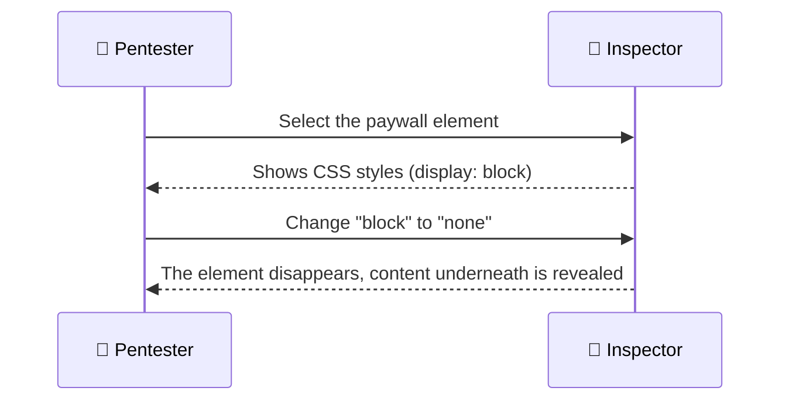

> ⚠️ **Important fact:** This change happens **only in your browser**, temporarily. Refreshing the page **reverts everything**. Nothing changes on the server side.

> 🔐 **Security lesson:** If "premium" content is hidden **only with client-side CSS** (with no server-side permission check), this is a **serious security issue** — any user can see the "paid" content with a small browser-side tweak.

### 🧪 Hint for the hands-on task

Find a blocked article in the news section, select the `premium-customer-blocker` class element, and change the `display` value to `none`.

---

## 🐛 DevTools: Debugger

**Debugger** (called **Sources** in Chrome) is for debugging JavaScript. For a pentester, this helps understand what a site is doing **behind the scenes**.

### 🗜️ Minification and obfuscation

| Term | Explanation |
|------|-------------|
| **Minification** | Removing formatting (whitespace, tabs, newlines) to shrink the file |
| **Obfuscation** | Making code **deliberately unreadable** (to make copying harder) |

> 🧩 A minified file usually appears **on one line** — practically impossible to read as-is.

### ✨ Pretty Print

The **Pretty Print** button (`{ }` icon) **reformats** the code — restoring line breaks and indentation. Obfuscation still makes it hard, but the structure becomes clearer.

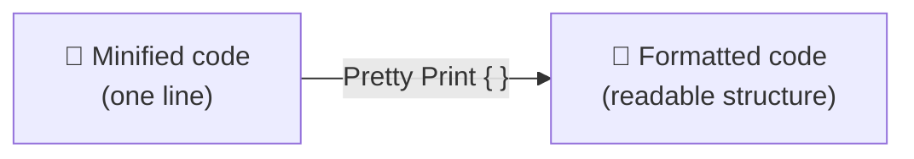

### 🛑 Breakpoints

A **breakpoint** tells the browser to **pause JavaScript execution** at a specific line.

**How to set one:** click the **line number** (usually on the left edge) — the line gets highlighted (often blue) and the breakpoint becomes active.

### 🔴 Example: "freezing" a disappearing red box

Some JavaScript **automatically removes** an element that briefly appears when the page loads (for example `element['remove']();`). Setting a breakpoint on that line and reloading the page makes execution **pause exactly there** — the element stays **on screen**, never removed.

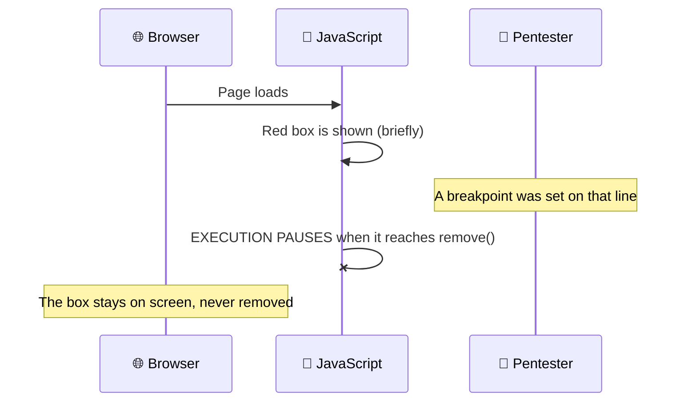

> 💡 **General principle:** breakpoints aren't just for red boxes — they can "freeze" **anything** that JavaScript hides, removes, or changes.

### 🧪 Hint for the hands-on task

Find the relevant JavaScript file, Pretty Print it, scroll to the bottom, find the line that removes the element, click its line number to set a breakpoint, then reload the page (`F5`).

---

## 🌐 DevTools: Network

The **Network** tab lets you track **every external request** a page makes — files, images, and **background requests (AJAX)**.

### 🔄 What is AJAX?

**AJAX** (Asynchronous JavaScript and XML) is a way to send/receive data **in the background without reloading** the page. For example, submitting a form doesn't refresh the whole page — only the relevant part changes.

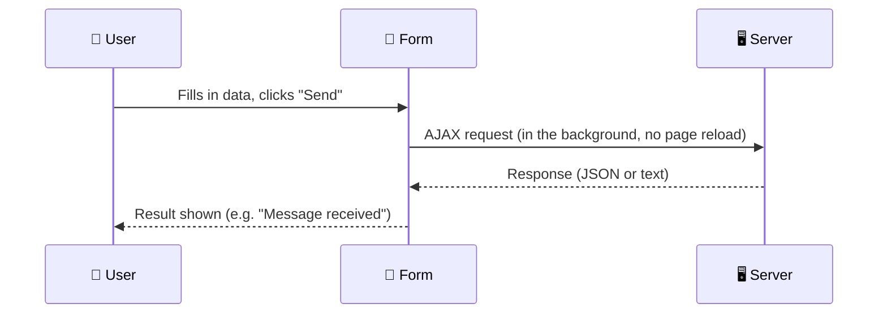

### 🔍 Examining a request

Clicking a request in the Network tab shows:

| Section | Shows |
|---------|-------|
| **Headers** | Request/response headers (server type, cookies, custom headers) |
| **Response** | What the server **actually returned** (often JSON) |
| **Cookies** | Cookie data tied to this request |

> 🔑 **Key idea:** sometimes the **Headers** section doesn't show the whole picture. Checking the **Response** section separately matters — it may hold **extra information** not present in the headers.

### 🧪 Hint for the hands-on task

Fill in and submit the contact form, find the resulting POST request in the Network tab (usually named after the form's endpoint, for example `contact-msg`), and check both the **Headers** and the **Response** sections — each may show different information.

---

## 💾 DevTools: Storage

The **Storage** tab shows data a site stores in the browser. This is **client-side** data and can reveal a lot about **authentication, session handling, and user preferences** during a pentest.

### 📦 Four main types

| Type | Explanation |
|------|-------------|
| **Local Storage** | Data that **persists** even after the browser closes |
| **Session Storage** | Temporary data for **a single tab/session** |
| **Cookies** | Small pieces of data sent by the server and stored in the browser (often used for sessions and authentication) |
| **Cache Storage** | Cached resources (images, scripts, API responses) for faster loading |

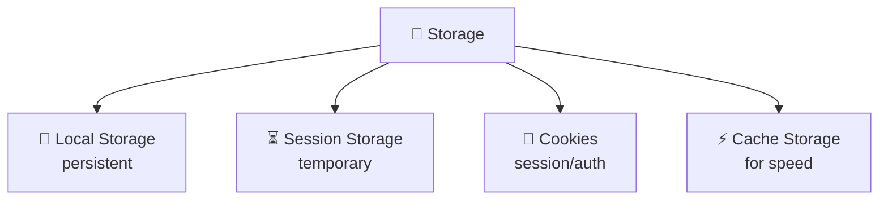

### 🍪 Cookies: the most important for a pentester

Cookies often hold **session identifiers**, **user preferences**, and sometimes **authentication tokens**.

### 🛡️ Cookie security flags

| Flag | What it does |
|------|---------------|
| **HttpOnly** | Prevents JavaScript from **accessing** the cookie — protects against **XSS attacks** |
| **Secure** | Ensures the cookie is only sent over **HTTPS** |
| **SameSite** | Helps mitigate **CSRF attacks** |

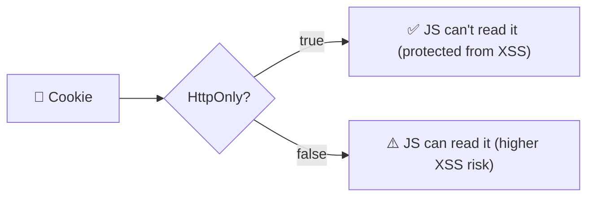

> ⚠️ **What should a pentester check?** Whether these flags are **correctly set** on sensitive authentication-related cookies (for example, an admin session). A sensitive cookie with `HttpOnly` set to `false` **can be stolen via XSS**.

### 🧪 Hint for the hands-on task

Sign up and log in, then check Storage → Cookies. Seeing a different cookie as an admin may require logging out and back in. Pay attention to the `HttpOnly` column's value.

---

## 📊 Summary: which tab does what

| Tab/Method | What it's used for |
|------------|----------------------|
| **View Page Source** | Initial HTML, comments, hidden links, framework hints |
| **Inspector** | View and change the live DOM/CSS, discover client-side restrictions |
| **Debugger / Sources** | Read JavaScript, Pretty Print, pause execution with breakpoints |
| **Network** | Track AJAX requests, headers, and responses |
| **Storage** | Local/Session Storage, Cookies, Cache — client-side stored data |

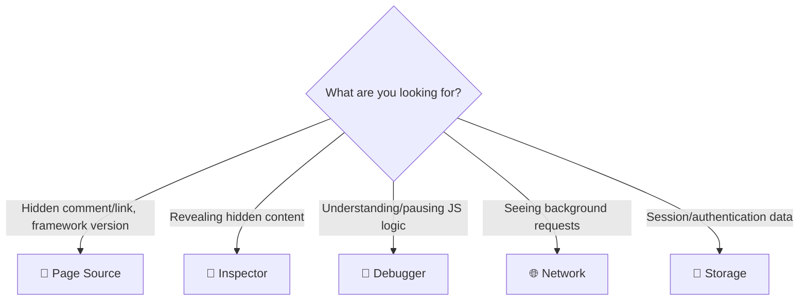

> 🧠 **Core philosophy:** learning to **observe, question, and analyze** before relying on automated tools makes you far more effective as a pentester. Tools are powerful, but **a trained eye and a curious mind** are even more powerful.

---

## 🛡️ The defender's view

> 📎 This section is based on general knowledge.

| Issue | Defensive measure |
|-------|---------------------|
| Sensitive comments in source code | Strip comments and debug info before production deployment |
| Directory listing enabled | Disable directory listing in the web server configuration |
| Outdated framework version | Keep the framework updated regularly, don't expose version info publicly |
| Content restricted only client-side | Apply **server-side** authorization checks for sensitive content |
| Data "hidden" via JavaScript | Never put truly sensitive data in client-side code at all |
| Cookie flags misconfigured | Properly apply `HttpOnly`, `Secure`, `SameSite` on sensitive cookies |
| Backup/config files left in a web folder | Store such files outside web-accessible paths |

---

## 📖 Glossary

| Term | Short explanation |
|------|-------------------|
| **Page Source** | The initial, human-readable code sent from server to browser |
| **HTML / CSS / JavaScript** | The structure / appearance / behavior layers of a web page |
| **Comment** | A developer note in the code, not shown on the page |
| **Anchor tag (`<a>`)** | HTML's link element |
| **Directory listing** | A public list of all files in a folder (a misconfiguration) |
| **Framework** | Pre-made code that speeds up development |
| **Developer Tools (DevTools)** | A browser's built-in debugging and inspection tools |
| **Inspector** | The DevTools tab for viewing and changing the live DOM/CSS |
| **Paywall** | A floating box that hides content from non-paying users |
| **DOM** | Document Object Model — the page's live structural representation |
| **Debugger / Sources** | The DevTools tab for reading and debugging JavaScript |
| **Minification** | Shrinking code by stripping formatting |
| **Obfuscation** | Deliberately making code hard to read |
| **Pretty Print** | A function that reformats minified code |
| **Breakpoint** | A point that pauses JavaScript execution at a specific line |
| **Network tab** | The DevTools tab that tracks a page's network requests |
| **AJAX** | Exchanging data in the background without reloading the page |
| **Request/Response Headers** | Metadata carried with a request/response |
| **Storage tab** | The DevTools tab showing data stored in the browser |
| **Local Storage** | Persistent client-side storage |
| **Session Storage** | Temporary, single-session client-side storage |
| **Cookie** | A small piece of data used for session/authentication |
| **HttpOnly** | A flag protecting a cookie from JavaScript access (against XSS) |
| **Secure** | A flag that only sends a cookie over HTTPS |
| **SameSite** | A cookie flag that helps mitigate CSRF |
| **XSS** | Cross-Site Scripting — injecting malicious script into a page |
| **CSRF** | Cross-Site Request Forgery — making unauthorized requests on a user's behalf |

---

## 📝 Test yourself

<details>
<summary><b>1. What's the main difference between Page Source and Inspector?</b></summary>

Page Source shows the initial HTML from the server. Inspector shows the live DOM state as changed by JavaScript and user interaction.
</details>

<details>
<summary><b>2. Why can directory listing be dangerous?</b></summary>

All files in a folder (including backups, config files, source code) can become publicly visible, potentially leaking sensitive data.
</details>

<details>
<summary><b>3. Why is knowing a framework's version valuable for a pentester?</b></summary>

It lets you search for publicly known vulnerabilities (CVEs) affecting that version; an outdated version is a potential target.
</details>

<details>
<summary><b>4. What should you remember when changing CSS in Inspector?</b></summary>

The change is temporary and only in your own browser. Reloading the page reverts everything — nothing changes on the server.
</details>

<details>
<summary><b>5. What's the difference between minification and obfuscation?</b></summary>

Minification strips formatting (whitespace, newlines) to shrink a file. Obfuscation deliberately makes code hard to read so others can't copy it easily.
</details>

<details>
<summary><b>6. What is a breakpoint used for?</b></summary>

To pause JavaScript execution at a specific line — for example, to prevent code that removes an element from running.
</details>

<details>
<summary><b>7. What is AJAX?</b></summary>

A method for exchanging data with the server in the background, without fully reloading the page.
</details>

<details>
<summary><b>8. Which two sections are worth checking separately when examining a request in the Network tab?</b></summary>

Headers and Response — information not visible in the headers may appear in the response body.
</details>

<details>
<summary><b>9. What does the HttpOnly flag protect against?</b></summary>

It prevents JavaScript from reading the cookie, protecting against XSS attacks.
</details>

<details>
<summary><b>10. What's the difference between Local Storage and Session Storage?</b></summary>

Local Storage persists even after the browser closes. Session Storage is temporary, lasting only for a single tab/session.
</details>

---

## 📚 Sources

- TryHackMe: [Walking An Application room](https://tryhackme.com/room/walkinganapp) (do the hands-on part there yourself)
- [HTML - Wikipedia](https://en.wikipedia.org/wiki/HTML)
- [CSS - Wikipedia](https://en.wikipedia.org/wiki/CSS)
- [JavaScript - Wikipedia](https://en.wikipedia.org/wiki/JavaScript)
- [HTTP cookie - Wikipedia](https://en.wikipedia.org/wiki/HTTP_cookie)
- [HTTP headers - MDN](https://developer.mozilla.org/en-US/docs/Web/HTTP/Reference/Headers)
- [Ajax (programming) - Wikipedia](https://en.wikipedia.org/wiki/Ajax_(programming))
- [Web framework - Wikipedia](https://en.wikipedia.org/wiki/Web_framework)
- [DevTools - Chrome Docs](https://developer.chrome.com/docs/devtools/)
- [DevTools - Firefox User Docs](https://firefox-source-docs.mozilla.org/devtools-user/)

> ℹ️ These notes were written in my own words for personal learning. The diagrams were drawn with Mermaid. The room's flags, specific IP address, and exact task answers are not included; step-by-step explanations and hints are given instead.
